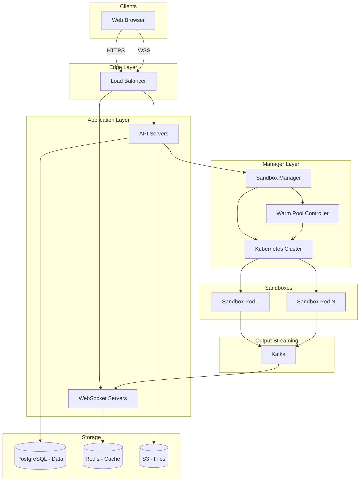
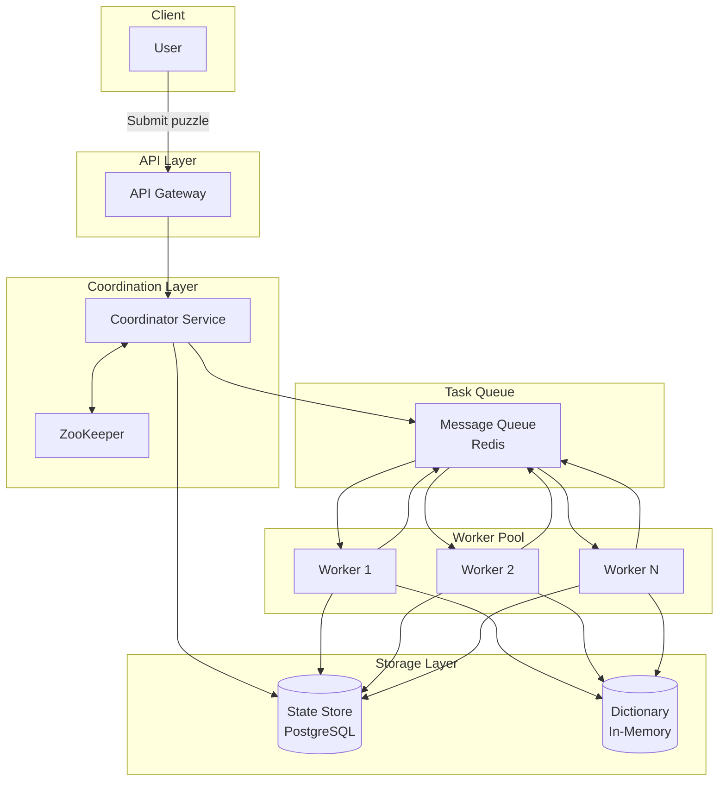
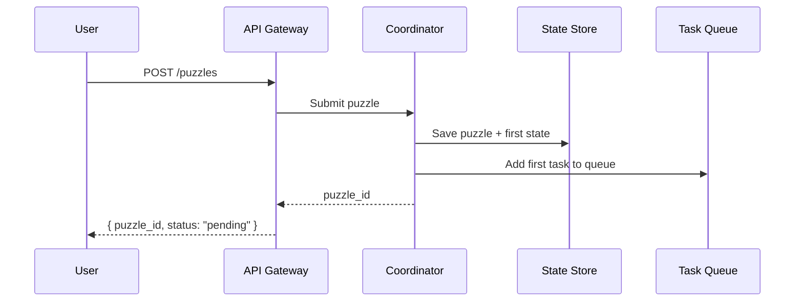
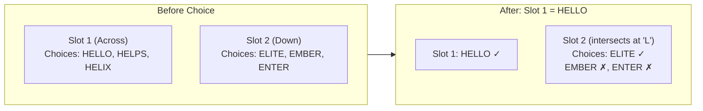
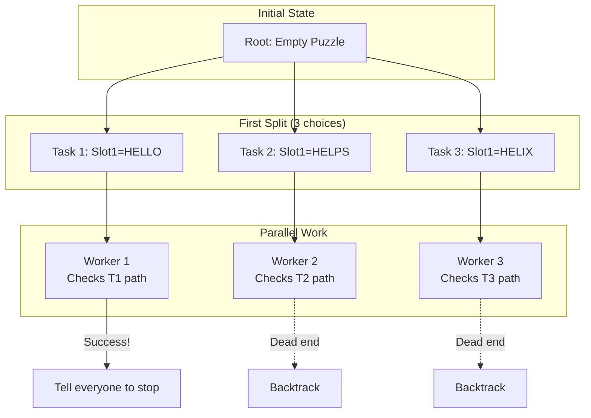

# OpenAI 面试题库 · 一亩三分地会员版（完整）

> 2026-07 从 `interview/problems/company/openai` 抓取。已尽量用解锁工具取正文；取不到的给出原帖 URL 供手动查看。
> 原始 HTML 在 raw/1p3a_html/。


# 一、面试情报 Briefings（会员版正文）

## Loop Structure & Timeline

## Pipeline

A typical OpenAI loop runs:

1. **Recruiter / HR screen** (~30 min). Process intro + standard BQ (why OpenAI, why leave, salary expectations, location). HR will not share interview-specific feedback later — this is a stated company policy, not an oversight.
2. **Phone screen — coding** (60 min). Almost always one prompt occupying the entire hour, with 3-5 progressive sub-parts. The interviewer expects the first 2-3 parts done with clean code and edges handled.
3. **Final loop** — by the company's own framing, "4–6 hours of final interviews with 4–6 people over 1–2 days." On a SWE / RS / RE pipeline this concretely lands as 4-5 rounds:
    - 1-2× coding (sometimes a separate ML programming round for RS / RE),
    - 1× system design or ML system design,
    - 1× technical deep dive (slide-based, on your strongest project),
    - 1× HM behavioral — the final gate.

XFN / PM / cross-functional pitch rounds appear on some loops.

## Typical timeline

- Resume review window after application: roughly one week.
- Recruiter reachout → HR call → phone screen: typically 2-3 weeks apart.
- Phone screen → final loop: 1-2 weeks scheduling, then the loop runs over 1-2 consecutive days.
- Final loop → decision: target is "within one week of final interviews," though team-match cases can stretch this to 1-2 weeks longer.

## Format

The default mode is **virtual** (video calls with screen-share for technical rounds). Candidates may request to interview onsite in San Francisco; that's the documented opt-in, not the default. Pre-loop, the recruiter confirms which rounds use Colab vs the standard coding platform.

## Signaling notes

- The HM BQ + technical deep dive are **gated** — they only "unlock" if the technical rounds passed. Reaching them is itself a positive signal.
- HR asking for internal references on Day 1 after the interview is widely read as a borderline-status signal — not a guaranteed pass.
- Quiet HM in the BQ round ("HM not selling the role") is widely cited as a negative signal. Counter it by proactively pitching role fit rather than passively answering.

## What the bar emphasizes

The published hiring philosophy is explicitly *not* credential-driven: the company flags collaboration, communication, openness to feedback, and mission alignment as core axes alongside the technical bar. Practically this maps onto the deep dive (collaboration + communication signals) and the HM BQ (mission alignment), which is why "Why OpenAI / AGI / safety" gets its own dedicated round and is treated as a real gate, not a formality.

## Post-loop add-on: the 15-minute HM call

A short (≈15 min) HM call sometimes appears between the loop pass signal and the team-match phase. Recruiters frame it as "no prep needed, just a chat," but it is graded: candidates have moved forward after positive technical feedback only to be rejected after a flat HM call. Treat it as a compressed HM round — have a sharp 'why OpenAI' and one timeline-pressure story ready, even though the format reads casual.

## Compensation & process signals (mid-2026)

- **Recruiter speed**: outreach can land within ~2 days of applying, weekends included.
- **Three-stage framing** a recruiter recently laid out: Stage 1 — two technical rounds (~60 min data-structures/coding + a system-design round); Stage 2 — virtual onsite (60-min coding, a live refactoring/optimization round, and the slide-based technical deep dive); Stage 3 — hiring manager.
- **Base salary** quoted in a recent recruiter call: roughly up to ~$327K (L5) and ~$385K (L6) base; total comp adds equity on top.
- **Debrief cadence** is commonly Tuesday / Friday, so the wait between the final round and a decision tends to bucket around those days.
- **Performance review** is framed loosely around 90-day and 1-year checkpoints.

## Late-stage rejection patterns

Positive mid-loop feedback does **not** predict the outcome. Multiple candidates cleared the technical loop with explicitly positive signals, then either (a) were given a surprise add-on round (e.g. a director "match" conversation) and rejected afterward with "not enough positive signal to send to hiring committee," or (b) sat in limbo while the team decided. Treat every round — including casual-sounding add-ons — as graded, and don't read a smooth technical loop as a done deal.

## Infra / AI-infra track

Candidates applying to AI-infra roles report a five-round virtual onsite that differs from the standard SWE shape: an **ML coding** round (60 min) *in addition to* a **systems coding** round (75 min), a **system design** round (60 min), a **hiring-manager** round, and a **technical deep dive**. The extra ML coding slot is the distinguishing piece — SWE loops usually pair a single coding round with system design, whereas infra loops carve out a separate ML-flavored coding round on top. The 75-minute systems round tends to lean on concurrency, so prepare for that explicitly.

## Team match (mid-2026)

Even after a passing hiring-manager chat, team match in mid-2026 is frequently slow, with candidates pointing to tight headcount rather than their own performance as the bottleneck. A representative recent onsite combination was BQ + technical (slide) presentation + a payment-system design + the plant-infection coding problem, followed by a separate HM team-match conversation that dragged on for weeks. Keep your own pipeline warm during this window — a clean loop does not guarantee a fast match.

## Hiring-committee spike signals

A late-June loop adds a sharper version of the team-match signal: after a positive onsite, the recruiter said the original team was full and the packet needed 1-2 clear "spike" / strong-hire signals before going to hiring committee. Read this as a reason to make one or two rounds unmistakably distinctive rather than merely solid across the board; a clean but flat loop can still stall at HC or team match.

来源帖: [openai vo ml coding面啥 - infra岗](https://www.1point3acres.com/bbs/thread-1180594-1-1.html) · [开放爱全套 （team matching)](https://www.1point3acres.com/bbs/thread-1180678-1-1.html) · [開放愛 碼農全套過經](https://www.1point3acres.com/bbs/thread-1181608-1-1.html) · [开放爱VO过经](https://www.1point3acres.com/bbs/thread-1181278-1-1.html) · [開放愛 全套](https://www.1point3acres.com/bbs/thread-1181418-1-1.html)

## The No-AI Rule (and what is allowed)


## The Single-Prompt Phone-Screen Format


## Technical Deep Dive & HM Behavioral


## Tooling & Platforms


## Research / RS Onsite Track


# 二、外链帖题解（解锁工具编辑版）

## ModalLock and FairModalLock

### ModalLock and FairModalLock

## Problem Overview

This reported OpenAI **ML Infra** question is a Python concurrency problem. The prompt gives you a partially completed file and asks you to implement two synchronization primitives using `threading` tools such as `Lock`, `Condition`, and related primitives:

- `ModalLock.acquire(mode)`
- `ModalLock.release(mode)`
- `FairModalLock.acquire(mode)`
- `FairModalLock.release(mode)`
The story wrapper uses a frog switching between `"water"` and `"land"`, but the real task is to build a **mode-aware shared lock** and then a **fair version** of that lock.

The prompt explicitly says candidates may look up Python threading primitives:

- Python threading documentation
**Reported interview structure:** although only **two classes** are implemented, the online coding environment unlocks tests progressively rather than asking for everything at once. Based on the report and the visible harness, this is best modeled as a **5-level progressive coding question**:

- `test_modal_lock_example`
- `test_fair_modal_lock_example`
- `test_fair_modal_lock_staggered`
- `test_fair_modal_lock_herd`
- `test_fair_modal_lock_trimodal`
There is also a `test_modal_lock_simple` helper in the file, but it is explicitly marked as disabled in the provided harness and does not appear to be one of the reported interview progression gates.

So the clean summary is: **2 implementation targets, but effectively 5 test-driven levels**.

## What The Interviewer Provides

The candidate is not starting from a blank editor. The reported prompt provides:

- a fully written Python file
- all imports and helper utilities
- the problem statement and frog-themed story wrapper
- class shells for `ModalLock` and `FairModalLock`
- a test harness with worker threads, queues, a timeline renderer, and expected outputs
- progressively harder tests that are unlocked one by one
So the interview is closer to a **guided implementation/debugging environment** than an open-ended "design the whole problem from scratch" coding round.

## What The Candidate Is Asked To Implement

The candidate is expected to fill in exactly these missing methods:

```python
class ModalLock:
    def acquire(self, mode: str):
        # TODO: implement this!

    def release(self, mode: str):
        # TODO: implement this!

class FairModalLock:
    def acquire(self, mode: str):
        # TODO: implement this!

    def release(self, mode: str):
        # TODO: implement this!
```

Everything else in the file is scaffolding:

- imports
- explanatory comments
- test helpers
- timeline visualization
- expected timeline fixtures
- the `main()` entrypoint
So the cleanest description is:

- **provided by interviewer:** the full file and tests
- **implemented by candidate:** 4 methods across 2 classes
- **graded progressively:** 5 unlocked test stages according to the report

## Original Reported Code

Below is the original reported code prompt that the candidate sees, including the surrounding test harness and comments.

For readability in this write-up, I removed ANSI terminal color escape sequences from the embedded code block below. That only affects terminal coloring and decorative output, not the actual locking logic being tested.

```python
from __future__ import annotations

import builtins
import collections
import concurrent.futures
import contextlib
import contextvars
import functools
import hashlib
import io
import itertools
import pprint
import queue
import random
import signal
import threading
import time
from dataclasses import dataclass, field
from typing import Any

"""

You are a frog. As an amphibian, you seek to find balance between the time you spend
in the water and the time you spend on land.

In this question, we'll build some concurrency primitives to help us achieve water-land balance.

Feel free to look up Python threading primitives:
https://docs.python.org/3/library/threading.html

"""

# ==============================
# ModalLock
# ==============================

class ModalLock:
   """ModalLock can be used to ensure that we only perform actions when we're in a certain mode.

   For example, say we have various threads doing either "water" tasks or
   "land" tasks. We want to use ModalLock to let us ensure we have
   water-land separation -- that we will never do a water thing while concurrently
   doing a land thing.

   ModalLock can never be held simultaneously by acquirers of different modes.
   For example, when the lock is held in "water" mode, it cannot be acquired in
   "land" mode.

   It's important we're able to do multiple water things concurrently, or
   multiple land things concurrently -- we only wish to disallow doing water
   things concurrently with land things.
```

lock = ModalLock()

def frog_does_water_things():
lock.acquire("water")
# go for a swim
# catch fish
lock.release("water")

def frog_does_more_water_things():
lock.acquire("water")
# marvel at the ocean
lock.release("water")

def frog_does_land_things():
lock.acquire("land")
# touch grass
# eat flies
lock.release("land")

def frog_does_more_land_things():
lock.acquire("land")
# jump onto trees
lock.release("land")

threading.Thread(target=frog_does_water_things).start()
threading.Thread(target=frog_does_more_water_things).start()
threading.Thread(target=frog_does_land_things).start()
threading.Thread(target=frog_does_more_land_things).start()

```python
"""

def acquire(self, mode: str):
    # TODO: implement this!

def release(self, mode: str):
    # TODO: implement this!

# ==============================
# Test ModalLock
# ==============================

def test_modal_lock_example():
# You don't need to understand the test harness particularly well
timeline = Timeline()
expected_timeline.set(EXPECTED_MODAL_LOCK_EXAMPLE)
threads, queues = setup_threads_queues(num_threads=5, timeline=timeline)

lock = ModalLock()

def acquire(mode):
    return Thunk(lock.acquire, mode, pre=ACQUIRING(), post=HOLDING(mode))

def release(mode):
    return Thunk(lock.release, mode, pre=RELEASING(mode), post=IDLE())

# This can be a lot! Look at the visualisation in the terminal :-)
queues[0].put(acquire("water"))
timeline.step_clock()
queues[1].put(acquire("land"))
timeline.step_clock()
queues[2].put(acquire("water"))
timeline.step_clock()
timeline.step_clock()
queues[0].put(release("water"))
timeline.step_clock()
queues[1].put(release("land"))
timeline.step_clock()
queues[3].put(acquire("land"))
queues[4].put(acquire("land"))
timeline.step_clock()
queues[2].put(release("water"))
timeline.step_clock()
timeline.step_clock()
queues[3].put(release("land"))
queues[4].put(release("land"))
timeline.step_clock()
queues[0].put(acquire("water"))
queues[0].put(release("water"))

teardown_threads_queues(threads, queues)

print()
print(expected_timeline.get())

timeline.print_timeline()
# timeline.print_events()
# timeline.print_summary()

# fmt: off
assert timeline.summary() == {
    0: [(0, ACQUIRING()), (0, HOLDING(mode="water")), (4, RELEASING()), (4, IDLE()), (10, ACQUIRING()), (10, HOLDING(mode="water")), (10, RELEASING()), (10, IDLE())],
    1: [(1, ACQUIRING()), (7, HOLDING(mode="land")), (7, RELEASING()), (7, IDLE())],
    2: [(2, ACQUIRING()), (2, HOLDING(mode="water")), (7, RELEASING()), (7, IDLE())],
    3: [(6, ACQUIRING()), (7, HOLDING(mode="land")), (9, RELEASING()), (9, IDLE())],
    4: [(6, ACQUIRING()), (7, HOLDING(mode="land")), (9, RELEASING()), (9, IDLE())],
}, "Incorrect timeline, compare to expected timeline above"
# fmt: on

def test_modal_lock_simple():
# This test is disabled by default because it's a little too simplistic,
# but feel free to re-enable!

timeline = Timeline()
expected_timeline.set(EXPECTED_MODAL_LOCK_SIMPLE)
threads, queues = setup_threads_queues(num_threads=2, timeline=timeline)

lock = ModalLock()

def acquire(mode):
    return Thunk(lock.acquire, mode, pre=ACQUIRING(), post=HOLDING(mode))

def release(mode):
    return Thunk(lock.release, mode, pre=RELEASING(mode), post=IDLE())

queues[0].put(acquire("water"))
timeline.step_clock()
queues[1].put(acquire("land"))
timeline.step_clock()
timeline.step_clock()
queues[0].put(release("water"))
timeline.step_clock()
timeline.step_clock()
queues[1].put(release("land"))

teardown_threads_queues(threads, queues)

print()
print(expected_timeline.get())

timeline.print_timeline()
# timeline.print_events()
# timeline.print_summary()

assert timeline.summary() == {
    0: [
        (0, ACQUIRING()),
        (0, HOLDING(mode="water")),
        (3, RELEASING()),
        (3, IDLE()),
    ],
    1: [(1, ACQUIRING()), (3, HOLDING(mode="land")), (5, RELEASING()), (5, IDLE())],
}, "Incorrect timeline, compare to expected timeline above"

# ==============================
# FairModalLock
# ==============================

"""
0 W 0 0 0 0
1 L   1 1 1 1 1
2 W     2 2 2 2 2
3 L       3 3 3 3 3

0 W 0 0 0 0 0
1 L   1 1 1 1 1
2 L     2 2 2 2 2
3 W       3 3 3 3 3
4 L         4 4 4 4 4
"""

class FairModalLock:
"""
Unfortunately, ModalLock isn't quite enough to achieve water-land balance -- it's not fair.

If threads keep acquiring the "water" mode, then the threads trying to
acquire the "land" mode will block forever. The frog will never get to
touch land!

The guarantee FairModalLock provides is that we grant the mode of the lock
in exactly the order requested. Acquisition of the lock should **never**
succeed before an earlier acquire call with a different mode.

For example, if we're currently in "water" mode and a thread tries to acquire
"land" mode, then subsequent threads trying to acquire "water" mode will
have to wait for "land" mode to be acquired and released before those
subsequent threads can acquire "water" mode.

It remains important that whenever possible we do multiple water things
concurrently, or multiple land things concurrently.
"""

def acquire(self, mode: str):
    # TODO: implement this!

def release(self, mode: str):
    # TODO: implement this!

# ==============================
# Test FairModalLock
# ==============================

def test_fair_modal_lock_example():
timeline = Timeline()
expected_timeline.set(EXPECTED_FAIR_MODAL_LOCK_EXAMPLE)
threads, queues = setup_threads_queues(num_threads=5, timeline=timeline)

lock = FairModalLock()

def acquire(mode):
    return Thunk(lock.acquire, mode, pre=ACQUIRING(), post=HOLDING(mode))

def release(mode):
    return Thunk(lock.release, mode, pre=RELEASING(mode), post=IDLE())

# This is the same example as test_modal_lock_example,
# but with FairModalLock instead of ModalLock.
queues[0].put(acquire("water"))
timeline.step_clock()
queues[1].put(acquire("land"))
timeline.step_clock()
queues[2].put(acquire("water"))
timeline.step_clock()
timeline.step_clock()
queues[0].put(release("water"))
timeline.step_clock()
queues[1].put(release("land"))
timeline.step_clock()
queues[3].put(acquire("land"))
queues[4].put(acquire("land"))
timeline.step_clock()
queues[2].put(release("water"))
timeline.step_clock()
timeline.step_clock()
queues[3].put(release("land"))
queues[4].put(release("land"))
timeline.step_clock()
queues[0].put(acquire("water"))
queues[0].put(release("water"))

teardown_threads_queues(threads, queues)

print()
print(expected_timeline.get())

timeline.print_timeline()
# timeline.print_events()
# timeline.print_summary()

# fmt: off
assert timeline.summary() == {
    0: [(0, ACQUIRING()), (0, HOLDING(mode="water")), (4, RELEASING()), (4, IDLE()), (10, ACQUIRING()), (10, HOLDING(mode="water")), (10, RELEASING()), (10, IDLE())],
    1: [(1, ACQUIRING()), (4, HOLDING(mode="land")), (5, RELEASING()), (5, IDLE())],
    2: [(2, ACQUIRING()), (5, HOLDING(mode="water")), (7, RELEASING()), (7, IDLE())],
    3: [(6, ACQUIRING()), (7, HOLDING(mode="land")), (9, RELEASING()), (9, IDLE())],
    4: [(6, ACQUIRING()), (7, HOLDING(mode="land")), (9, RELEASING()), (9, IDLE())],
}, "Incorrect timeline, compare to expected timeline above"
# fmt: on

def test_fair_modal_lock_staggered():
timeline = Timeline()
expected_timeline.set(EXPECTED_FAIR_MODAL_LOCK_STAGGERED)
threads, queues = setup_threads_queues(num_threads=8, timeline=timeline)

lock = FairModalLock()

def acquire(mode):
    return Thunk(lock.acquire, mode, pre=ACQUIRING(), post=HOLDING(mode))

def release(mode):
    return Thunk(lock.release, mode, pre=RELEASING(mode), post=IDLE())

queues[0].put(acquire("water"))
timeline.step_clock()
queues[1].put(acquire("land"))
timeline.step_clock()
queues[2].put(acquire("water"))
timeline.step_clock()
queues[3].put(acquire("water"))
timeline.step_clock()
queues[4].put(acquire("land"))
timeline.step_clock()
queues[5].put(acquire("land"))
timeline.step_clock()
queues[6].put(acquire("water"))
timeline.step_clock()
queues[7].put(acquire("land"))
timeline.step_clock()
queues[7].put(release("land"))
timeline.step_clock()
queues[0].put(release("water"))
timeline.step_clock()
queues[1].put(release("land"))
timeline.step_clock()
queues[2].put(release("water"))
timeline.step_clock()
queues[3].put(release("water"))
timeline.step_clock()
queues[4].put(release("land"))
timeline.step_clock()
queues[5].put(release("land"))
timeline.step_clock()
queues[6].put(release("water"))

teardown_threads_queues(threads, queues)

print()
print(expected_timeline.get())

timeline.print_timeline()
# timeline.print_events()
# timeline.print_summary()

assert timeline.summary() == {
    0: [
        (0, ACQUIRING()),
        (0, HOLDING(mode="water")),
        (9, RELEASING()),
        (9, IDLE()),
    ],
    1: [
        (1, ACQUIRING()),
        (9, HOLDING(mode="land")),
        (10, RELEASING()),
        (10, IDLE()),
    ],
    2: [
        (2, ACQUIRING()),
        (10, HOLDING(mode="water")),
        (11, RELEASING()),
        (11, IDLE()),
    ],
    3: [
        (3, ACQUIRING()),
        (10, HOLDING(mode="water")),
        (12, RELEASING()),
        (12, IDLE()),
    ],
    4: [
        (4, ACQUIRING()),
        (12, HOLDING(mode="land")),
        (13, RELEASING()),
        (13, IDLE()),
    ],
    5: [
        (5, ACQUIRING()),
        (12, HOLDING(mode="land")),
        (14, RELEASING()),
        (14, IDLE()),
    ],
    6: [
        (6, ACQUIRING()),
        (14, HOLDING(mode="water")),
        (15, RELEASING()),
        (15, IDLE()),
    ],
    7: [
        (7, ACQUIRING()),
        (15, HOLDING(mode="land")),
        (15, RELEASING()),
        (15, IDLE()),
    ],
}, "Incorrect timeline, compare to expected timeline above"

def test_fair_modal_lock_herd():
timeline = Timeline()
expected_timeline.set(EXPECTED_FAIR_MODAL_LOCK_HERD)
threads, queues = setup_threads_queues(num_threads=5, timeline=timeline)

lock = FairModalLock()

def acquire(mode):
    return Thunk(lock.acquire, mode, pre=ACQUIRING(), post=HOLDING(mode))

def release(mode):
    return Thunk(lock.release, mode, pre=RELEASING(mode), post=IDLE())

queues[0].put(acquire("water"))
timeline.step_clock()
queues[1].put(acquire("land"))
queues[1].put(release("land"))
queues[2].put(acquire("land"))
queues[2].put(release("land"))
queues[3].put(acquire("land"))
queues[3].put(release("land"))
queues[4].put(acquire("land"))
queues[4].put(release("land"))
timeline.step_clock()
queues[0].put(release("water"))

timeline.step_clock()
queues[0].put(acquire("water"))
timeline.step_clock()
queues[1].put(acquire("land"))
queues[1].put(release("land"))
queues[2].put(acquire("land"))
queues[2].put(release("land"))
queues[3].put(acquire("land"))
queues[3].put(release("land"))
queues[4].put(acquire("land"))
queues[4].put(release("land"))
timeline.step_clock()
queues[0].put(release("water"))

teardown_threads_queues(threads, queues)

print()
print(expected_timeline.get())

timeline.print_timeline()
# timeline.print_events()
# timeline.print_summary()

# fmt: off
assert timeline.summary() == {
    0: [(0, ACQUIRING()), (0, HOLDING(mode="water")), (2, RELEASING()), (2, IDLE()), (3, ACQUIRING()), (3, HOLDING(mode="water")), (5, RELEASING()), (5, IDLE())],
    1: [(1, ACQUIRING()), (2, HOLDING(mode="land")), (2, RELEASING()), (2, IDLE()), (4, ACQUIRING()), (5, HOLDING(mode="land")), (5, RELEASING()), (5, IDLE())],
    2: [(1, ACQUIRING()), (2, HOLDING(mode="land")), (2, RELEASING()), (2, IDLE()), (4, ACQUIRING()), (5, HOLDING(mode="land")), (5, RELEASING()), (5, IDLE())],
    3: [(1, ACQUIRING()), (2, HOLDING(mode="land")), (2, RELEASING()), (2, IDLE()), (4, ACQUIRING()), (5, HOLDING(mode="land")), (5, RELEASING()), (5, IDLE())],
    4: [(1, ACQUIRING()), (2, HOLDING(mode="land")), (2, RELEASING()), (2, IDLE()), (4, ACQUIRING()), (5, HOLDING(mode="land")), (5, RELEASING()), (5, IDLE())],
}, "Incorrect timeline, compare to expected timeline above"
# fmt: on

def test_fair_modal_lock_trimodal():
timeline = Timeline()
expected_timeline.set(EXPECTED_FAIR_MODAL_LOCK_TRIMODAL)
threads, queues = setup_threads_queues(num_threads=9, timeline=timeline)

lock = FairModalLock()

def acquire(mode):
    return Thunk(lock.acquire, mode, pre=ACQUIRING(), post=HOLDING(mode))

def release(mode):
    return Thunk(lock.release, mode, pre=RELEASING(mode), post=IDLE())

queues[0].put(acquire("water"))
timeline.step_clock()
queues[1].put(acquire("land"))
timeline.step_clock()
queues[2].put(acquire("lava"))
timeline.step_clock()
queues[3].put(acquire("water"))
timeline.step_clock()
queues[4].put(acquire("land"))
timeline.step_clock()
queues[5].put(acquire("lava"))
timeline.step_clock()

queues[6].put(acquire("land"))
timeline.step_clock()
queues[7].put(acquire("water"))
timeline.step_clock()

queues[0].put(release("water"))
timeline.step_clock()
queues[1].put(release("land"))
timeline.step_clock()
queues[2].put(release("lava"))
timeline.step_clock()

queues[0].put(acquire("water"))
timeline.step_clock()
queues[1].put(acquire("water"))
timeline.step_clock()
queues[2].put(acquire("land"))
timeline.step_clock()

queues[8].put(acquire("lava"))
timeline.step_clock()

queues[3].put(release("water"))
timeline.step_clock()
queues[4].put(release("land"))
timeline.step_clock()
queues[5].put(release("lava"))
timeline.step_clock()
queues[6].put(release("land"))
timeline.step_clock()
queues[7].put(release("water"))
timeline.step_clock()

queues[0].put(release("water"))
timeline.step_clock()
queues[1].put(release("water"))
timeline.step_clock()
queues[2].put(release("land"))
timeline.step_clock()

queues[8].put(release("lava"))
timeline.step_clock()

teardown_threads_queues(threads, queues)

print()
print(expected_timeline.get())

timeline.print_timeline()
# timeline.print_events()
# timeline.print_summary()

# fmt: off
assert timeline.summary() == {
    0: [(0, ACQUIRING()), (0, HOLDING(mode="water")), (8, RELEASING()), (8, IDLE()), (11, ACQUIRING()), (18, HOLDING(mode="water")), (20, RELEASING()), (20, IDLE())],
    1: [(1, ACQUIRING()), (8, HOLDING(mode="land")), (9, RELEASING()), (9, IDLE()), (12, ACQUIRING()), (18, HOLDING(mode="water")), (21, RELEASING()), (21, IDLE())],
    2: [(2, ACQUIRING()), (9, HOLDING(mode="lava")), (10, RELEASING()), (10, IDLE()), (13, ACQUIRING()), (21, HOLDING(mode="land")), (22, RELEASING()), (22, IDLE())],
    3: [(3, ACQUIRING()), (10, HOLDING(mode="water")), (15, RELEASING()), (15, IDLE())],
    4: [(4, ACQUIRING()), (15, HOLDING(mode="land")), (16, RELEASING()), (16, IDLE())],
    5: [(5, ACQUIRING()), (16, HOLDING(mode="lava")), (17, RELEASING()), (17, IDLE())],
    6: [(6, ACQUIRING()), (17, HOLDING(mode="land")), (18, RELEASING()), (18, IDLE())],
    7: [(7, ACQUIRING()), (18, HOLDING(mode="water")), (19, RELEASING()), (19, IDLE())],
    8: [(14, ACQUIRING()), (22, HOLDING(mode="lava")), (23, RELEASING()), (23, IDLE())],
}, "Incorrect timeline, compare to expected timeline above"
# fmt: on

# ==============================
# Testing harness
# ==============================

#
#
#
#
#
#
#
#
#
#
# You don't need to look down here unless you want to!
#
#
#
#
#
#
#
#
#
#

class State:
def render(self) -> str:
    raise NotImplementedError

def legend(self) -> str:
    data = " ".join(f"{k}={v}" for k, v in self.__dict__.items() if v)
    return f"{self.render()}   {self.__class__.__name__.lower()} {data}"

@dataclass(frozen=True)
class IDLE(State):
def render(self) -> str:
    return " "

@dataclass(frozen=True)
class ACQUIRING(State):
def render(self) -> str:
    return "a"

@dataclass(frozen=True)
class HOLDING(State):
mode: str

def render(self) -> str:
    return f"{colour_for_mode(self.mode)}█"

@dataclass(frozen=True)
class RELEASING(State):
mode: str = field(default="", compare=False)

def render(self) -> str:
    return "r"

def legend(self) -> str:
    return f"{self.render()}   {self.__class__.__name__.lower()}"

class Timeline:
def __init__(self) -> None:
    self._clock = 0
    self._events: list[tuple[int, int, State]] = []

def add_event(self, thread_id: int, state: State) -> None:
    self._events.append((self._clock, thread_id, state))

def print_events(self) -> None:
    """Print the events we recorded."""

    print("Events:")
    for clock, thread_id, state in self._events:
        print(f"clock: {clock:2d}  thread_id: {thread_id:2d}  state: {state}")
    print()

def format_timeline(self) -> str:
    """Visualise the events we recorded."""

    buffer = io.StringIO()
    print = functools.partial(builtins.print, file=buffer)

    print(" Actual Timeline ".center(60, "="))
    all_state_types = State.__subclasses__()
    all_states = sorted(
        {s for _, _, s in self._events},
        key=lambda x: (all_state_types.index(type(x)), repr(x)),
    )
    print("Legend:")
    for state in all_states:
        print(" ", state.legend())
    print("-" * 60)

    max_clock = max(c for c, _, _ in self._events)
    max_thread_id = max(t for _, t, _ in self._events)

    # pad self._events so we have at least 2 events per clock
    padded_events = self._events.copy()
    clock_counts = collections.Counter(c for c, _, _ in padded_events)
    for clock in range(max_clock + 1):
        padded_events.extend([(clock, -1, IDLE())] * (2 - clock_counts[clock]))
    padded_events.sort(key=lambda x: x[0])  # rely on stable sort to preserve order

    print(len("thread XX |") * " ", end="")
    for clock, events in itertools.groupby(padded_events, key=lambda x: x[0]):
        print(str(clock).center(len(list(events))), end="")
        print("|", end="")
    print()

    for thread_id in range(max_thread_id + 1):
        print(f"thread {thread_id:2d} |", end="")
        state = IDLE()
        clock = 0
        for clock, events in itertools.groupby(padded_events, key=lambda x: x[0]):
            events = list(events)
            assert len(events) >= 2
            for _, t, s in events:
                if t == thread_id:
                    state = s
                print(state.render(), end="")
            print("|", end="")
        print()
    print("=" * 60)
    return buffer.getvalue()

def print_timeline(self) -> None:
    print(self.format_timeline())

def print_timeline_repr(self) -> None:
    r = self.format_timeline()
    for l in r.splitlines(keepends=True):
        print(repr(l))

def summary(self) -> dict[int, list[tuple[int, State]]]:
    ret = {}
    for thread_id in sorted({t for _, t, _ in self._events}):
        for c, t, s in self._events:
            if t == thread_id:
                ret.setdefault(thread_id, []).append((c, s))
    return ret

def print_summary(self) -> None:
    pprint.PrettyPrinter(width=120).pprint(self.summary())

def step_clock(self) -> None:
    assert threading.current_thread() is threading.main_thread()
    time.sleep(0.01)
    self._clock += 1
    time.sleep(0.01)

class Thunk:
def __init__(self, fn, *args, pre: State, post: State):
    self.fn = fn
    self.args = args
    self.pre = pre
    self.post = post

def __call__(self, thread_id: int, timeline: Timeline):
    timeline.add_event(thread_id, self.pre)
    self.fn(*self.args)
    timeline.add_event(thread_id, self.post)

expected_timeline = contextvars.ContextVar("expected_timeline")
global_timeline = contextvars.ContextVar("global_timeline")

def setup_threads_queues(
*, num_threads: int, timeline: Timeline
) -> tuple[dict[int, ErrorThread], dict[int, queue.Queue[Thunk]]]:
global_timeline.set(timeline)
queues = {i: queue.Queue[Thunk]() for i in range(num_threads)}
threads = {
    i: ErrorThread(target=waterer, args=(i, queues[i], timeline), daemon=True)
    for i in range(num_threads)
}
for thread in threads.values():
    thread.start()
return threads, queues

def teardown_threads_queues(
threads: dict[int, ErrorThread], queues: dict[int, queue.Queue]
):
for q in queues.values():
    q.put(None)
for thread in threads.values():
    thread.join()

def waterer(index: int, q: queue.Queue[Thunk], timeline: Timeline):
while True:
    thunk = q.get()
    if thunk is None:
        break
    try:
        thunk(index, timeline)
    except BaseException as e:
        print(f"Exception {e} in thread index {index} at clock {timeline._clock}")
        raise

class ErrorThread(threading.Thread):
def run(self):
    self._exc = None
    try:
        super().run()
    except BaseException as e:
        self._exc = e
        raise

def join(self, timeout=None):
    super().join(timeout)
    if self._exc is not None:
        raise self._exc

def time_limit(seconds: int):
def decorator(f):
    def handler(signum, frame):
        if DEADLOCK_TIMELINE:
            try:
                print()
                print(expected_timeline.get())
                global_timeline.get().print_timeline()
            except Exception:
                pass
        raise TimeoutError("Do you have a deadlock?")

    @functools.wraps(f)
    def inner(*args, **kwargs):
        signal.signal(signal.SIGALRM, handler)
        signal.alarm(seconds)
        try:
            return f(*args, **kwargs)
        finally:
            signal.alarm(0)

    return inner

return decorator

colour_index = 0

@functools.cache
def colour_for_mode(mode: str) -> str:
if mode == "water":
    return ""  # blue
elif mode == "land":
    return ""  # green
elif mode == "lava":
    return ""  # red

colours = ["", "", ""]
global colour_index
ret = colours[colour_index % len(colours)]
colour_index += 1
return ret

EXPECTED_MODAL_LOCK_SIMPLE = (
"==================== Expected Timeline =====================\n"
"Legend:\n"
"      idle \n"
"  a   acquiring \n"
"  █   holding mode=land\n"
"  █   holding mode=water\n"
"  r   releasing\n"
"------------------------------------------------------------\n"
"           0 |1 |2 | 3 |4 |5 |\n"
"thread  0 |a█|██|██|r  |  |  |\n"
"thread  1 |  |aa|aa|aa█|██|r |\n"
"============================================================\n"
)

EXPECTED_MODAL_LOCK_EXAMPLE = (
"==================== Expected Timeline =====================\n"
"Legend:\n"
"      idle \n"
"  a   acquiring \n"
"  █   holding mode=land\n"
"  █   holding mode=water\n"
"  r   releasing\n"
"------------------------------------------------------------\n"
"           0 |1 |2 |3 |4 |5 |6 |   7   |8 | 9  | 10 |\n"
"thread  0 |a█|██|██|██|r |  |  |       |  |    |a█r |\n"
"thread  1 |  |aa|aa|aa|aa|aa|aa|aa█r   |  |    |    |\n"
"thread  2 |  |  |a█|██|██|██|██|r      |  |    |    |\n"
"thread  3 |  |  |  |  |  |  |aa|aaaaa██|██|r   |    |\n"
"thread  4 |  |  |  |  |  |  | a|aaaaaa█|██|██r |    |\n"
"============================================================\n"
)

EXPECTED_FAIR_MODAL_LOCK_EXAMPLE = (
"==================== Expected Timeline =====================\n"
"Legend:\n"
"      idle \n"
"  a   acquiring \n"
"  █   holding mode=land\n"
"  █   holding mode=water\n"
"  r   releasing\n"
"------------------------------------------------------------\n"
"           0 |1 |2 |3 | 4 | 5 |6 | 7  |8 | 9  | 10 |\n"
"thread  0 |a█|██|██|██|r  |   |  |    |  |    |a█r |\n"
"thread  1 |  |aa|aa|aa|aa█|r  |  |    |  |    |    |\n"
"thread  2 |  |  |aa|aa|aaa|aa█|██|r   |  |    |    |\n"
"thread  3 |  |  |  |  |   |   |aa|aaa█|██|r   |    |\n"
"thread  4 |  |  |  |  |   |   | a|aa██|██|██r |    |\n"
"============================================================\n"
)

EXPECTED_FAIR_MODAL_LOCK_STAGGERED = (
"==================== Expected Timeline =====================\n"
"Legend:\n"
"      idle \n"
"  a   acquiring \n"
"  █   holding mode=land\n"
"  █   holding mode=water\n"
"  r   releasing\n"
"------------------------------------------------------------\n"
"           0 |1 |2 |3 |4 |5 |6 |7 |8 | 9 | 10 |11| 12 |13| 14|  15 |\n"
"thread  0 |a█|██|██|██|██|██|██|██|██|r  |    |  |    |  |   |     |\n"
"thread  1 |  |aa|aa|aa|aa|aa|aa|aa|aa|aa█|r   |  |    |  |   |     |\n"
"thread  2 |  |  |aa|aa|aa|aa|aa|aa|aa|aaa|aaa█|r |    |  |   |     |\n"
"thread  3 |  |  |  |aa|aa|aa|aa|aa|aa|aaa|aa██|██|r   |  |   |     |\n"
"thread  4 |  |  |  |  |aa|aa|aa|aa|aa|aaa|aaaa|aa|aa██|r |   |     |\n"
"thread  5 |  |  |  |  |  |aa|aa|aa|aa|aaa|aaaa|aa|aaa█|██|r  |     |\n"
"thread  6 |  |  |  |  |  |  |aa|aa|aa|aaa|aaaa|aa|aaaa|aa|aa█|r    |\n"
"thread  7 |  |  |  |  |  |  |  |aa|aa|aaa|aaaa|aa|aaaa|aa|aaa|aa█r |\n"
"============================================================\n"
)

EXPECTED_FAIR_MODAL_LOCK_HERD = (
"==================== Expected Timeline =====================\n"
"Legend:\n"
"      idle \n"
"  a   acquiring \n"
"  █   holding mode=land\n"
"  █   holding mode=water\n"
"  r   releasing\n"
"------------------------------------------------------------\n"
"           0 | 1  |      2       |3 | 4  |      5       |\n"
"thread  0 |a█|████|r             |a█|████|r             |\n"
"thread  1 |  |aaaa|aaaaaaaaaaa█r |  |aaaa|aa█r          |\n"
"thread  2 |  | aaa|aa█r          |  | aaa|aaaaa█r       |\n"
"thread  3 |  |  aa|aaaaa█r       |  |  aa|aaaaaaaa█r    |\n"
"thread  4 |  |   a|aaaaaaaa█r    |  |   a|aaaaaaaaaaa█r |\n"
"============================================================\n"
)

EXPECTED_FAIR_MODAL_LOCK_TRIMODAL = (
"==================== Expected Timeline =====================\n"
"Legend:\n"
"      idle \n"
"  a   acquiring \n"
"  █   holding mode=lava\n"
"  █   holding mode=land\n"
"  █   holding mode=water\n"
"  r   releasing\n"
"------------------------------------------------------------\n"
"           0 |1 |2 |3 |4 |5 |6 |7 | 8 | 9 | 10|11|12|13|14| 15| 16| 17|  18 |19|20| 21| 22|23|\n"
"thread  0 |a█|██|██|██|██|██|██|██|r  |   |   |aa|aa|aa|aa|aaa|aaa|aaa|aaa██|██|r |   |   |  |\n"
"thread  1 |  |aa|aa|aa|aa|aa|aa|aa|aa█|r  |   |  |aa|aa|aa|aaa|aaa|aaa|aaaa█|██|██|r  |   |  |\n"
"thread  2 |  |  |aa|aa|aa|aa|aa|aa|aaa|aa█|r  |  |  |aa|aa|aaa|aaa|aaa|aaaaa|aa|aa|aa█|r  |  |\n"
"thread  3 |  |  |  |aa|aa|aa|aa|aa|aaa|aaa|aa█|██|██|██|██|r  |   |   |     |  |  |   |   |  |\n"
"thread  4 |  |  |  |  |aa|aa|aa|aa|aaa|aaa|aaa|aa|aa|aa|aa|aa█|r  |   |     |  |  |   |   |  |\n"
"thread  5 |  |  |  |  |  |aa|aa|aa|aaa|aaa|aaa|aa|aa|aa|aa|aaa|aa█|r  |     |  |  |   |   |  |\n"
"thread  6 |  |  |  |  |  |  |aa|aa|aaa|aaa|aaa|aa|aa|aa|aa|aaa|aaa|aa█|r    |  |  |   |   |  |\n"
"thread  7 |  |  |  |  |  |  |  |aa|aaa|aaa|aaa|aa|aa|aa|aa|aaa|aaa|aaa|aa███|r |  |   |   |  |\n"
"thread  8 |  |  |  |  |  |  |  |  |   |   |   |  |  |  |aa|aaa|aaa|aaa|aaaaa|aa|aa|aaa|aa█|r |\n"
"============================================================\n"
)

froge = "(decorative terminal frog art omitted in this write-up)"

# ==============================
# Main
# ==============================

DEADLOCK_TIMELINE = False
USE_SOLUTION = False
if USE_SOLUTION:
from solution import *

def main():
# time_limit(seconds=2)(test_modal_lock_simple)()

for test in [
    test_modal_lock_example,
    # test_fair_modal_lock_example,
    # test_fair_modal_lock_staggered,
    # test_fair_modal_lock_herd,
    # test_fair_modal_lock_trimodal,
]:
    print("\n\n\n\n")
    print(f"Testing {test.__name__}...")
    time_limit(seconds=2)(test)()
    print(f"Finished testing {test.__name__}")

print("\nAll tests passed!")

if __name__ == "__main__":
print(froge)
main()
```

## Part 1: Implement `ModalLock`

### Required Behavior

`ModalLock` should allow **concurrent holders of the same mode**, but **never** holders of different modes at the same time.

For example:

- two `"water"` threads may hold the lock concurrently
- two `"land"` threads may hold the lock concurrently
- a `"water"` holder and a `"land"` holder may **not** overlap
That makes this different from a normal mutex:

- it is **exclusive across modes**
- it is **shared within a mode**

### Key Invariants

- If the lock is idle, any mode may acquire it.
- If the lock is currently in mode `M`, another acquire of `M` may proceed immediately.
- If the lock is currently in mode `M`, an acquire of any other mode must block.
- Releasing the last holder should transition the lock back to idle and wake blocked threads.

### Suggested Approach

The simplest implementation uses:

- one internal mutex
- one `Condition`
- `current_mode`
- `holder_count`
This gives a compact solution:

```python
import threading

class ModalLock:
    def __init__(self):
        self._cond = threading.Condition()
        self._current_mode = None
        self._holders = 0

    def acquire(self, mode: str):
        with self._cond:
            while self._current_mode is not None and self._current_mode != mode:
                self._cond.wait()

            self._current_mode = mode
            self._holders += 1

    def release(self, mode: str):
        with self._cond:
            if self._current_mode != mode or self._holders == 0:
                raise RuntimeError("release without matching acquire")

            self._holders -= 1
            if self._holders == 0:
                self._current_mode = None
                self._cond.notify_all()
```

### What Level 1 Is Really Testing

The first unlocked test checks:

- same-mode sharing
- cross-mode exclusion
- correct wake-up after the last release
It does **not** yet require fairness.

## Part 2: Implement `FairModalLock`

### Why `ModalLock` Is Not Enough

`ModalLock` can starve a waiting mode forever.

Example:

- `"water"` acquires the lock
- `"land"` arrives and waits
- more `"water"` threads keep arriving
- those later `"water"` threads keep joining immediately
- `"land"` may wait forever
`FairModalLock` fixes that by enforcing **request-order fairness across modes**.

### Required Fairness Rule

Once an earlier acquire request for a **different mode** is waiting, a later acquire must **not** bypass it.

That means:

- if `"land"` is waiting behind current `"water"` holders
- then later `"water"` callers must also wait
- after the current `"water"` batch finishes, `"land"` gets its turn
At the same time, the lock is still **modal**, not exclusive per thread:

- when a mode reaches the front, multiple waiters of that same mode may proceed together

### A Good Mental Model

Think of the fair version as a queue of **mode batches**:

- consecutive requests for the same waiting mode can be grouped together
- batches must be served in arrival order
- when a batch starts, all waiters in that batch can acquire concurrently
- later batches must wait

### Suggested Data Structures

- one `Condition`
- `current_mode`
- `holder_count`
- a FIFO queue of waiting mode-groups
Each waiting group tracks:

- `mode`
- how many threads are still waiting to enter that group
- how many currently active holders belong to that group

### Reference Implementation

```python
import collections
import threading
from dataclasses import dataclass

@dataclass
class _Group:
    mode: str
    waiting: int = 0
    granted: int = 0

class FairModalLock:
    def __init__(self):
        self._cond = threading.Condition()
        self._current_mode = None
        self._holders = 0
        self._queue = collections.deque()

    def _can_join_current_mode(self, mode: str) -> bool:
        if self._current_mode != mode:
            return False

        if not self._queue:
            return True

        return (
            len(self._queue) == 1
            and self._queue[0].mode == mode
            and self._queue[0].granted > 0
        )

    def acquire(self, mode: str):
        with self._cond:
            if self._current_mode is None and not self._queue:
                self._current_mode = mode
                self._holders = 1
                return

            if self._can_join_current_mode(mode):
                self._holders += 1
                if self._queue:
                    self._queue[0].granted += 1
                return

            if self._queue and self._queue[-1].mode == mode and self._queue[-1].granted == 0:
                group = self._queue[-1]
            else:
                group = _Group(mode=mode)
                self._queue.append(group)

            group.waiting += 1

            while True:
                is_front = self._queue and self._queue[0] is group

                if is_front and self._current_mode is None:
                    self._current_mode = mode
                    self._holders += 1
                    group.waiting -= 1
                    group.granted += 1
                    return

                if is_front and self._current_mode == mode and group.granted > 0:
                    self._holders += 1
                    group.waiting -= 1
                    group.granted += 1
                    return

                self._cond.wait()

    def release(self, mode: str):
        with self._cond:
            if self._current_mode != mode or self._holders == 0:
                raise RuntimeError("release without matching acquire")

            self._holders -= 1

            if self._queue and self._queue[0].mode == mode and self._queue[0].granted > 0:
                front = self._queue[0]
                front.granted -= 1
                if front.waiting == 0 and front.granted == 0:
                    self._queue.popleft()

            if self._holders == 0:
                self._current_mode = None
                self._cond.notify_all()
```

## Progressive Difficulty Levels

The reporter said the interview unlocks tests one by one. A useful reconstruction is:

### Level 1: `test_modal_lock_example`

Implement `ModalLock` so that:

- same-mode holders overlap
- different modes block each other
- release wakes blocked threads correctly

### Level 2: `test_fair_modal_lock_example`

Implement the basic fairness rule:

- once `"land"` is waiting, a later `"water"` acquire must not jump ahead of it

### Level 3: `test_fair_modal_lock_staggered`

Handle staggered arrivals across multiple alternating mode groups. This checks that your queueing logic survives interleavings rather than only the simplest example.

### Level 4: `test_fair_modal_lock_herd`

Handle a burst of same-mode waiters. When that mode reaches the front, the whole waiting batch should be able to enter together rather than being serialized one thread at a time.

### Level 5: `test_fair_modal_lock_trimodal`

Generalize the lock beyond just two modes. The prompt includes `"water"`, `"land"`, and `"lava"` to confirm that the implementation is truly **mode-generic**, not hardcoded for two states.

*原帖: https://www.1point3acres.com/interview/thread/7100265*

---

## Data Labeling Task Scheduler

### Data Labeling Task Scheduler

## Problem Overview

This OpenAI Machine Learning Engineer question was reported as a **two-part coding problem** about constructing a schedule for data labeling work.

- **Part 1** is the easy version: build any valid schedule.
- **Part 2** adds stronger fairness constraints that must hold at **every prefix** of the returned list.

## Problem Statement

You are given:

- `t` tasks, indexed `0..t-1`
- `m` models, indexed `0..m-1`
- `h` human labelers, indexed `0..h-1`
- a target `k`
Return a scheduling, represented as a list of tuples:

```python
(task, model, human)
```

Each tuple means:

- human `human` works on task `task`
- that assignment is paired with model `model`
Your schedule must satisfy:

- Every human labeler participates in at least `k` assignments total.
- Every `(task, human)` pair appears at most once.
- For every task `x`, and for every prefix of the schedule, the counts across models stay balanced:

```text
max_i count_prefix(x, model=i) - min_i count_prefix(x, model=i) <= 1
```

- For every task `x`, and for every prefix of the schedule, the counts across humans also stay balanced:

```text
max_j count_prefix(x, human=j) - min_j count_prefix(x, human=j) <= 1
```

If no valid schedule exists, return failure in whatever form your language uses (`None`, empty list, exception, etc.).

## Part 1: Build Any Valid Schedule

Ignore the prefix-balance constraints for now. Just return any schedule such that:

- each human appears at least `k` times
- each human works on a given task at most once

### Key Observation

Because each human can touch a task at most once, a human can do at most `t` assignments total. Therefore:

```text
k > t  =>  impossible
```

That is the main feasibility condition for Part 1.

### Simple Construction

If `k <= t` and `m >= 1`, assign each human to `k` distinct tasks, for example:

```python
for human in range(h):
    for offset in range(k):
        task = (human + offset) % t
        model = 0
        schedule.append((task, model, human))
```

This is already enough for the easy part.

## Part 2: Prefix-Balanced Schedule

Now add the stronger requirement that the schedule must remain balanced at **every intermediate point**, not just at the end.

This sounds more complicated than it is. The clean construction is:

- Schedule work in exactly `k` rounds.
- In each round, every human gets exactly one assignment.
- Rotate tasks cyclically so each human sees a new task each round.
- For each task, assign models in local round-robin order.

### Why This Works

For round `r` and human `u`, choose:

```text
task = (u + r) mod t
```

This gives every human exactly one assignment per round, and over `k` rounds each human sees `k` distinct tasks as long as `k <= t`.

Now keep a counter `task_seen[task]`, meaning how many times task `task` has already been scheduled. When task `task` appears again, assign:

```text
model = task_seen[task] mod m
```

Then increment `task_seen[task]`.

This makes the model counts for each fixed task cycle through:

```text
0, 1, 2, ..., m-1, 0, 1, 2, ...
```

So for every task, the counts across models are always as even as possible, even at intermediate prefixes.

### Important Simplification

The `(task, human)` balance condition is mostly automatic once you enforce:

- each `(task, human)` pair is used at most once
Since every such count is then either `0` or `1`, the difference between the maximum and minimum is never more than `1`.

That means the real nontrivial part is balancing models for each task while also giving every human at least `k` distinct tasks.

## Worked Example

Suppose:

```text
t = 3, m = 2, h = 4, k = 2
```

One valid schedule is:

```python
[
    (0, 0, 0),
    (1, 0, 1),
    (2, 0, 2),
    (0, 1, 3),
    (1, 1, 0),
    (2, 1, 1),
    (0, 0, 2),
    (1, 0, 3),
]
```

Check the properties:

- every human appears exactly `2` times
- no human repeats the same task
- for task `0`, model counts evolve as `(1,0)`, then `(1,1)`, then `(2,1)` so the difference never exceeds `1`
- the same holds for tasks `1` and `2`

## Reference Solution

```python
from typing import List, Optional, Tuple

Assignment = Tuple[int, int, int]

def build_basic_schedule(t: int, m: int, h: int, k: int) -> Optional[List[Assignment]]:
    """
    Part 1: ignore prefix balance and build any valid schedule.
    """
    if k == 0:
        return []
    if t <= 0 or m <= 0 or h <= 0:
        return None
    if k > t:
        return None

    schedule: List[Assignment] = []
    for human in range(h):
        for offset in range(k):
            task = (human + offset) % t
            model = 0
            schedule.append((task, model, human))
    return schedule

def build_balanced_schedule(t: int, m: int, h: int, k: int) -> Optional[List[Assignment]]:
    """
    Part 2: build a schedule such that:
      - each human appears at least k times
      - each (task, human) pair appears at most once
      - for every task, model counts stay prefix-balanced
      - task-human balance is automatic because counts are only 0/1

    Returns a minimal-length valid schedule of exactly h * k assignments,
    or None if impossible.
    """
    if k == 0:
        return []
    if t <= 0 or m <= 0 or h <= 0:
        return None
    if k > t:
        return None

    schedule: List[Assignment] = []
    task_seen = [0] * t

    for round_idx in range(k):
        for human in range(h):
            task = (human + round_idx) % t
            model = task_seen[task] % m
            schedule.append((task, model, human))
            task_seen[task] += 1

    return schedule
```

## Why The Construction Is Correct

### 1. Each human gets at least `k` assignments

There are exactly `k` rounds, and each human receives exactly one assignment per round. So each human appears exactly `k` times.

### 2. No human repeats the same task

For a fixed human `u`, the assigned tasks are:

```text
(u + 0) mod t,
(u + 1) mod t,
...,
(u + k - 1) mod t
```

These are all distinct when `k <= t`.

### 3. Model counts stay balanced for every task

Fix any task `x`. Each time `x` appears, we assign the next model in round-robin order:

```text
0, 1, 2, ..., m-1, 0, 1, ...
```

After any number of occurrences of task `x`, each model has been used either:

- `floor(c / m)` times, or
- `ceil(c / m)` times
where `c` is the number of times task `x` has appeared so far.

Therefore the difference between the largest and smallest model count is always at most `1`.

### 4. The schedule is minimal in length

Every tuple increases the total assignment count of exactly one human by `1`. Since each of the `h` humans must reach at least `k`, any valid schedule needs at least:

```text
h * k
```

assignments.

Our construction uses exactly `h * k`, so it is optimal in schedule length.

## Complexity

The construction is straightforward:

- **Time:** `O(hk)`
- **Space:** `O(t)` auxiliary space, plus the output list

*原帖: https://www.1point3acres.com/interview/thread/7100239*

---

## Design a Cloud IDE

### Design a Cloud IDE

**Problem:** Design a cloud-based IDE like Replit or GitHub Codespaces.
**Goal:** Users can write code, manage files, and run terminal commands in their browser. They should not need to install anything on their own computer.

This problem tests your ability to design systems that handle:

- **Resource Management** (Managing CPU/RAM for thousands of users).
- **Real-time Streaming** (Showing terminal output instantly).
- **Isolation** (Making sure User A cannot see User B's files).
The hardest parts are managing the lifecycle of the Virtual Machines (VMs) and sending terminal text to the browser quickly.

## 1. What We Need to Build

### Functional Requirements

- **File Management:** Users can create folders, and add, edit, or delete files.
- **Run Code:** Users can run commands and see the output (stdout/stderr) instantly.
- **Stop Processes:** Users can stop a program that is running.
- **Install Packages:** Users can install libraries (like `npm install`) and they stay there while the session is active.
- **Sharing:** Users can share their workspace so others can view or edit it.
*Note on Sharing:* We will focus on simple access control. We will not cover real-time collaborative typing (like Google Docs) in this guide.

*Note on Persistence:* When a user installs a package, it stays until they close the tab/session. Saving the whole operating system state forever is hard and usually a paid feature.

### System Requirements (Non-Functional)

| Requirement | Target | Reason |
| :--- | :--- | :--- |
| **Startup Speed** | < 5 seconds | Users hate waiting for the environment to load. |
| **Output Speed** | < 100ms | Typing in the terminal needs to feel instant. |
| **Reliability** | 99.9% | Important for paying customers. |
| **Scale** | 100K users at once | Must handle popular traffic. |
| **Security** | Strong Isolation | One user must never access another user's data. |

*Interview Tip:* Ask the interviewer: "Do we support jobs that run for hours, or just short coding sessions?" For this design, we assume interactive coding with a 12-hour limit.

### Capacity Estimation

**Assumptions:**

- 100,000 concurrent users.
- Each user gets: 2 vCPU, 4GB RAM.
**Compute Needed:**

- 100,000 users × 2 vCPUs = **200,000 vCPUs**.
- 100,000 users × 4GB RAM = **400TB RAM**.
- If one server has ~40GB RAM, we need about **10,000 servers**.
**Network Bandwidth (Terminal Text):**

- Assume 50% of users are running a command at the same time.
- 50,000 active processes × 1KB/second = **50MB/second**.
- A small **Kafka** cluster (3-5 brokers) can easily handle this.
**Conclusion:** The biggest cost is the servers (compute), not the storage or network. We must be smart about how we use the VMs to save money.

## 2. Database Schema

### Core Entities

```text
Workspace
├── id: UUID
├── owner_id: UUID
├── name: string
├── template: string (e.g., "python", "node")
├── sharing_mode: enum (private, view, edit)
└── timestamps...

File
├── id: UUID
├── workspace_id: UUID (Foreign Key)
├── path: string (e.g., "/src/main.py")
├── content: text (for small files)
├── content_ref: string (link to S3 for large files)
└── is_directory: boolean

Process
├── id: UUID
├── workspace_id: UUID (Foreign Key)
├── sandbox_id: UUID (Foreign Key)
├── command: string (e.g., "npm run dev")
├── status: enum (running, completed, failed)
├── exit_code: integer
└── timestamps...

Sandbox (The Virtual Computer/Container)
├── id: UUID
├── workspace_id: UUID (Foreign Key)
├── user_id: UUID
├── status: enum (provisioning, warm, assigned, running, idle)
├── instance_type: string (cpu-small, gpu)
├── ip_address: string
└── expires_at: timestamp
```

### Relationships

- A **User** has many **Workspaces**.
- A **Workspace** has many **Files**.
- A **Workspace** has exactly one active **Sandbox** (the running environment).
- A **Sandbox** can run many **Processes** (commands).
*Note:* We keep `Sandbox` and `Process` separate. The Sandbox is the computer; the Process is a specific command running on that computer.

## 3. How Clients Talk to Servers (API)

### Protocol Strategy

| Action | Protocol | Why? |
| :--- | :--- | :--- |
| **Manage Files/Settings** | REST | Simple and standard. |
| **Terminal Output** | WebSocket | Needs to be real-time (two-way). |
| **File Uploads** | REST + multipart | Better for large data. |

### REST Endpoints

```text
# Workspace Basics
POST   /api/workspaces                   # Create new
GET    /api/workspaces/{id}              # Get details
DELETE /api/workspaces/{id}              # Delete

# Files
GET    /api/workspaces/{id}/files        # List all files
GET    /api/files/{id}                   # Read file content
POST   /api/workspaces/{id}/files        # Create file
PUT    /api/files/{id}                   # Save file content

# Running Code
POST   /api/workspaces/{id}/run          # Run a command
# Returns: { "process_id": "...", "stream_token": "..." }

POST   /api/processes/{id}/cancel        # Stop a command
```

### WebSocket Protocol

We use WebSockets to stream the terminal text. The client gets a `stream_token` from the REST API first.

**Connect:**
`WSS /api/stream/{sandbox_id}?token=stream_token`

**Server sends to Client:**

```json
{
  "type": "output",
  "process_id": "proc-123",
  "stream": "stdout",
  "data": "Hello World\n"
}
```

**Client sends to Server:**

```json
{
  "type": "input",
  "process_id": "proc-123",
  "data": "user typed something\n"
}
```

The WebSocket connects to the **Sandbox**, not just one process. This lets us run two commands at once (like a server and a test runner) over one connection.

## 4. System Architecture

### High-Level Diagram



### Who Does What?

- **API Servers:** Handle login, file saving (to S3), and creating workspaces.
- **WebSocket Servers:** Send terminal text to the user. They listen to **Kafka**.
- **Sandbox Manager:** The "brain." It creates Sandboxes and assigns them to users.
- **Warm Pool Controller:** Keeps a list of "ready-to-go" Sandboxes so users don't have to wait.
- **Kubernetes:** Runs the actual Sandboxes (Pods).
- **Kafka:** A message bus that moves terminal output from the Sandbox to the WebSocket Server.

### Data Flow: Running a Command

- **User** clicks "Run".
- **API** tells **Sandbox Manager** to start the command.
- **Sandbox Manager** finds the correct **Sandbox (Pod)** and sends the command.
- **Sandbox** runs the code. Output (text) is sent to **Kafka**.
- **WebSocket Server** reads **Kafka** and sends text to the **User's** browser.

### Sandbox Design (The Pod)

Each Sandbox is a Kubernetes Pod with two containers:

- **Runtime Container:** Where the user's code runs (Python, Node, etc.). It has limited permissions.
- **Agent Container:** A helper program. It receives commands from our API and streams the output to Kafka.
**Security is key:**

- **Network Policy:** Block internet access (except for specific package managers like npm/pip).
- **Read-Only:** The root file system is read-only. We mount a separate volume for `/workspace` where the user writes code.

### Terminal Streaming (The Hard Part)

To make it feel real-time:

- **Agent** collects output from the user's code.
- It groups (batches) the text into small chunks (every 50ms).
- It sends the chunk to **Kafka**.
- **WebSocket Server** picks it up and sends it to the browser.
*Why batch?* Sending every single letter individually is too slow and expensive. 50ms is fast enough for humans but saves resources.

**Code Logic for Agent:**

```python
class OutputStreamer:
    def capture(self, data):
        self.buffer.append(data)
        
        # Send to Kafka if buffer is big OR 50ms has passed
        if self.should_flush():
            self.send_to_kafka(self.buffer)
            self.buffer = []
```

### Reconnecting

If a user refreshes the page, they shouldn't lose the terminal history.

- **Solution:** Store the last 1 hour of output in **Redis**.
- When a user reconnects, send the old data from Redis first, then switch to live Kafka streaming.

### Warm Pool Strategy (Speeding up Start Times)

Starting a new container takes 10-30 seconds. This is too slow.
**Solution:** Start them *before* the user needs them.

- **Warm Pool:** Keep 500 "blank" Python environments running.
- **Allocation:** When a user clicks "Start", grab one from the pool. It takes 1 second.
- **Refill:** The Pool Controller sees the pool is low and starts more.

## 5. Scaling and Important Choices

### Improving Speed

- **Cold Starts:** Use **Warm Pools**.
- **Output Latency:** Use **Kafka** partitioned by `sandbox_id`. This ensures text arrives in the correct order.

### Bottlenecks

- **Sandbox Manager:** If this crashes, no one can run code.

*Fix:* Run multiple copies. Store state in Redis, not in memory.
- **Kafka Load:** 50,000 active streams is a lot.

*Fix:* Use `sandbox_id` as the partition key. Use a cluster of Kafka brokers.

### VM Lifecycle (Saving Money)

Servers are expensive. We need a strict lifecycle.

- **Provisioning:** Creating the container.
- **Warm:** Sitting in the pool, waiting for a user.
- **Running:** User is actively working.
- **Idle:** User hasn't typed in 30 minutes.
- **Terminated:** Shut down to save money.
*Cost Tip:* Give free users a short timeout (5 mins idle). Give paid users a long timeout (30 mins idle).

### Alternatives to Containers

**AWS Lambda / Firecracker:**

- *Pros:* Extremely fast startup (milliseconds). Very secure.
- *Cons:* Harder to set up than Docker/Kubernetes.
- *Verdict:* Use Firecracker if you are building a huge enterprise competitor. Use Kubernetes for a standard system design interview.

## Checklist for the Interview

- [ ] **Clarify Scope:** Did you ask if this is for long jobs or interactive coding?
- [ ] **Latency:** Did you mention Warm Pools to fix slow startups?
- [ ] **Streaming:** Did you explain how text gets from the container to the browser (Agent -> Kafka -> WebSocket)?
- [ ] **Security:** Did you mention that users are isolated in their own containers?
- [ ] **Scaling:** Did you mention handling 100K users requires many servers?

## Final Summary

| Feature | Design Choice | Why? |
| :--- | :--- | :--- |
| **Runtime** | Kubernetes Pods | Standard, good tools available. |
| **Streaming** | Kafka + WebSocket | Fast, reliable, handles many users. |
| **Startup Speed** | Warm Pools | Makes starting a workspace feel instant. |
| **Persistence** | Hybrid | Save source code to S3. Lose installed packages when session ends (to save money). |

**Key Takeaway:** The "real-time feel" comes from the streaming pipeline (Kafka/WebSockets). Users don't mind waiting 2 seconds for a workspace to load, but the terminal output *must* be instant.

*原帖: https://www.1point3acres.com/interview/thread/7100129*

---

## Social Network with Snapshots

### Social Network with Snapshots

## Problem Overview

You need to build a **social network**. The system must handle users, let them follow each other, and save "snapshots" of the network. A snapshot saves the state of all friendships at a specific moment in time.

You will build this in three parts.

## Part 1: Users, Follows & Snapshots

### Problem Requirements

Create a `SocialNetwork` class. It needs to handle three things:

- **Add User:** Put a new user in the system.
- **Follow:** Let one user follow another.
- **Create Snapshot:** Save the current list of who follows whom. This snapshot must **not change**, even if users follow new people later.

```python
class SocialNetwork:
    def __init__(self):
        """Initialize an empty social network."""
        pass

    def add_user(self, user_id: str) -> None:
        """
        Add a user to the network.
        Raises ValueError if the user already exists.
        """
        pass

    def follow(self, follower: str, followee: str) -> None:
        """
        Make `follower` follow `followee`.
        Raises ValueError if a user does not exist.
        Notes: A user cannot follow themselves. Duplicate follows do nothing.
        """
        pass

    def create_snapshot(self) -> 'Snapshot':
        """
        Create a snapshot of the current network state.
        This object must be immutable (it cannot change).
        """
        pass

class Snapshot:
    def is_following(self, follower: str, followee: str) -> bool:
        """
        Check if `follower` is following `followee` in this snapshot.
        Returns True or False.
        """
        pass
```

### Example Usage

```python
network = SocialNetwork()

network.add_user("A")
network.add_user("B")
network.add_user("C")

network.follow("A", "B")
network.follow("B", "C")

# Take a picture of the network state right now
snapshot1 = network.create_snapshot()

assert snapshot1.is_following("A", "B") == True
assert snapshot1.is_following("B", "C") == True
assert snapshot1.is_following("A", "C") == False   # A does not follow C

# Add a new follow AFTER taking the snapshot
network.follow("A", "C")

# The old snapshot should NOT show the new follow
assert snapshot1.is_following("A", "C") == False

# A new snapshot shows the new follow
snapshot2 = network.create_snapshot()
assert snapshot2.is_following("A", "C") == True
```

### Solution for Part 1

```python
class Snapshot:
    def __init__(self, follows: dict[str, set[str]]):
        # Deep copy ensures immutability (safety from future changes)
        self._follows = {user: set(followees) for user, followees in follows.items()}

    def is_following(self, follower: str, followee: str) -> bool:
        return followee in self._follows.get(follower, set())

class SocialNetwork:
    def __init__(self):
        self.users = set()
        self.follows = {}  # user -> set of users they follow

    def add_user(self, user_id: str) -> None:
        if user_id in self.users:
            raise ValueError(f"User '{user_id}' already exists.")
        self.users.add(user_id)
        self.follows[user_id] = set()

    def follow(self, follower: str, followee: str) -> None:
        if follower not in self.users or followee not in self.users:
            raise ValueError("Both users must exist.")
        if follower == followee:
            return
        self.follows[follower].add(followee)

    def create_snapshot(self) -> Snapshot:
        return Snapshot(self.follows)
```

**Time and Space Complexity:**

| Method | Time | Space |
| --- | --- | --- |
| `add_user` | O(1) | O(1) |
| `follow` | O(1) | O(1) |
| `create_snapshot` | O(U + E) | O(U + E) |
| `is_following` | O(1) | O(1) |

Here, U = number of users, and E = total follow edges.

**Important Detail:** The snapshot must use a **deep copy**. This means we copy every list of followers. If we don't do this, adding a friend to the live network would accidentally update the old snapshot too.

## Part 2: Followers & Following Lists

### New Requirement: Get Lists

The interviewer now asks: "Update the snapshot class so we can see the full list of followers."

Add these methods:

```python
class Snapshot:
    # ... (Part 1 methods) ...

    def get_following(self, user_id: str) -> list[str]:
        """
        Get a list of people that `user_id` follows.
        """
        pass

    def get_followers(self, user_id: str) -> list[str]:
        """
        Get a list of people who follow `user_id`.
        """
        pass
```

### Example Usage

```python
network = SocialNetwork()

# Setup users and follows...
network.add_user("A")
network.add_user("B")
network.add_user("C")
network.add_user("D")

network.follow("A", "B")
network.follow("A", "C")
network.follow("B", "C")
network.follow("D", "A")

snapshot = network.create_snapshot()

print(snapshot.get_following("A"))    # ["B", "C"]
print(snapshot.get_followers("C"))    # ["A", "B"]
```

### Solution for Part 2

```python
class Snapshot:
    def __init__(self, follows: dict[str, set[str]]):
        self._follows = {user: set(followees) for user, followees in follows.items()}
        # Build reverse index for efficient follower lookups
        self._followers = {}
        for user, followees in self._follows.items():
            for followee in followees:
                if followee not in self._followers:
                    self._followers[followee] = set()
                self._followers[followee].add(user)

    def is_following(self, follower: str, followee: str) -> bool:
        return followee in self._follows.get(follower, set())

    def get_following(self, user_id: str) -> list[str]:
        return list(self._follows.get(user_id, set()))

    def get_followers(self, user_id: str) -> list[str]:
        return list(self._followers.get(user_id, set()))
```

**Time and Space Complexity:**

| Method | Time | Space |
| --- | --- | --- |
| `Snapshot.__init__` | O(U + E) | O(U + E) |
| `get_following` | O(F) | O(F) |
| `get_followers` | O(F) | O(F) |

Here, F is the number of friends found.

**Design Choice:** We build a reverse list (`_followers`) immediately when we create the snapshot. This uses more memory O(E), but it makes `get_followers` very fast O(F). This is a good trade-off because we create the snapshot once, but we might read from it many times.

## Part 3: Follow Recommendations

### New Requirement: Recommendations

The interviewer now asks: "Suggest people for a user to follow based on who their friends follow."

**The Logic:**

- Look at who the user follows (User A follows B).
- Look at who *those* people follow (B follows C).
- Count how often C appears.
- Do not recommend people User A already follows.
- Return the top K people with the highest counts.

```python
class Snapshot:
    # ... (Parts 1-2 methods) ...

    def recommend(self, user_id: str, k: int) -> list[str]:
        """
        Recommend top K users for `user_id` to follow.
        """
        pass
```

### Example Usage

```python
# A follows B and C.
# B follows D and E.
# C follows D and F.

# D is followed by 2 of A's friends (B and C).
# E is followed by 1 friend (B).
# F is followed by 1 friend (C).

# Recommendation for A: D comes first, then E or F.
print(snapshot.recommend("A", 2))   # ["D", "E"]
```

### Solution for Part 3

```python
from collections import Counter
import heapq

class Snapshot:
    # ... (Parts 1-2 code) ...

    def recommend(self, user_id: str, k: int) -> list[str]:
        following = self._follows.get(user_id, set())
        candidate_counts = Counter()

        for followee in following:
            # Look at who each of user's followees follows
            for candidate in self._follows.get(followee, set()):
                # Exclude self and already-followed users
                if candidate != user_id and candidate not in following:
                    candidate_counts[candidate] += 1

        # Return top K by count
        return [user for user, count in candidate_counts.most_common(k)]
```

**Alternative: Using a Min-Heap (Better for large data)**

```python
def recommend(self, user_id: str, k: int) -> list[str]:
    following = self._follows.get(user_id, set())
    candidate_counts = Counter()

    for followee in following:
        for candidate in self._follows.get(followee, set()):
            if candidate != user_id and candidate not in following:
                candidate_counts[candidate] += 1

    # Use a min-heap to efficiently find top K
    min_heap = []
    for candidate, count in candidate_counts.items():
        if len(min_heap) < k:
            heapq.heappush(min_heap, (count, candidate))
        elif count > min_heap[0][0]:
            heapq.heapreplace(min_heap, (count, candidate))

    # Sort by count descending
    result = [(candidate, count) for count, candidate in min_heap]
    result.sort(key=lambda x: x[1], reverse=True)
    return [candidate for candidate, count in result]
```

**Time and Space Complexity:**

| Approach | Time | Space |
| --- | --- | --- |
| Counter | O(F × G + C log C) | O(C) |
| Min-heap | O(F × G + C log K) | O(C + K) |

Here, C is the number of candidates found.

**Note:** `Counter.most_common(k)` is usually fast enough because it uses a heap internally.

## Follow-Up Questions

### Common Interview Topics

- **Immutability:** How do you make sure snapshots don't break?

**Deep copy** is the easiest way.
- For very big systems, copying everything is too slow. You might use **Copy-on-Write** or store data with version timestamps.
- **Scaling:** What if there are millions of users?

Full copies take too much memory.
- Store only the **deltas** (the changes) between snapshots.
- Or, store edges with a time range, like `[created_at, deleted_at]`.
- **Better Recommendations:**

Give more points for recent interactions.
- Look at "friends of friends of friends" (2nd degree connections).
- **Concurrency:** Handling many users at once?

Use **read-write locks**. Many people can read snapshots at the same time, but only one person can add a follow at a time.

## Complexity Overview

| Method | Time | Space |
| --- | --- | --- |
| `add_user` | O(1) | O(1) |
| `follow` | O(1) | O(1) |
| `create_snapshot` | O(U + E) | O(U + E) |
| `is_following` | O(1) | O(1) |
| `get_following` | O(F) | O(F) |
| `get_followers` | O(F) | O(F) |
| `recommend` | O(F × G + C log K) | O(C) |

- **U** = Users
- **E** = Edges (total follows)
- **F** = Friends (of the specific user)
- **G** = Average friends per user
- **C** = Candidates found
- **K** = Top-K limit

*原帖: https://www.1point3acres.com/interview/thread/7100180*

---

## Design Chess.com (Online Chess Game)

### Design Chess.com (Online Chess Game)

Design an online chess platform like Chess.com. Users need to find opponents quickly, play in real time, and the chess clock must be accurate (time limits with optional extra time per move).

This problem tests if you can design **matchmaking**, **secure move handling**, and **server-side timing** while keeping everything fast (**low latency**).

## Phase 1: What We Need to Build

### Basic Features

- **Join Queue:** Users select settings (time limit, rated vs. casual) to find a game.
- **Start Game:** The system pairs two players and begins the match.
- **Play Moves:** Users make moves and see the opponent's moves instantly.
- **Chess Clock:** The system tracks time accurately. Players lose if time runs out.
- **Game Actions:** Users can resign, offer a draw, or reconnect if the internet drops.
Assume this is standard 1-vs-1 chess. No tournaments or bots unless asked.

### Performance Goals

| Goal | Target | Why? |
| --- | --- | --- |
| **Match Speed (P95)** | < 5 seconds | Players hate waiting in queues. |
| **Move Speed (P95)** | < 150ms | The game must feel real-time. |
| **Clock Accuracy** | < 100ms | Timers must be exact to be fair. |
| **Availability** | 99.95% | Games should not crash. |
| **Safety** | No lost moves | Players must trust the game history. |

**Crucial Rule:** The server is the boss of the clock. The timer on the user's screen is just a display.

### Scale Numbers

**Assumptions:**

- 2 million players per day.
- Peak traffic is 8% of players = 160,000 people online at once.
- 2 players per game = 80,000 games happening at once.
- Average speed: 1 move every 8 seconds per game.
**Data Speed:**

- **Move Writes:** 80K games / 8 seconds = 10,000 moves per second.
- **Sending Moves:** We send updates to both players, so ~20,000 events per second.
- **Bandwidth:** This is about 6 MB/sec. This is low.
**Matchmaking Queue:**

- If 10% of players are waiting: 16,000 people in the queue.
- The system needs to insert and remove players very fast.
**Interview Tip:** Mention that the *volume* of data is easy. The hard part is **latency** (speed) and **correctness** (rules/timing).

## Phase 2: How We Store Data

### Database Tables

```python
Player
├── id: UUID
├── username: string
├── rating_blitz: int
├── rating_rapid: int
└── created_at: timestamp

QueueEntry
├── id: UUID
├── player_id: UUID (FK)
├── mode: enum (rated, casual)
├── time_control: string (e.g., "5+0", "10+5")
├── rating: int
├── region: string
├── joined_at: timestamp
└── status: enum (waiting, matched, cancelled, expired)

Game
├── id: UUID
├── white_player_id: UUID (FK)
├── black_player_id: UUID (FK)
├── mode: enum (rated, casual)
├── time_control_base_ms: bigint
├── increment_ms: int
├── status: enum (active, white_won, black_won, draw, aborted)
├── result_reason: enum (checkmate, resignation, timeout, draw, disconnect_forfeit)
├── current_fen: string
├── move_count: int
├── turn: enum (white, black)
├── started_at: timestamp
└── ended_at: timestamp

MoveEvent
├── id: UUID
├── game_id: UUID (FK)
├── move_number: int
├── player_id: UUID
├── uci: string (e2e4)
├── san: string (optional)
├── fen_after: string
├── remaining_white_ms: bigint
├── remaining_black_ms: bigint
├── server_received_at: timestamp
└── is_legal: boolean

ClockState
├── game_id: UUID (PK/FK)
├── white_remaining_ms: bigint
├── black_remaining_ms: bigint
├── active_side: enum (white, black)
├── turn_started_server_ms: bigint (Official server time)
└── version: bigint
```

### How Tables Connect

```python
Player 1:N QueueEntry
Player 1:N Game (as white/black)
Game 1:N MoveEvent
Game 1:1 ClockState
```

We store every single move (`MoveEvent`) for history. We also store the current board state (`Game.current_fen` and `ClockState`) so we can read it quickly.

## Phase 3: Communication Rules (API)

### Choosing How to Connect

| Action | Protocol | Reason |
| --- | --- | --- |
| **Joining Queue** | REST | Simple request and response. |
| **Playing Moves** | WebSocket | Needs to be super fast and two-way. |
| **Internal Servers** | gRPC | Strictly typed and fast for servers talking to servers. |

### HTTP Commands (REST)

```python
# Finding a Match
POST   /api/chess/queue                    Join the line
DELETE /api/chess/queue/{entry_id}         Leave the line
GET    /api/chess/queue/status             Check if matched

# Game Actions
GET    /api/chess/games/{game_id}          Get game board
POST   /api/chess/games/{game_id}/move     Make a move
POST   /api/chess/games/{game_id}/resign   Give up
POST   /api/chess/games/{game_id}/draw     Offer draw
POST   /api/chess/games/{game_id}/abort    Cancel (only at start)
GET    /api/chess/games/{game_id}/moves    Get list of past moves
```

**Request to make a move:**

```json
{
  "move_number": 17,
  "uci": "e2e4",
  "client_sent_at_ms": 1730000000000,
  "idempotency_key": "4f8d7a3f"
}
```

**Response (Success):**

```json
{
  "accepted": true,
  "game_id": "game-123",
  "move_number": 17,
  "fen_after": "rnbqkbnr/pppppppp/8/8/4P3/8/PPPP1PPP/RNBQKBNR b KQkq - 0 1",
  "turn": "black",
  "remaining_white_ms": 178450,
  "remaining_black_ms": 180000,
  "game_status": "active"
}
```

### Real-Time Messages (WebSocket)

```python
WSS /ws/chess?token=<signed_jwt>
```

```json
{ "type": "game.matched", "game_id": "game-123", "color": "white", "opponent": { "id": "u2", "rating": 1830 } }
{ "type": "game.move", "game_id": "game-123", "move_number": 17, "uci": "e2e4", "fen_after": "...", "turn": "black" }
{ "type": "game.clock_sync", "game_id": "game-123", "white_remaining_ms": 178450, "black_remaining_ms": 180000, "server_now_ms": 1730000001234 }
{ "type": "game.ended", "game_id": "game-123", "result": "white_won", "reason": "timeout" }
```

Every move must have a `move_number`. If the server receives move #17 twice, it knows to ignore the second one.

## Phase 4: System Architecture

### What Each Part Does

**Matchmaking Service**

- Organizes waiting lists based on game type (Time limit + Rated/Casual).
- Finds players with similar ratings.
- If a player waits too long, the system looks for a wider range of ratings.
- Creates the game and removes players from the queue.
**Game Service**

- The "Boss" of the game logic.
- Checks if moves are legal using a chess engine library.
- Calculates time used based on **server time**.
- Schedules timeouts (if a player does nothing, they lose).
- Saves the move to the database.
**WebSocket Gateway**

- Keeps the connection open with the player.
- Sends moves and clock updates instantly.
- Helps players reconnect if their internet flickers.

### How the Timer Works (Chess Clock)

We **do not** write to the database every second (tick-tock). That generates too much traffic. We use an event-based method.

```python
When a move happens:
Time Used = Current Server Time - Time When Turn Started
Time Left = Old Time Left - Time Used

If Time Left <= 0 -> Player loses (Timeout)
Else -> Add Increment Time (e.g., +2 seconds)

Switch Active Player
Save New "Turn Start Time"
```

**Why is this better?**

- We calculate the exact time only when necessary (on a move or check).
- No "ticking" load on the database.
- The server is the source of truth. It doesn't matter what the client says.

```typescript
function applyMoveAndClock(state: ClockState, nowMs: number, incrementMs: number): ClockState {
  const elapsed = nowMs - state.turn_started_server_ms;
  
  if (state.active_side === 'white') {
    state.white_remaining_ms -= elapsed;
    if (state.white_remaining_ms <= 0) throw new Error('white_timeout');
    state.white_remaining_ms += incrementMs;
    state.active_side = 'black';
  } else {
    state.black_remaining_ms -= elapsed;
    if (state.black_remaining_ms <= 0) throw new Error('black_timeout');
    state.black_remaining_ms += incrementMs;
    state.active_side = 'white';
  }
  
  state.turn_started_server_ms = nowMs;
  state.version += 1;
  return state;
}
```

**Handling Timeouts:**

- After a move, the server sets a background timer for the *maximum* time the next player has.
- If that background timer fires, we check the database. If the player hasn't moved yet, they lose.

### Handling Disconnects

- **Redis** (Fast Memory): Stores the current board, move number, and clock state.
- **PostgreSQL** (Storage): Stores the full history of moves.
- When a player reconnects, they ask `GET /game`. We send them the latest snapshot from Redis so they can resume instantly.
- The clock keeps running even if you disconnect.

## Phase 5: Handling Growth & Problems

### Meeting Performance Goals

**1. Fast Matchmaking**

- Keep different queues separate (don't mix 3-minute blitz with 3-day daily chess).
- Start looking for a close rating match (+/- 50 points). If they wait, expand the search (+/- 100 points).
- Use fast in-memory structures (like Redis sets) to find players.
**2. Fast Moves**

- Keep the active game state in Redis.
- Use "Sticky Sessions" or consistent hashing so requests for Game #123 always go to the same server.
- Send data via WebSocket directly; don't make the client ask for updates.
**3. Correctness**

- Use `version` numbers on the game state.
- If two moves arrive at the same time, the database checks the version. The second one will fail, and the client must refresh.

### Slow Spots and Fixes

**Problem: Hot Queues**

- *Issue:* Everyone plays "Blitz 5+0". That queue is huge.
- *Fix:* Split the queue by region (US, EU, Asia) or rating buckets (Beginner, Intermediate, Pro).
**Problem: Redis Memory Full**

- *Issue:* 80,000 active games take up space.
- *Fix:* Only keep active games in Redis. Once a game ends, move it to the SQL database and clear it from Redis.
**Problem: Duplicate Moves**

- *Issue:* Bad internet makes a phone send the same move twice.
- *Fix:* Use an `idempotency_key`. If the server sees the same key twice, it ignores the second one but returns "Success" so the phone stops retrying.

### Choice: Good Match vs. Fast Match

| Approach | Pros | Cons |
| --- | --- | --- |
| **Strict Rating** | Very fair games. | Long wait times. |
| **Loose Rating** | Instant games. | Skill gap is too big. |
| **Dynamic (Best)** | Start strict, then get looser. | Balances both. |

*Recommendation:* Use the Dynamic approach.

### Choice: Storing Game State

| Approach | Pros | Cons |
| --- | --- | --- |
| **Database Only** | Very safe. | Too slow for real-time. |
| **Memory Only** | Very fast. | If server crashes, game is lost. |
| **Hybrid (Best)** | Fast and safe. | More complex to build. |

*Recommendation:* Hybrid. Use Redis for the live game, save moves to Postgres for history.

## Common Mistakes

- **Trusting the Client:** Never assume the client clock is right. Users can hack their app to stop the timer.
- **Ticking Clock:** Writing to the DB every second ($1s, 2s, 3s...$) kills performance. Calculate time by subtraction instead.
- **One Big Queue:** Mixing all players in one list makes matchmaking very slow and hard to filter.

## Interview Checklist

### Requirements

- [ ] Checked difference between rated and casual.
- [ ] Defined speed targets (latency) and clock accuracy.
- [ ] Explained what happens when a player disconnects.

### Design

- [ ] Explained how the queue expands rating range over time.
- [ ] Designed a secure way to process moves.
- [ ] Explained the "Subtraction" method for the clock (not ticking).
- [ ] Covered how to resume a game after a crash.

### Scaling

- [ ] Discussed splitting queues to handle high traffic.
- [ ] Mentioned `idempotency` to handle retries.
- [ ] Explained why we use both Redis and SQL.

## Final Summary

| Aspect | Decision | Why? |
| --- | --- | --- |
| **Matchmaking** | Separate queues + Expanding range | Balances fairness with speed. |
| **Game Logic** | Server checks everything | Prevents cheating and bugs. |
| **Clock** | Event-based math | Accurate without overloading the DB. |
| **Active Storage** | Redis | Super fast for live games. |
| **History Storage** | PostgreSQL | Permanent record for replay and analysis. |
| **Transport** | WebSocket | Immediate updates (<150ms). |

**Main Takeaway:** This system isn't just about handling lots of users; it's about **fairness**. If the matching is bad or the clock is wrong, players will leave. The server must always be the single source of truth.

*原帖: https://www.1point3acres.com/interview/thread/7100178*

---

## Design Google Calendar

### Google Calendar System Design

Google Calendar is an app used to manage time and schedules. It lets users add events and check their plans over various periods. The main difficulties in building this system are:

- Fast data retrieval for different calendar views (like day, week, month, or year).
- Making sure updates show up on all devices in near real-time.

*原帖: https://www.1point3acres.com/interview/thread/7100130*

---

## Design a URL Shortener

### Overview: URL Shortener

A URL shortener takes a long web address and turns it into a short link. When a user clicks the short link, they are redirected to the original page. Famous services like Bit.ly and TinyURL are examples of this.

This is a very common question in system design interviews. It is a great topic because the basic idea is easy for beginners to understand, but there is enough detail to challenge senior engineers.

*原帖: https://www.1point3acres.com/interview/thread/7100128*

---

## Vectorized 1-NN and Neural Network Forward Pass

### Vectorized 1-NN and Neural Network Forward Pass

## Problem Overview

This Machine Learning coding interview has been reported as a **two-part question**:

- Implement **1-nearest-neighbor (1-NN)** using only **NumPy vectorized operations**
- Re-express the same computation as the **forward pass of a small feedforward network** using only affine layers of the form `Wx + b` plus an activation
The interviewer is likely to press on:

- Why the vectorized distance formula works
- The exact **shape of every tensor** at each step
- Why a nearest-neighbor lookup can be rewritten as a linear layer plus activation
Assume:

- `X_train` has shape `(n, d)` where each row is a training example
- `y_train` has shape `(n,)`
- `X_query` has shape `(m, d)` where each row is a query example
- Distance metric is **squared Euclidean distance**
- Ties should break toward the **smallest training index**

## Part 1: Implement 1-NN with No Python Loops

Implement:

```python
import numpy as np

def one_nn_predict(
    X_train: np.ndarray,
    y_train: np.ndarray,
    X_query: np.ndarray,
) -> np.ndarray:
    pass
```

### Requirements

- Do **not** use `for` or `while`
- Use **NumPy vector operations only**
- Return the predicted label for each query point
- You may assume:

`X_train.shape == (n, d)`
- `y_train.shape == (n,)`
- `X_query.shape == (m, d)`

### Example

```python
X_train = np.array([
    [0.0, 0.0],
    [2.0, 0.0],
    [0.0, 2.0],
])
y_train = np.array([0, 1, 1])

X_query = np.array([
    [1.2, 0.1],
    [0.2, 1.6],
])

# nearest training rows are 1 and 2
assert np.array_equal(one_nn_predict(X_train, y_train, X_query), np.array([1, 1]))
```

### Key Vectorization Trick

For a query vector `q` and training vector `x_i`:

```text
||q - x_i||^2 = ||q||^2 + ||x_i||^2 - 2 q^T x_i
```

For all queries at once:

- `query_sq = np.sum(X_query * X_query, axis=1, keepdims=True)` has shape `(m, 1)`
- `train_sq = np.sum(X_train * X_train, axis=1)` has shape `(n,)`
- `cross = X_query @ X_train.T` has shape `(m, n)`
- `dist2 = query_sq + train_sq[None, :] - 2 * cross` has shape `(m, n)`
Then:

- `nn_idx = np.argmin(dist2, axis=1)` has shape `(m,)`
- `pred = y_train[nn_idx]` has shape `(m,)`
Because `np.argmin` returns the first minimum, ties are automatically resolved by the smallest index.

## Part 2: Re-express 1-NN as a Neural Network Forward Pass

Now suppose the interviewer says:

"Don’t compute distances directly. Show me a feedforward network that does the same nearest-neighbor selection using only `Wx + b` and an activation."

### Single-Query Formulation

Take a single query column vector `q in R^d`.

Let the training set contain `n` examples `x_1, ..., x_n`, each in `R^d`.

Define:

- `W_1 in R^(n x d)` where row `i` is `2 x_i^T`
- `b_1 in R^n` where `b_1[i] = -||x_i||^2`
Then the first affine layer produces:

```text
z = W_1 q + b_1
```

and each coordinate is:

```text
z_i = 2 x_i^T q - ||x_i||^2
```

Now expand squared distance again:

```text
||q - x_i||^2 = ||q||^2 + ||x_i||^2 - 2 x_i^T q
              = ||q||^2 - z_i
```

For fixed `q`, the term `||q||^2` is constant across all `i`, so:

```text
argmin_i ||q - x_i||^2 = argmax_i z_i
```

That is the core trick: **nearest neighbor under L2 distance becomes an argmax over affine scores**.

### Why Softmax Is Acceptable

If the interviewer insists on an activation layer, use:

```text
p = softmax(z)
```

Softmax preserves ordering, so:

```text
argmax_i p_i = argmax_i z_i
```

Therefore the nearest neighbor can still be recovered from the softmax output.

### Batch Version and Shapes

In NumPy, examples are usually stored as row vectors. For batched queries:

- `X_train`: `(n, d)`
- `X_query`: `(m, d)`
- `W_code = 2 * X_train.T`: `(d, n)`
- `b_code = -np.sum(X_train * X_train, axis=1)`: `(n,)`
- `logits = X_query @ W_code + b_code`: `(m, n)`
- `probs = softmax(logits, axis=1)`: `(m, n)`
- `nn_idx = np.argmax(probs, axis=1)`: `(m,)`
This is the same math as the `W_1 q + b_1` formulation above, just written in row-major batch form.

### Optional Label Projection

If the interviewer wants the network to return a **label** instead of the nearest-neighbor index, the exact hard 1-NN output is still:

```text
single query: pred = y_train[argmax(probs)]
batched query: pred = y_train[argmax(probs, axis=1)]
```

If they specifically want the network to return **class scores** instead of a hard nearest-neighbor label:

- Build one-hot labels `Y_onehot` with shape `(n, c)`
- Compute exemplar probabilities `probs` with shape `(m, n)`
- Project to class scores with:

```text
class_scores = probs @ Y_onehot
```

This projected version is a soft class aggregation over training examples. It is **not** the same as exact hard 1-NN classification unless you first take the final `argmax` over exemplars and then index into `y_train`.

## Reference Solution

### Part 1: Vectorized 1-NN

```python
import numpy as np

def one_nn_indices(X_train: np.ndarray, X_query: np.ndarray) -> np.ndarray:
    """
    Return the nearest training index for each query.

    X_train: (n, d)
    X_query: (m, d)
    Returns: (m,)
    """
    train_sq = np.sum(X_train * X_train, axis=1)                # (n,)
    query_sq = np.sum(X_query * X_query, axis=1, keepdims=True) # (m, 1)
    cross = X_query @ X_train.T                                 # (m, n)

    dist2 = query_sq + train_sq[None, :] - 2.0 * cross          # (m, n)
    return np.argmin(dist2, axis=1)                             # (m,)

def one_nn_predict(
    X_train: np.ndarray,
    y_train: np.ndarray,
    X_query: np.ndarray,
) -> np.ndarray:
    nn_idx = one_nn_indices(X_train, X_query)
    return y_train[nn_idx]
```

### Part 2: Neural Network Forward Pass

```python
import numpy as np

def softmax(x: np.ndarray, axis: int = -1) -> np.ndarray:
    x = x - np.max(x, axis=axis, keepdims=True)
    exp_x = np.exp(x)
    return exp_x / np.sum(exp_x, axis=axis, keepdims=True)

def one_nn_network_forward(
    X_train: np.ndarray,
    X_query: np.ndarray,
) -> tuple[np.ndarray, np.ndarray]:
    """
    Returns:
      probs:  (m, n) softmax over training exemplars
      nn_idx: (m,) nearest-neighbor index for each query
    """
    W = 2.0 * X_train.T                                 # (d, n)
    b = -np.sum(X_train * X_train, axis=1)              # (n,)

    logits = X_query @ W + b                            # (m, n)
    probs = softmax(logits, axis=1)                     # (m, n)
    nn_idx = np.argmax(probs, axis=1)                   # (m,)
    return probs, nn_idx
```

### Sanity Check

```python
X_train = np.array([
    [0.0, 0.0],
    [2.0, 0.0],
    [0.0, 2.0],
])
y_train = np.array([0, 1, 1])
X_query = np.array([
    [1.2, 0.1],
    [0.2, 1.6],
])

pred = one_nn_predict(X_train, y_train, X_query)
assert np.array_equal(pred, np.array([1, 1]))

probs, idx = one_nn_network_forward(X_train, X_query)
assert np.array_equal(idx, np.array([1, 2]))
assert np.array_equal(y_train[idx], pred)
```

## Complexity

For `m` queries, `n` training examples, and feature dimension `d`:

- **Time:** `O(mnd)` for the matrix multiply
- **Space:** `O(mn)` for the full distance or logit matrix
If `m * n` is too large to materialize, process `X_query` in chunks.

## Common Follow-Ups

### 1. Why use squared distance instead of Euclidean distance?

Because square root is monotonic:

```text
argmin_i ||q - x_i|| = argmin_i ||q - x_i||^2
```

Squared distance is easier to vectorize and algebraically rewrite into an affine form.

### 2. Where did the `||q||^2` term go in Part 2?

It does not affect the `argmin` over training examples because it is the same constant for every candidate `i` for a fixed query.

### 3. Why does softmax not change the answer?

Softmax is monotonic with respect to each input coordinate when the others are fixed, so the index of the largest logit remains the index of the largest probability.

### 4. What shape mistakes commonly happen?

- Forgetting `keepdims=True` for query norms and ending up with broadcast errors
- Mixing up `(n, d)` vs `(d, n)` when building the affine layer
- Applying softmax over the wrong axis
- Forgetting that `b` should broadcast across the batch dimension

### 5. How would you scale this up?

- Chunk the query batch to reduce peak memory
- Use approximate nearest-neighbor methods for very large `n`
- Normalize vectors first if the interviewer pivots to cosine similarity

*原帖: https://www.1point3acres.com/interview/thread/7100237*

---

## Infection Spread Simulation

### Infection Spread Simulation

## The Problem

You have an `n × m` grid that represents a group of people. Each spot in the grid is a person. They are either **healthy** (`0`) or **infected** (`1`).

The infection spreads based on a simple rule:

- **A healthy person gets infected if they have at least `N` infected neighbors.**
Neighbors are the 4 people directly next to them (up, down, left, right). We do not count diagonals.

Your job is to find out **how many time steps** it takes for everyone in the grid to get infected. If it is impossible to infect everyone, return `-1`.

This is similar to the Game of Life, but here we focus on how a virus spreads.

## Part 1: Basic Infection (N = 1)

### The Task

We start with a simple case: **N = 1**. This means a healthy person gets sick if they have **at least 1** infected neighbor.

You must simulate the spread. Count how many steps it takes until every cell is `1`.

Important note: At each step, infections happen **simultaneously**. This means we look at the grid as it was in the *last* step to decide what happens in the *current* step.

### Code Structure

```python
def time_to_full_infection(grid: list[list[int]]) -> int:
    """
    Args:
        grid: An n×m grid where 0 = healthy and 1 = infected

    Returns:
        The number of steps until all cells are infected,
        or -1 if not all cells will become infected.
    """
    pass
```

### Sample Cases

**Example 1:**

```python
Input:
grid = [
    [0, 0, 0],
    [0, 1, 0],
    [0, 0, 0]
]

Output: 2

Explanation:
- Start: Only the middle is sick.
- Step 1: The 4 neighbors of the middle get sick.
- Step 2: The corner people get sick. Now everyone is infected.
```

**Example 2:**

```python
Input:
grid = [
    [1, 0, 0],
    [0, 0, 0],
    [0, 0, 1]
]

Output: 2

Explanation:
- Start: Two corners are sick.
- Step 1: Their neighbors get sick.
- Step 2: The infection meets in the middle. Everyone is infected.
```

**Example 3:**

```python
Input:
grid = [
    [0, 0, 0],
    [0, 0, 0],
    [0, 0, 0]
]

Output: -1

Explanation:
- No one is sick to start with. The infection cannot start.
```

### Solution 1: Multi-Source BFS

This is a classic graph problem. We can use **Multi-Source BFS** (Breadth-First Search). Think of the infection spreading like waves from every sick person at the same time.

```python
from collections import deque
from typing import List

def time_to_full_infection(grid: List[List[int]]) -> int:
    if not grid or not grid[0]:
        return -1

    n, m = len(grid), len(grid[0])
    total_cells = n * m

    # Find all sick cells to start
    queue = deque()
    infected_count = 0

    for i in range(n):
        for j in range(m):
            if grid[i][j] == 1:
                queue.append((i, j, 0))  # (row, col, time_step)
                infected_count += 1

    # Check basic cases
    if infected_count == 0:
        return -1  # No infection source
    if infected_count == total_cells:
        return 0  # Everyone is already sick

    # Directions: up, down, left, right
    directions = [(-1, 0), (1, 0), (0, -1), (0, 1)]

    max_time = 0

    while queue:
        row, col, time = queue.popleft()

        for dr, dc in directions:
            new_row, new_col = row + dr, col + dc

            # Check limits and if cell is healthy
            if 0 <= new_row < n and 0 <= new_col < m and grid[new_row][new_col] == 0:
                grid[new_row][new_col] = 1  # Make it sick
                infected_count += 1
                max_time = max(max_time, time + 1)
                queue.append((new_row, new_col, time + 1))

    # Did we infect everyone?
    if infected_count == total_cells:
        return max_time
    else:
        return -1  # Some cells were unreachable
```

### Solution 2: Simulation

If you find BFS hard to follow, you can simulate the process step-by-step. In this method, we scan the whole grid, find who gets sick next, and then update them.

```python
def time_to_full_infection_simulation(grid: List[List[int]]) -> int:
    if not grid or not grid[0]:
        return -1

    n, m = len(grid), len(grid[0])
    directions = [(-1, 0), (1, 0), (0, -1), (0, 1)]

    # Count healthy people
    healthy_count = sum(1 for i in range(n) for j in range(m) if grid[i][j] == 0)

    if healthy_count == 0:
        return 0
    if healthy_count == n * m:
        return -1

    time_step = 0

    while True:
        # List cells that get sick this turn
        new_infections = []

        for i in range(n):
            for j in range(m):
                if grid[i][j] == 0:  # Healthy cell
                    # Count sick neighbors
                    infected_neighbors = 0
                    for dr, dc in directions:
                        ni, nj = i + dr, j + dc
                        if 0 <= ni < n and 0 <= nj < m and grid[ni][nj] == 1:
                            infected_neighbors += 1

                    # For N=1, we need at least 1 sick neighbor
                    if infected_neighbors >= 1:
                        new_infections.append((i, j))

        # If nothing changes but healthy people remain, we are stuck
        if not new_infections:
            # Check if everyone is sick
            if all(grid[i][j] == 1 for i in range(n) for j in range(m)):
                return time_step
            else:
                return -1

        # Apply infections (update all at once)
        for i, j in new_infections:
            grid[i][j] = 1

        time_step += 1
```

### Time and Space Complexity

**BFS Approach:**

- **Time Complexity:** O(n × m). We look at each cell at most once.
- **Space Complexity:** O(n × m). In the worst case, the queue holds many cells.
**Simulation Approach:**

- **Time Complexity:** O((n × m)²). In the worst case, we scan the whole grid for every single time step.
- **Space Complexity:** O(n × m). We need space to store the list of new infections.

## Part 2: Adding Immune Cells

### The Task

Now, let's make it harder. Some cells are **immune**. This could mean they are vaccinated.

- **Immune cells cannot get sick.** They stay immune forever.
- **They do not spread the virus.** They act like walls.
- They have a special value, like `-1` or `2`.
How does this change the code?

### Things to Watch Out For

- **Blockers:** Immune cells are like walls. The BFS must go around them.
- **Reachability:** Some healthy people might be "safe" because they are surrounded by immune walls.
- **Stopping:**

If all *reachable* healthy people are sick, return the time.
- If any healthy person is safe behind a wall, return `-1`.

### Solution Approach

We can use the same BFS logic, but we make two changes:

- Ignore immune cells when looking for neighbors.
- Only count healthy (non-immune) cells when checking if we are done.

```python
def time_to_full_infection_with_immunity(grid: List[List[int]]) -> int:
    """
    Grid values:
    - 0: Healthy
    - 1: Infected
    - 2: Immune (cannot be infected, does not spread)
    """
    if not grid or not grid[0]:
        return -1

    n, m = len(grid), len(grid[0])
    queue = deque()
    infected_count = 0
    healthy_count = 0

    for i in range(n):
        for j in range(m):
            if grid[i][j] == 1:
                queue.append((i, j, 0))
                infected_count += 1
            elif grid[i][j] == 0:
                healthy_count += 1
            # We ignore Immune cells (value 2)

    if healthy_count == 0:
        return 0  # All non-immune cells are already sick
    if infected_count == 0:
        return -1  # No infection source

    directions = [(-1, 0), (1, 0), (0, -1), (0, 1)]
    max_time = 0

    while queue:
        row, col, time = queue.popleft()

        for dr, dc in directions:
            new_row, new_col = row + dr, col + dc

            if 0 <= new_row < n and 0 <= new_col < m and grid[new_row][new_col] == 0:
                grid[new_row][new_col] = 1
                healthy_count -= 1
                max_time = max(max_time, time + 1)
                queue.append((new_row, new_col, time + 1))

    return max_time if healthy_count == 0 else -1
```

## Part 3: Recovery and Immunity

### The Task

Now, let's add recovery. If a person has been infected for **D days**, they become **immune**.

Once a cell is immune:

- It cannot spread the virus anymore.
- It cannot get sick again.
Eventually, the grid will stop changing. Everyone will be either healthy or immune, and no active infections will be left.

**Question:** How many days until the infection stops completely?

### Things to Watch Out For

- **3 States:** A person can be Healthy, Infected (with an age), or Immune.
- **Timing:**

Healthy -> Infected (if a neighbor is sick).
- Infected -> Immune (after D days).
- **When to stop:** Stop when there are no more active infections.
- **Dying Waves:** The infection wave might die out because people recover and stop spreading it.

### Solution Details

We need to track exactly when each person got sick. We simulate one day at a time.

```python
def time_to_stable_state(grid: List[List[int]], D: int) -> int:
    """
    Grid values:
    - 0: Healthy
    - 1: Initially infected (day 0)

    D: Days until infected becomes immune

    Returns: Days until stable (no active infections)
    """
    if not grid or not grid[0]:
        return 0

    n, m = len(grid), len(grid[0])
    directions = [(-1, 0), (1, 0), (0, -1), (0, 1)]

    # State tracking: -1 = immune, 0 = healthy, 1+ = infected on day X
    # Store infection day for each cell (-1 = immune, None = healthy)
    infection_day = [[None] * m for _ in range(n)]

    # Initialize: find initially sick cells (infected on day 0)
    active_infections = set()
    for i in range(n):
        for j in range(m):
            if grid[i][j] == 1:
                infection_day[i][j] = 0
                active_infections.add((i, j))

    if not active_infections:
        return 0  # No infections, already stable

    current_day = 0

    while active_infections:
        current_day += 1
        new_infections = set()
        new_immune = set()

        # Check who becomes immune today
        for (i, j) in active_infections:
            if infection_day[i][j] is not None and infection_day[i][j] >= 0:
                days_infected = current_day - infection_day[i][j]
                if days_infected >= D:
                    new_immune.add((i, j))

        # Remove newly immune cells from active list
        for (i, j) in new_immune:
            infection_day[i][j] = -1  # Mark as immune
            active_infections.discard((i, j))

        # Spread infection from remaining active cells
        for (i, j) in list(active_infections):
            for dr, dc in directions:
                ni, nj = i + dr, j + dc
                if 0 <= ni < n and 0 <= nj < m:
                    if infection_day[ni][nj] is None:  # Healthy
                        infection_day[ni][nj] = current_day
                        new_infections.add((ni, nj))

        active_infections.update(new_infections)

    return current_day
```

### Time and Space Complexity

- **Time Complexity:** O(days × n × m). The "days" part depends on `D` and how big the grid is.
- **Space Complexity:** O(n × m) to track the state of every cell.

## Next Steps

If you want to practice even harder versions (Level 4 or 5), consider these ideas:

- **Level 4:** What if `N > 1`? A person needs 2 or 3 sick neighbors to get infected.
- **Level 5:** Multiple virus types competing for space.

### Testing Your Code

Here are some tests to make sure your code works:

```python
# Test 1: Basic center infection
assert time_to_full_infection([[0, 0, 0], [0, 1, 0], [0, 0, 0]]) == 2

# Test 2: Corner infections
assert time_to_full_infection([[1, 0, 0], [0, 0, 0], [0, 0, 1]]) == 2

# Test 3: No infection source
assert time_to_full_infection([[0, 0], [0, 0]]) == -1

# Test 4: Already fully infected
assert time_to_full_infection([[1, 1], [1, 1]]) == 0

# Test 5: Single cell
assert time_to_full_infection([[1]]) == 0
assert time_to_full_infection([[0]]) == -1

# Test 6: Linear spread (a line)
assert time_to_full_infection([[1, 0, 0, 0, 0]]) == 4

# Test 7: Larger grid
grid = [
    [0, 0, 0, 0, 0],
    [0, 0, 0, 0, 0],
    [0, 0, 1, 0, 0],
    [0, 0, 0, 0, 0],
    [0, 0, 0, 0, 0]
]
assert time_to_full_infection(grid) == 4
```

*原帖: https://www.1point3acres.com/interview/thread/7100132*

---

## Design Sora Video Generation Scheduling

### Design Sora Video Generation Scheduling

Design the backend for Sora-style video generation. A client submits a prompt and video settings, your service accepts the job, schedules it onto an external GPU pool, tracks progress, and returns the final video artifact. The hardest part is that **each worker can generate only one video at a time**, and the external GPU pool is elastic and preemptible, so workers may be terminated at any point during generation. This problem primarily tests whether you can design **durable job orchestration**, **capacity-aware scheduling**, and **failure recovery on unreliable compute**.

## Phase 1: Requirements

### Functional Requirements

- **Users should be able to** submit a video generation request with prompt, model version, duration, and output settings
- **Users should be able to** get asynchronous job status, progress, and the final downloadable video
- **Users should be able to** cancel a queued or running generation job
- **The system should be able to** assign each queued job to an available GPU worker, with at most one active video per worker
- **The system should be able to** recover from worker termination, provider failure, or transient network issues without losing accepted jobs
Assume prompt safety checks, billing, and content moderation happen upstream or in a separate service. The focus here is scheduling, worker lifecycle, and failure handling for video generation.

Do not block the client request until generation finishes. Video creation takes minutes, so the public API must be asynchronous and return a durable `job_id`.

### Non-Functional Requirements

| Requirement | Target | Rationale |
| --------------------------------- | ------------ | -------------------------------------------------- |
| **Request acknowledgement (P95)** | < 500ms | Fast control-plane response for job creation |
| **Scheduling latency (P95)** | < 30 seconds | Jobs should start quickly when capacity exists |
| **Progress freshness** | < 5 seconds | Users expect visible status updates |
| **Accepted-job durability** | No lost jobs | Once accepted, a job must survive service failures |
| **Availability** | 99.9% | Generation service should remain usable |
| **Work lost on preemption** | < 30 seconds | Checkpointing should bound wasted GPU work |

In an interview, call out that queue wait may exceed the target during GPU shortages. The system should expose ETA and enforce admission control rather than pretending infinite capacity.

### Capacity Estimation

**Assumptions:**

- 100K video generations per day
- Peak submission rate: 20 jobs/sec
- Average generation time: 3 minutes on one GPU worker
- Average final video size: 25 MB
- Workers send progress updates every 5 seconds
- Workers heartbeat every 10 seconds for lease renewal
**Compute requirement:**

- 20 jobs/sec x 180 sec = 3,600 concurrent running jobs at peak
- With a 10% warm buffer, target ~4,000 ready/busy workers across pools
**Control-plane throughput:**

- Job creates: ~20 writes/sec
- Heartbeats: 3,600 / 10 = 360 heartbeats/sec
- Progress updates: 3,600 / 5 = 720 progress events/sec
- Checkpoint writes are much less frequent and still modest relative to GPU compute cost
**Storage requirement:**

- Final artifacts: 100K x 25 MB = 2.5 TB/day
- Checkpoints can exceed final output volume, so keep only the latest few and apply aggressive TTL/lifecycle policies
The metadata/control plane is not the bottleneck here. GPU capacity, cold starts, and lost work from preemption dominate the design.

## Phase 2: Data Model

### Core Entities

```python
GenerationJob
├── id: UUID
├── user_id: UUID
├── idempotency_key: string
├── prompt_ref: string (encrypted prompt/input blob)
├── model_version: string
├── duration_sec: int
├── resolution: string
├── priority_tier: enum (free, pro, enterprise)
├── status: enum (queued, assigned, running, completing, completed, failed, cancelled)
├── progress_pct: int
├── latest_checkpoint_ref: string
├── final_artifact_id: UUID
├── failure_reason: string
├── created_at: timestamp
├── started_at: timestamp
└── completed_at: timestamp

JobAttempt
├── id: UUID
├── job_id: UUID (FK)
├── attempt_no: int
├── worker_id: UUID (FK)
├── provider_instance_id: string
├── fencing_token: UUID
├── status: enum (leased, running, lost, failed, succeeded)
├── last_heartbeat_at: timestamp
├── lease_expires_at: timestamp
├── checkpoint_ref: string
├── failure_reason: string
├── started_at: timestamp
└── ended_at: timestamp

Worker
├── id: UUID
├── provider: string
├── provider_instance_id: string
├── gpu_type: string
├── region: string
├── status: enum (booting, idle, busy, draining, lost, terminated)
├── current_job_id: UUID
├── registered_at: timestamp
├── last_heartbeat_at: timestamp
└── drain_deadline: timestamp

Artifact
├── id: UUID
├── job_id: UUID (FK)
├── type: enum (input, checkpoint, final_video)
├── object_key: string
├── size_bytes: bigint
├── checksum: string
├── created_at: timestamp
└── expires_at: timestamp

JobEvent
├── id: UUID
├── job_id: UUID (FK)
├── attempt_id: UUID (FK)
├── type: enum (queued, leased, progress, checkpointed, completed, failed, cancelled)
├── payload: jsonb
└── created_at: timestamp
```

### Entity Relationships

```python
User 1:N GenerationJob
GenerationJob 1:N JobAttempt
Worker 1:N JobAttempt
GenerationJob 1:N Artifact
GenerationJob 1:N JobEvent
```

Separate the logical job from execution attempts. The job represents one requested video; each attempt represents one run on one worker. This separation makes retries and preemption recovery much cleaner.

## Phase 3: API Design

### Protocol Choices

| Operation | Protocol | Reason |
| ----------------------------- | ----------- | --------------------------------------- |
| Public job lifecycle | REST | Simple async request-response API |
| Progress/result notifications | Webhook/SSE | Efficient async delivery to clients |
| Worker control plane | gRPC / RPC | Typed, efficient heartbeats and leasing |

### Public REST Endpoints

```python
# Job lifecycle
POST   /api/video-generations                 Create generation job
GET    /api/video-generations/{job_id}        Get job status, progress, result
DELETE /api/video-generations/{job_id}        Cancel queued/running job
GET    /api/video-generations/{job_id}/events Get progress/event history
```

**Create job request:**

```json
{
  "prompt": "A cinematic drone shot over a snowy mountain at sunrise",
  "model_version": "sora-v1",
  "duration_sec": 10,
  "resolution": "720p",
  "callback_url": "https://client.example.com/webhooks/video-status",
  "idempotency_key": "req_7cfa9c1a"
}
```

**Create job response (202):**

```json
{
  "job_id": "job_123",
  "status": "queued",
  "estimated_wait_seconds": 45
}
```

**Get job response (200):**

```json
{
  "job_id": "job_123",
  "status": "running",
  "progress_pct": 62,
  "attempt_no": 2,
  "result_url": null,
  "failure_reason": null
}
```

### Internal Worker APIs

```python
POST /internal/workers/register                Worker registers after boot
POST /internal/workers/{worker_id}/lease       Worker requests one job
POST /internal/attempts/{attempt_id}/heartbeat Extend lease / report liveness
POST /internal/attempts/{attempt_id}/progress  Update progress / ETA
POST /internal/attempts/{attempt_id}/checkpoint Persist resume point
POST /internal/attempts/{attempt_id}/complete  Mark job success with artifact ref
POST /internal/attempts/{attempt_id}/fail      Mark job failure and classify retryability
```

Every `heartbeat`, `progress`, `checkpoint`, `complete`, and `fail` request must include the `fencing_token` from assignment. If a stale worker comes back after losing its lease, its writes must be rejected.

## Phase 4: High-Level Design

### Architecture Overview

### Component Responsibilities

**API Service**

- Validates request shape and idempotency key
- Persists `GenerationJob` durably before acknowledging
- Emits a durable ready signal so Redis queues can be rebuilt after crashes
- Enqueues the job by priority/model/GPU requirements
- Exposes status, cancel, and result retrieval APIs
**Scheduler**

- Owns queue selection and worker-job matching
- Assigns at most one active job per worker
- Creates fenced `JobAttempt` records transactionally
- Uses Redis as a readiness index, but claims jobs authoritatively in PostgreSQL
- Prefers resume-from-checkpoint over restart-from-zero
**Capacity Manager**

- Watches queue depth, wait time, and idle worker buffer
- Calls the external provider API to scale pools up/down
- Marks workers as `draining` when the provider warns of shutdown
**Lease Monitor**

- Detects missed heartbeats and expired leases
- Marks attempts as `lost`
- Requeues jobs using the latest durable checkpoint
**GPU Worker**

- Pulls one job at a time
- Loads model/runtime, generates frames/video, emits progress
- Writes checkpoints and final artifact to object storage
- Stops accepting new work when draining
Treat Redis ready queues as an optimization, not the source of truth. The authoritative state transition from `queued` to `assigned` should happen in PostgreSQL so stale Redis entries cannot create double assignment or lost jobs.

### Data Flow: Job Submission and Assignment

In production, the API would usually write the job row and an outbox/ready event in the same PostgreSQL transaction, then a dispatcher would populate Redis asynchronously. The simplified diagram shows the happy path, but the key interview point is that a Redis miss must not lose an accepted job.

### Data Flow: Generation, Checkpoint, and Completion

### Data Flow: Worker Preemption and Recovery

### Deep Dive: Lease-Based Scheduling With Fencing

The key invariant is: **one logical video job can have only one valid active attempt at a time**.

Use worker pull plus leased execution:

- Workers register as `idle` and ask for work when ready
- Scheduler uses Redis to find candidate jobs, then atomically claims one queued job in PostgreSQL and creates a `JobAttempt`
- Attempt gets `lease_expires_at = now + 30s` and a unique `fencing_token`
- Worker heartbeats every 10s to extend the lease; progress can be reported more frequently
- If lease expires, the attempt is treated as dead even if the old worker later reconnects

```typescript
function assignJobToWorker(
  workerId: string,
  capabilities: WorkerCapabilities,
): Assignment | null {
  const candidateIds = peekReadyJobIds(capabilities); // Redis hint/index only

  beginTransaction();

  const job = claimQueuedJob(candidateIds); // DB row lock / compare-and-swap
  if (!job) {
    rollback();
    return null;
  }

  const attempt = createJobAttempt({
    jobId: job.id,
    workerId,
    fencingToken: randomUUID(),
    leaseExpiresAt: nowPlusSeconds(30),
  });

  markJobAssigned(job.id, attempt.id);
  markWorkerBusy(workerId, job.id);
  commit();
  removeReadyHint(job.id); // best-effort cleanup

  return attempt;
}
```

If Redis and PostgreSQL ever disagree, PostgreSQL wins. Stale ready hints are acceptable because the final claim is protected by the job row state.

Why pull beats push here:

- Workers can disappear without warning, so assigning only to currently alive workers reduces wasted dispatches
- Provider cold starts are slow, so booted workers should immediately pull from the queue
- Pulling naturally respects the "one worker, one video" rule

### Deep Dive: Checkpointing Strategy

Without checkpointing, a terminated worker can waste several minutes of GPU time. With checkpointing:

- Worker uploads resume state every 20-30 seconds or at major generation milestones
- Scheduler records only the latest durable checkpoint reference
- Replacement workers resume from the newest checkpoint
- If no checkpoint exists yet, retry from the start
Checkpoint trade-off:

- More frequent checkpoints reduce lost work
- But checkpoints cost upload bandwidth, storage, and latency
Practical interview answer:

- Start with a 30-second checkpoint interval
- Keep only the latest 1-2 checkpoints per active job
- Delete old checkpoints after success or terminal failure

### Deep Dive: Provider Volatility

External GPU pools are not fully under your control, so treat them as unreliable infrastructure:

- If the provider emits `draining` or preemption warnings, mark the worker `draining` and stop assigning new jobs
- If the worker vanishes without notice, rely on heartbeat timeout
- Use multiple providers or regions for failover at higher scale
- Keep the system-of-record for jobs in your own database, never only inside the provider queue
Do not "hand off" the job entirely to the GPU provider and assume it is now safe. If the provider loses the task or the instance dies, you need your own durable job state and retry history.

### Cancellation Flow

- If job is `queued`, remove it from the queue and mark `cancelled`
- If job is `running`, mark cancel requested in DB and notify the worker on next heartbeat or via a control channel
- Worker should checkpoint only if useful, then stop and release the GPU
- Late success from a cancelled stale attempt is rejected via fencing token + terminal job state check

## Phase 5: Scaling & Trade-offs

### Addressing Non-Functional Requirements

**Fast API acknowledgement**

- Persist metadata in PostgreSQL and enqueue asynchronously
- Return `202 Accepted` immediately after durable write
**Durability**

- Keep job/attempt state in PostgreSQL as source of truth
- Rebuild in-memory queues from DB after Redis loss
- Use outbox/event log for reliable notifications and ready-queue rehydration
**Recovery from preemption**

- Heartbeat leases + fenced attempts
- Periodic checkpoints to object storage
- Lease monitor automatically requeues lost jobs
**Scheduling latency**

- Maintain a small warm worker buffer per GPU type/model
- Partition queues by `priority_tier + model_version + gpu_type`
- Prefer local-region or already-warm compatible workers

### Bottlenecks and Mitigations

**1. GPU cold-start latency**

Problem: Booting an external GPU worker can take tens of seconds or minutes.

Mitigation:

- Keep a warm idle buffer for popular models
- Predict demand using recent queue depth
- Separate premium and best-effort pools
**2. Checkpoint overhead**

Problem: Large checkpoint uploads can slow active generation and consume storage.

Mitigation:

- Checkpoint at coarse time intervals, not every step
- Store compressed or delta checkpoints if supported by the model runtime
- Retain only the newest checkpoint(s)
**3. Split-brain execution**

Problem: A network partition can make the scheduler think a worker died while the worker keeps running.

Mitigation:

- Reject all writes without the latest fencing token
- Mark only one attempt as current in the DB
- Make completion/failure APIs idempotent
**4. Provider outage or shrinking pool**

Problem: External vendor capacity can suddenly drop.

Mitigation:

- Route across multiple providers/regions
- Surface longer ETA to clients
- Apply admission control or rate limiting rather than overload the queue indefinitely

### Trade-off: Push vs Pull Scheduling

| Approach | Pros | Cons |
| ---------- | ---------------------------------- | ------------------------------------- |
| **Push** | Lower scheduler round-trip latency | More fragile when workers disappear |
| **Pull** | Natural fit for volatile workers | Slightly more polling/control traffic |
| **Hybrid** | Can optimize hot pools | More operational complexity |

For this problem, choose **pull scheduling**:

- Workers are ephemeral
- One worker handles one video
- Pull simplifies liveness and assignment correctness

### Trade-off: Checkpoint Frequency

| Approach | Pros | Cons |
| ------------------------ | ------------------------------- | ------------------------------------ |
| **Frequent checkpoints** | Less lost work | More storage and generation overhead |
| **Sparse checkpoints** | Cheaper and simpler | More recomputation on failure |
| **Adaptive interval** | Better cost/performance balance | Harder to tune and reason about |

A strong interview answer is to start with a fixed interval, then discuss adapting it by job duration, queue pressure, and provider reliability.

### Trade-off: One Video Per Worker

Why keep one active video per worker instead of sharing a worker across jobs?

- GPU memory is large but model runtime is heavy
- Per-job interference makes latency and checkpoint timing less predictable
- Scheduling becomes simpler and failure isolation is stronger
If the interviewer asks about higher utilization, discuss batching or multi-tenancy only for smaller models or lower-quality tiers.

## Common Pitfalls

Returning success to the client before the job is durably stored. A crash between accept and enqueue can silently lose the generation request.

Assuming the GPU provider will always send a preemption warning. In practice, heartbeat loss is the only reliable failure signal for many pools.

Allowing stale workers to finalize a video after the job was already retried elsewhere. Without fencing, you can end up with conflicting outcomes.

Using a single giant FIFO queue for all models and GPU types. Mismatched jobs will sit behind incompatible workers and hurt latency.

## Interview Checklist

### Requirements Phase

- [ ] Clarified that generation is asynchronous
- [ ] Stated the one-worker-per-video constraint
- [ ] Called out external GPU pool volatility as a core design driver

### Design Phase

- [ ] Introduced durable job state plus retryable attempts
- [ ] Explained worker pull, leases, and fencing tokens
- [ ] Covered checkpoint upload and resume flow
- [ ] Described cancellation and result delivery

### Scaling Phase

- [ ] Addressed GPU cold starts and warm pools
- [ ] Discussed provider outage and shrinking capacity
- [ ] Covered checkpoint interval trade-offs
- [ ] Mentioned queue partitioning and priority tiers

## Summary

| Aspect | Decision | Rationale |
| ----------------------- | --------------------------------------------- | ---------------------------------------------- |
| **Client API** | Async `POST` returning `job_id` | Video generation takes minutes |
| **Scheduling model** | Worker pull + lease-based assignment | Fits volatile external GPU workers |
| **Execution semantics** | One active attempt per job with fencing token | Prevents duplicate/conflicting completion |
| **Failure recovery** | Heartbeats + checkpoint/resume + requeue | Bounds lost work when workers are terminated |
| **State storage** | PostgreSQL + Redis + object storage | Durable metadata, fast queues, large artifacts |
| **Capacity strategy** | Warm buffers + provider-aware scaling | Reduces cold starts and queue wait |

The most important insight is that this system is not primarily a "video pipeline" problem; it is a **durable orchestration problem on unreliable GPUs**. If you preserve job ownership, liveness, and resume state correctly, the rest of the system becomes much easier to scale.

*原帖: https://www.1point3acres.com/interview/thread/7100240*

---

## Design a Crossword Puzzle Solver

### Design a Crossword Puzzle Solver

Design a service that solves crossword puzzles. You are given a board with empty spots (positions, directions, lengths) and a dictionary of about 1 million words. You must find words that fit into the slots and match correctly where they cross each other.

The board is medium-sized (~50x50) with about 100 slots to fill. **Important:** The interviewer does not want a clever math algorithm. They want you to see that one computer is too slow to solve this (it would take forever). You must design a **distributed system** to split the work across many computers (workers).

**Common mistake:** Do not spend all your time trying to write the perfect algorithm. The key is to prove one computer will fail, and then design a system that shares the work, handles dead ends fast, and moves tasks around if workers get stuck.

## What Candidates Experienced

### Experience #1: The Guess-and-Check Method

The board size wasn't clear at first, but the interviewer confirmed it was about 50x50 with 100 slots. The goal was to find *any* valid answer.

The candidate proved that checking every combination on one machine is impossible. They proposed a **stochastic optimization** approach (like a sophisticated guessing game). They spent the whole interview explaining how the system flows. The interviewer said: "I haven't seen this approach before, but I need to check if it works."

The 'standard' answer is Distributed DFS (Depth First Search). However, many people use simulation methods—splitting tasks and trying again if they get stuck.

### Experience #2: Getting Stuck on the Algorithm

This candidate treated the question like a coding puzzle. They spent too much time looking for the "perfect" algorithm. Halfway through, they realized it was a system design problem, not a coding problem.

They tried to fix it by using a standard system design template, but it was the wrong fit.

This is really a **job scheduler problem**. Because the board is big, one machine cannot finish in time. You need to split the puzzle into pieces for many workers, stop bad paths quickly, and move work around if some tasks are too hard.

## How to Solve It

A crossword solver is a service. It takes a board with empty slots and a list of words. It finds which words go where. The hard part is doing this quickly when checking every option on one computer is too slow.

## Step 1: What We Need

### Basic Features

- **Solve puzzles** — Take a board and a dictionary, then find a valid set of words.
- **Handle rules** — Words must fit the length of the slot and share letters where they cross.
- **Return solution** — Show the user the completed puzzle.

### What We Don't Need

- Making new puzzles from scratch.
- Understanding clues (we ignore the meaning of clues).
- Finding every possible answer (finding one is enough).
- User interface (UI) for editing.

### System Goals

| Requirement | Target | Notes |
| --- | --- | --- |
| Board size | ~50×50 | Medium-sized puzzle |
| Word slots | ~100 slots | Each needs a word from the list |
| Dictionary | ~1 million words | Standard English dictionary |
| Latency | Minutes acceptable | This is a slow job, not instant |
| Reliability | Must find solution | If an answer exists, we must find it |

The interviewer will likely say the board is 50×50. This is big enough to ensure that a simple brute-force approach on one computer will fail. This forces you to design a distributed system.

### Why One Computer Fails

**The Math:**

- 100 slots to fill.
- About 1,000 words fit each slot length.
- Total combinations: $1000^{100} = 10^{300}$.
- Even with shortcuts, this is too big for one machine.
**The Insight:** Logic cuts down the list of choices, but you still need many computers working together to search through the remaining options.

**Common mistake:** Do not waste time optimizing the code for one computer. Prove it won't work, then start designing the distributed system.

## Step 2: Data Structures

### Main Objects

```python
Puzzle
├── id: UUID
├── width: integer
├── height: integer
├── slots: Slot[]
└── status: "pending" | "solving" | "solved" | "failed"

Slot
├── id: integer
├── start_row: integer
├── start_col: integer
├── direction: "across" | "down"
├── length: integer
├── clue: string | null               // Metadata, we ignore this
└── assigned_word: string | null

Dictionary
├── words: string[]
└── by_length: Map<integer, string[]>  // Grouped by word length

SearchState
├── id: UUID
├── puzzle_id: UUID
├── assignments: Map<slot_id, word>    // Current progress
├── remaining_slots: slot_id[]         // Empty slots
├── depth: integer                     // How deep we are in the tree
└── parent_state_id: UUID | null       // To go back if stuck

Task
├── id: UUID
├── puzzle_id: UUID
├── state_id: UUID
├── priority: integer
├── status: "pending" | "running" | "completed" | "dead_end"
└── assigned_worker: string | null
```

### Why We Designed It This Way

**Why track SearchState separately?**

- It lets us give work to different computers. Each state is a starting point for a worker.
- If a worker crashes, we can pick up where it left off.
- It lets us split big tasks into smaller ones.
**Why index the dictionary by length?**

- Slots have specific lengths. We only care about words that match that length.
- This shrinks the list of choices from 1 million to about 1,000–10,000 per slot.

## Step 3: Interface Design

This system processes jobs in batches. It is not real-time. We need ways to submit a job and check if it is done.

### REST Endpoints

```python
POST /puzzles
  Request:  {
    "width": 50,
    "height": 50,
    "slots": [
      { "start_row": 0, "start_col": 0, "direction": "across", "length": 5, "clue": "A greeting" },
      ...
    ],
    "dictionary_id": "en-1m" // Use the big dictionary
  }
  Response: { "puzzle_id": "abc123", "status": "pending" }

GET /puzzles/{puzzle_id}
  Response: {
    "puzzle_id": "abc123",
    "status": "solving",
    "progress": { "explored_states": 150000, "active_workers": 8 }
  }

GET /puzzles/{puzzle_id}/solution
  Response: {
    "puzzle_id": "abc123",
    "status": "solved",
    "solution": [
      { "slot_id": 1, "word": "HELLO", "direction": "across", "position": "1-Across" },
      ...
    ]
  }
```

## Step 4: System Architecture

### System Diagram



### How It Works

**1. Submitting a Puzzle**



**2. Worker Processing Loop**

Each worker runs a loop like this:

```python
while true:
    task = queue.dequeue()
    state = load_state(task.state_id)

    if is_solved(state):
        mark_puzzle_solved(state)
        return

    if is_dead_end(state):
        mark_task_dead_end(task)
        continue

    # Pick the best slot to fill next
    slot = pick_most_constrained_slot(state)
    candidates = get_valid_words(slot, state)

    if len(candidates) == 0:
        mark_task_dead_end(task)
        continue

    if len(candidates) > SPLIT_THRESHOLD:
        # Too many choices - split this into smaller tasks
        for word in candidates:
            new_state = apply_assignment(state, slot, word)
            save_state(new_state)
            queue.enqueue(new_task(new_state))
    else:
        # Few choices - check them one by one
        for word in candidates:
            new_state = apply_assignment(state, slot, word)
            if explore_dfs(new_state):
                return  # We found the answer!
```

**Key Idea:** This is Distributed DFS. If a worker sees too many options, it splits the work and puts it in the queue for others. If there are only a few options, it does the work itself to save time.

**3. Spreading Constraints**

When you put a word in a slot, it limits what words can go in the crossing slots.



This is important because it removes bad choices early.

### The Main Logic: Distributed DFS

**Why DFS (Depth First Search)?**

| Approach | Memory | Parallelism | Speed |
| --- | --- | --- | --- |
| BFS | Huge (bad) | High | Finds shortest path |
| DFS | Low (good) | Lower | Finds *any* answer fast |

For crosswords, we just want *any* valid answer, and we don't want to run out of memory. DFS is better for this.

**Distributed DFS Strategy**



**Key mechanisms:**

- **Task splitting** — If a state has many choices, make new tasks.
- **Queue** — Idle workers grab tasks from here.
- **Stopping early** — If someone wins, tell everyone to stop.
- **Dead ends** — If no words fit, stop and go back.

## Step 5: Hard Problems & Solutions

### Topic 1: Choosing Which Slot to Fill First

**Problem:** If we pick slots randomly, we might waste time.

**Solution:** Fill the hardest slot first. This is the slot with the *fewest* possible words. This is called the "Most Constrained Variable" (MCV) heuristic.

```python
function pick_most_constrained_slot(state):
    min_candidates = infinity
    best_slot = null

    for slot in state.remaining_slots:
        candidates = count_valid_words(slot, state)
        if candidates < min_candidates:
            min_candidates = candidates
            best_slot = slot

    return best_slot
```

**Why this works:**

- It tackles bottlenecks immediately.
- It finds dead ends quickly, so we don't waste time on bad paths.

### Topic 2: Splitting Work Smartly

**Problem:** Some tasks take forever, others finish instantly. If we don't balance this, some workers will sit idle.

**Solution:** Only split tasks if the list of candidates is long.

```python
SPLIT_THRESHOLD = 10  # Adjustable number

function should_split(candidates, depth):
    # Split if many choices AND we aren't too deep
    return len(candidates) > SPLIT_THRESHOLD and depth < MAX_SPLIT_DEPTH
```

**Adaptive splitting:**

- If workers are idle → Split more often (lower the threshold).
- If the queue is full → Split less often (raise the threshold).

### Topic 3: Finding Dead Ends Fast

**Problem:** Many paths lead nowhere. How do we stop exploring them early?

**Solution:** Look ahead. Before picking a word, check if it makes any crossing slot impossible to fill.

```python
function is_consistent(state, slot, word):
    # Try the word
    new_state = apply_assignment(state, slot, word)

    # Check intersecting slots
    for intersecting_slot in get_intersections(slot):
        if count_valid_words(intersecting_slot, new_state) == 0:
            return false  # This is a dead end

    return true
```

This saves time by pruning bad branches before we even explore them.

### Topic 4: The Random Guessing Method

**Alternative:** You can use a random method (stochastic optimization) first. If it fails, use the precise DFS method.

Some candidates suggest "Simulated Annealing."

```python
function solve_stochastic(puzzle):
    # Start with random words
    state = random_assignment(puzzle)

    temperature = INITIAL_TEMP
    while temperature > MIN_TEMP:
        # Pick a slot and try a new word
        slot = random_slot(state)
        new_word = random_valid_word(slot)

        # Check errors
        old_violations = count_violations(state)
        new_state = swap_word(state, slot, new_word)
        new_violations = count_violations(new_state)

        # Keep if better, sometimes keep if worse (to escape traps)
        if new_violations < old_violations:
            state = new_state
        elif random() < exp((old_violations - new_violations) / temperature):
            state = new_state

        temperature *= COOLING_RATE

    return state if count_violations(state) == 0 else null
```

**Trade-offs:**

- It can be faster.
- It is not guaranteed to find an answer.
- Easy to run on many machines at once.

### Topic 5: Stopping When Done

**Problem:** Worker 1 finds the answer. How do Worker 2 and 3 know to stop?

**Solution:** The Coordinator sends a "Cancel" message.

```python
Coordinator:
    on solution_found(puzzle_id, solution):
        store_solution(puzzle_id, solution)
        increment_generation(puzzle_id)
        broadcast("cancel", puzzle_id, generation)

Worker:
    before processing task:
        if task.generation < current_generation(puzzle_id):
            skip task  # This is old work

    periodically:
        check for cancellation messages
        if cancelled:
            stop working
```

### Topic 6: Handling Crashes

**Worker failure:**

- The Coordinator checks if workers are alive (heartbeats).
- If a worker dies, the Coordinator puts its task back in the queue.
- We save state in a database, so no progress is lost.
**Coordinator failure:**

- ZooKeeper picks a new leader.
- The new leader reads the state from the database.
- Workers reconnect automatically.

### Topic 7: Knowing When to Give Up

**Problem:** What if the puzzle has no solution?

**Solution:** Count the tasks. If all tasks end in dead ends and the queue is empty, there is no solution.

```python
Coordinator tracks:
├── total_tasks_created: counter
├── tasks_completed: counter (dead ends + solution found)
└── active_tasks: set

When tasks_completed == total_tasks_created AND active_tasks is empty:
    if no solution found:
        mark puzzle as "unsolvable"
```

**Key insight:** Distributed DFS explores everything. If every path is a dead end, we have proven no answer exists.

## What to Remember

Before you finish the interview, make sure you:

- [ ] Proved that one computer cannot solve it (10^300 options).
- [ ] Explained Distributed DFS.
- [ ] Explained how filling one slot limits the choices for others.
- [ ] Discussed picking the hardest slot first (MCV).
- [ ] Covered how to split tasks and balance the load.
- [ ] Explained how to spot dead ends.
- [ ] Explained how to stop everyone when the answer is found.
- [ ] Mentioned what happens if a worker crashes.
- [ ] Discussed how to know if a puzzle is impossible.

## Recap

| Component | Technology | Purpose |
| --- | --- | --- |
| Task distribution | Message Queue (Redis) | Send work to workers |
| State storage | PostgreSQL | Save progress in case of crashes |
| Coordination | ZooKeeper | Manage workers and leaders |
| Dictionary | In-memory | Fast lookups by word length |
| Search algorithm | Distributed DFS | Many computers searching together |
| Optimization | MCV heuristic + Forward checking | Reduce the number of options fast |

**Key takeaway:** This problem is about recognizing when a simple loop is too slow. You need to design a system that takes a sequential process (DFS) and splits it across many machines, while handling failures and keeping everyone busy.

*原帖: https://www.1point3acres.com/interview/thread/7100131*

---

## Design YouTube

### Designing YouTube

YouTube is a massive platform for sharing videos. Users from all over the world use it to upload, process, find, and watch content.

The main challenges when building this system include:

- Managing the huge amount of video data coming in (ingestion) and converting it into different formats (transcoding).
- Ensuring videos play quickly with low latency by using CDNs.
- Helping users find what they want through search and personalized recommendations at a very large scale.

*原帖: https://www.1point3acres.com/interview/thread/7100179*

---

## Shard Rebalancing

### Shard Rebalancing

You are implementing a shard management system for a distributed key-value store.

Each shard is represented as a string in the format `"id:start:end"`, where the shard covers the inclusive key range `[start, end]`.

Given an integer `limit` and an array `shards`, rebalance the shards so that:

- No key is covered by more than `limit` shards.
- Processing happens after sorting the original shards by `start` ascending, then `end` ascending.
- If a shard would cover a key that already has `limit` active shards, shift that shard's `start` to the earliest key where coverage becomes strictly less than `limit`.
- If shifting makes `start > end`, delete that shard.
- After all shifts and deletions, coverage must stay continuous from the original minimum `start` to the original maximum `end`. If a gap appears, extend the most recently kept shard to fill it.
Return the rebalanced shards in the same `"id:start:end"` format. You may return them in any order.

Identifiers are distinct and do not contain colons.

## Examples

Example 1:

Input: `limit = 2, shards = ["A:0:100", "B:40:110", "C:80:200", "D:210:300"]`

Output: `["A:0:100", "B:40:110", "C:101:209", "D:210:300"]`

Explanation:

Shard `C` cannot start at `80` because keys `80..100` are already covered by `A` and `B`. It shifts to `101`. Then `C` is extended to `209` to fill the gap before `D`.

Example 2:

Input: `limit = 1, shards = ["A:0:100", "B:80:180"]`

Output: `["A:0:100", "B:101:180"]`

Example 3:

Input: `limit = 2, shards = ["A:0:30", "B:0:31", "C:0:32", "D:0:100"]`

Output: `["A:0:30", "B:0:31", "C:31:32", "D:32:100"]`

Explanation:

After `A` and `B`, shard `C` must move to `31`. Shard `D` is processed later and must start after the saturated region, so it becomes `32:100`.

## Constraints

- `1 <= limit <= 10^5`
- `0 <= shards.length <= 10^4`
- `-10^9 <= start <= end <= 10^9`
- Each shard string has the format `"id:start:end"`.
- Shard identifiers are distinct and contain no colons.

*原帖: https://www.1point3acres.com/interview/thread/7100238*

---

## Monster Battle System

### Monster Battle System

## Problem Description

Create a battle simulation where two teams of monsters fight. The fight happens in turns. Each team has a list of monsters. Every monster has a specific amount of health and attack power. The teams take turns attacking until one team has no monsters left. You need to print a log that describes what happens during the fight.

This is an **Object-Oriented Design** problem.

## Part 1: Simple Battle Logic

### Problem Requirements

Build a system with these rules:

- **Monster**: Every monster has:

A Name (string)
- Health Points (HP) - a positive integer
- Attack Power - a positive integer
- **Team**: Every team has:

A Team Name
- A list of Monsters
- **Rules of the Fight**:

Team A goes first. Teams switch turns after each attack.
- The **first living monster** on the attacking team hits the **first living monster** on the defending team.
- **Damage Math**: The defender loses HP equal to the attacker's power (`Defender HP = Defender HP - Attacker Power`).
- The attacker does NOT take damage back.
- If a monster's HP hits 0 or less, it is eliminated.
- The battle ends when all monsters on one team are eliminated.
- **Output Log**: You must print:

Every attack (who hit whom and the damage amount).
- When a monster is eliminated.
- Who won the battle.

### Class Blueprint

```python
class Monster:
    def __init__(self, name: str, health: int, attack: int):
        """
        Create a monster with a name, HP, and attack power.
        """
        pass

    def is_alive(self) -> bool:
        """Return True if health is greater than 0."""
        pass

    def take_damage(self, damage: int) -> None:
        """Lower health by the damage amount."""
        pass

class Team:
    def __init__(self, name: str, monsters: list[Monster]):
        """Create a team with a name and a list of monsters."""
        pass

    def get_first_alive(self) -> Monster | None:
        """Find the first monster that is still alive. Return None if all are dead."""
        pass

    def is_defeated(self) -> bool:
        """Return True if all monsters are eliminated."""
        pass

def battle(team_a: Team, team_b: Team) -> list[str]:
    """
    Run the battle between two teams.
    Return a list of strings describing the events.
    """
    pass
```

### Usage Example

```python
# Create monsters for Team A
dragon = Monster("Dragon", health=100, attack=25)
griffin = Monster("Griffin", health=80, attack=20)
team_a = Team("Heroes", [dragon, griffin])

# Create monsters for Team B
goblin = Monster("Goblin", health=30, attack=10)
orc = Monster("Orc", health=50, attack=15)
troll = Monster("Troll", health=70, attack=12)
team_b = Team("Monsters", [goblin, orc, troll])

# Run the battle
event_log = battle(team_a, team_b)

# The output should look like this:
# [
#     "Battle begins: Heroes vs Monsters",
#     "Dragon attacks Goblin for 25 damage. Goblin has 5 HP remaining.",
#     "Goblin attacks Dragon for 10 damage. Dragon has 90 HP remaining.",
#     "Dragon attacks Goblin for 25 damage. Goblin is eliminated!",
#     ...
#     "Battle ends: Heroes wins!"
# ]
```

### Solution Approach

```python
class Monster:
    def __init__(self, name: str, health: int, attack: int):
        self.name = name
        self.health = health
        self.attack = attack

    def is_alive(self) -> bool:
        return self.health > 0

    def take_damage(self, damage: int) -> None:
        self.health -= damage

class Team:
    def __init__(self, name: str, monsters: list[Monster]):
        self.name = name
        self.monsters = monsters

    def get_first_alive(self) -> Monster | None:
        for monster in self.monsters:
            if monster.is_alive():
                return monster
        return None

    def is_defeated(self) -> bool:
        # Check if every monster is not alive
        return all(not monster.is_alive() for monster in self.monsters)

def battle(team_a: Team, team_b: Team) -> list[str]:
    events = []
    events.append(f"Battle begins: {team_a.name} vs {team_b.name}")

    # Set initial attacker and defender teams
    current_attacker = team_a
    current_defender = team_b

    # Loop until one team loses
    while not team_a.is_defeated() and not team_b.is_defeated():
        attacker = current_attacker.get_first_alive()
        defender_monster = current_defender.get_first_alive()

        # Safety check
        if attacker is None or defender_monster is None:
            break

        # Apply damage
        damage = attacker.attack
        defender_monster.take_damage(damage)

        # Record what happened
        if defender_monster.is_alive():
            events.append(
                f"{attacker.name} attacks {defender_monster.name} for {damage} damage. "
                f"{defender_monster.name} has {defender_monster.health} HP remaining."
            )
        else:
            events.append(
                f"{attacker.name} attacks {defender_monster.name} for {damage} damage. "
                f"{defender_monster.name} is eliminated!"
            )

        # Switch turns
        current_attacker, current_defender = current_defender, current_attacker

    # Check who won
    if team_b.is_defeated():
        events.append(f"Battle ends: {team_a.name} wins!")
    else:
        events.append(f"Battle ends: {team_b.name} wins!")

    return events
```

## Part 2: Adding Elemental Types

### Problem Requirements

Update the system to include **monster types**. Certain types are strong or weak against others.

- **Monster Types**: Give every monster a type (like Fire, Water, Grass, Electric).
- **Type Logic**:

**Double Damage (2x)**: Strong matchups.
- **Half Damage (0.5x)**: Weak matchups.
- **Normal Damage (1x)**: Neutral matchups.
- **Type Chart**:

Fire beats Grass (2x)
- Fire is weak to Water (0.5x)
- Water beats Fire (2x)
- Water is weak to Grass (0.5x)
- Grass beats Water (2x)
- Grass is weak to Fire (0.5x)
- Electric beats Water (2x)
- Everything else is normal (1x)
- **Order**: The attack order stays the same (first alive vs. first alive).

### Class Updates

```python
from enum import Enum

class MonsterType(Enum):
    FIRE = "Fire"
    WATER = "Water"
    GRASS = "Grass"
    ELECTRIC = "Electric"

class Monster:
    def __init__(self, name: str, health: int, attack: int, monster_type: MonsterType):
        self.name = name
        self.health = health
        self.attack = attack
        self.monster_type = monster_type

    def calculate_damage(self, defender: 'Monster') -> int:
        """Calculate how much damage to deal based on types."""
        pass
```

### Usage Example

```python
# Create monsters with types
fire_dragon = Monster("FireDragon", health=100, attack=20, monster_type=MonsterType.FIRE)
water_serpent = Monster("WaterSerpent", health=80, attack=15, monster_type=MonsterType.WATER)

# Math:
# FireDragon vs WaterSerpent: 20 * 0.5 = 10 damage (Weak)
# WaterSerpent vs FireDragon: 15 * 2.0 = 30 damage (Strong)
```

### Solution Details

```python
from enum import Enum

class MonsterType(Enum):
    FIRE = "Fire"
    WATER = "Water"
    GRASS = "Grass"
    ELECTRIC = "Electric"

# Dictionary mapping (Attacker Type, Defender Type) to a multiplier
TYPE_CHART = {
    (MonsterType.FIRE, MonsterType.GRASS): 2.0,
    (MonsterType.FIRE, MonsterType.WATER): 0.5,
    (MonsterType.WATER, MonsterType.FIRE): 2.0,
    (MonsterType.WATER, MonsterType.GRASS): 0.5,
    (MonsterType.GRASS, MonsterType.WATER): 2.0,
    (MonsterType.GRASS, MonsterType.FIRE): 0.5,
    (MonsterType.ELECTRIC, MonsterType.WATER): 2.0,
}

class Monster:
    def __init__(self, name: str, health: int, attack: int, monster_type: MonsterType):
        self.name = name
        self.health = health
        self.attack = attack
        self.monster_type = monster_type

    def is_alive(self) -> bool:
        return self.health > 0

    def take_damage(self, damage: int) -> None:
        self.health -= damage

    def calculate_damage(self, defender: 'Monster') -> int:
        """Return damage adjusted by the type chart."""
        multiplier = TYPE_CHART.get(
            (self.monster_type, defender.monster_type),
            1.0  # Default to 1.0 if the pair isn't in the chart
        )
        return int(self.attack * multiplier)

class Team:
    def __init__(self, name: str, monsters: list[Monster]):
        self.name = name
        self.monsters = monsters

    def get_first_alive(self) -> Monster | None:
        for monster in self.monsters:
            if monster.is_alive():
                return monster
        return None

    def is_defeated(self) -> bool:
        return all(not monster.is_alive() for monster in self.monsters)

def battle(team_a: Team, team_b: Team) -> list[str]:
    events = []
    events.append(f"Battle begins: {team_a.name} vs {team_b.name}")

    current_attacker = team_a
    current_defender = team_b

    while not team_a.is_defeated() and not team_b.is_defeated():
        attacker = current_attacker.get_first_alive()
        defender_monster = current_defender.get_first_alive()

        if attacker is None or defender_monster is None:
            break

        # Calculate damage using the new method
        damage = attacker.calculate_damage(defender_monster)
        defender_monster.take_damage(damage)

        # Create a text note for effectiveness
        base_damage = attacker.attack
        if damage > base_damage:
            effectiveness = " (Super effective!)"
        elif damage < base_damage:
            effectiveness = " (Not very effective...)"
        else:
            effectiveness = ""

        # Log the event
        if defender_monster.is_alive():
            events.append(
                f"{attacker.name} attacks {defender_monster.name} for {damage} damage{effectiveness}. "
                f"{defender_monster.name} has {defender_monster.health} HP remaining."
            )
        else:
            events.append(
                f"{attacker.name} attacks {defender_monster.name} for {damage} damage{effectiveness}. "
                f"{defender_monster.name} is eliminated!"
            )

        current_attacker, current_defender = current_defender, current_attacker

    if team_b.is_defeated():
        events.append(f"Battle ends: {team_a.name} wins!")
    else:
        events.append(f"Battle ends: {team_b.name} wins!")

    return events
```

## Part 3: Optimized Targeting Strategy

### Problem Requirements

Change the rules so the attacking team acts smarter. Instead of always using the first monster, they should pick the monster that deals the **most damage**.

- **Choosing the Attacker**:

Look at the defending team's current monster (first alive).
- Check all living monsters on the attacking team.
- Pick the one that will do the highest damage to the defender.
- If there is a tie, pick the one that comes first in the list.
- **Choosing the Defender**: This does not change. It is still the first alive monster on the defending team.
- **Type Effectiveness**: Use the same chart from Part 2.

### Usage Example

```python
# Team A members:
# - FireDragon (Attack: 20, Type: FIRE)
# - ElectricEel (Attack: 15, Type: ELECTRIC)

# Defender:
# - WaterSerpent (Type: WATER)

# Calculations:
# - FireDragon hits WaterSerpent: 20 * 0.5 = 10 damage.
# - ElectricEel hits WaterSerpent: 15 * 2.0 = 30 damage.

# Result: ElectricEel is chosen because 30 > 10.
```

### Solution Details

```python
class Team:
    def __init__(self, name: str, monsters: list[Monster]):
        self.name = name
        self.monsters = monsters

    def get_first_alive(self) -> Monster | None:
        for monster in self.monsters:
            if monster.is_alive():
                return monster
        return None

    def get_best_attacker(self, defender: Monster) -> Monster | None:
        """
        Find the alive monster that does the most damage to the defender.
        If damage is equal, pick the first one found.
        """
        best_attacker = None
        best_damage = -1

        for monster in self.monsters:
            if monster.is_alive():
                damage = monster.calculate_damage(defender)
                if damage > best_damage:
                    best_damage = damage
                    best_attacker = monster

        return best_attacker

    def is_defeated(self) -> bool:
        return all(not monster.is_alive() for monster in self.monsters)

def battle(team_a: Team, team_b: Team) -> list[str]:
    events = []
    events.append(f"Battle begins: {team_a.name} vs {team_b.name}")

    current_attacker_team = team_a
    current_defender_team = team_b

    while not team_a.is_defeated() and not team_b.is_defeated():
        # Identify the defender
        defender_monster = current_defender_team.get_first_alive()
        if defender_monster is None:
            break

        # Identify the best attacker for this specific defender
        attacker = current_attacker_team.get_best_attacker(defender_monster)
        if attacker is None:
            break

        # Apply damage
        damage = attacker.calculate_damage(defender_monster)
        defender_monster.take_damage(damage)

        # Check effectiveness for the log
        base_damage = attacker.attack
        if damage > base_damage:
            effectiveness = " (Super effective!)"
        elif damage < base_damage:
            effectiveness = " (Not very effective...)"
        else:
            effectiveness = ""

        # Log the event
        if defender_monster.is_alive():
            events.append(
                f"{attacker.name} attacks {defender_monster.name} for {damage} damage{effectiveness}. "
                f"{defender_monster.name} has {defender_monster.health} HP remaining."
            )
        else:
            events.append(
                f"{attacker.name} attacks {defender_monster.name} for {damage} damage{effectiveness}. "
                f"{defender_monster.name} is eliminated!"
            )

        # Switch turns
        current_attacker_team, current_defender_team = current_defender_team, current_attacker_team

    if team_b.is_defeated():
        events.append(f"Battle ends: {team_a.name} wins!")
    else:
        events.append(f"Battle ends: {team_b.name} wins!")

    return events
```

### Complete Example with Smart Targeting

```python
# Create Team A with mixed types
fire_dragon = Monster("FireDragon", health=100, attack=20, monster_type=MonsterType.FIRE)
electric_eel = Monster("ElectricEel", health=60, attack=15, monster_type=MonsterType.ELECTRIC)
grass_golem = Monster("GrassGolem", health=120, attack=18, monster_type=MonsterType.GRASS)
team_a = Team("Elements", [fire_dragon, electric_eel, grass_golem])

# Create Team B with water types
water_serpent = Monster("WaterSerpent", health=80, attack=15, monster_type=MonsterType.WATER)
water_sprite = Monster("WaterSprite", health=50, attack=12, monster_type=MonsterType.WATER)
team_b = Team("Aquatics", [water_serpent, water_sprite])

event_log = battle(team_a, team_b)

# Because of smart targeting, the ElectricEel attacks the WaterSerpent.
# It does 30 damage. FireDragon would have only done 10 damage.
```

## Technical Design Choices

### Object-Oriented Principles Used

- **Encapsulation**: We protect the monster's data. You cannot change health directly; you must use the `take_damage` method.
- **Single Responsibility**: Each class has one job. `Monster` holds data, `Team` manages the group, and `battle` runs the loop.
- **Open/Closed**: We can add new types to the `TYPE_CHART` without rewriting the monster class logic.
- **Separation of Concerns**: The rules of the battle are separate from the definition of a monster.

### How to Test

```python
def test_basic_battle():
    m1 = Monster("A", 50, 30, MonsterType.FIRE)
    m2 = Monster("B", 100, 10, MonsterType.WATER)

    team_a = Team("TeamA", [m1])
    team_b = Team("TeamB", [m2])

    log = battle(team_a, team_b)

    # Check the math:
    # Fire hits Water: 30 * 0.5 = 15 damage
    # Water hits Fire: 10 * 2.0 = 20 damage
    # Verify the log output here

def test_smart_targeting():
    fire = Monster("Fire", 50, 20, MonsterType.FIRE)
    elec = Monster("Electric", 50, 15, MonsterType.ELECTRIC)
    water = Monster("Water", 100, 10, MonsterType.WATER)

    team_a = Team("A", [fire, elec])
    team_b = Team("B", [water])

    log = battle(team_a, team_b)

    # The Electric monster should attack first because 
    # 15*2 (30) is greater than 20*0.5 (10).
    assert "Electric attacks Water" in log[1]
```

*原帖: https://www.1point3acres.com/interview/thread/7100073*

---

## Resumable Iterator with Multi-Dimensional Support

## Problem Overview

You need to build a system that can pause and restart a loop (iteration). You must be able to save your current spot and come back to it later. The problem starts easy and gets harder in four steps: defining the rules, making a simple list iterator, making a 2D iterator (matrix), and finally a 3D iterator. The main goal is to save the "state" (your position) so you can resume exactly where you left off.

## Part 1: Defining the Rules

First, define a base class. This sets the rules for how your iterator works.

### What You Need to Do

- Create an abstract class called `ResumableIterator`.
- It must have these standard Python methods:

`__iter__()` and `__next__()` to make it work like a loop.
- `get_state()` to save where you are right now.
- `set_state(state)` to go back to a saved spot.
- The "state" must be simple (like a dictionary or JSON) so it is easy to save.
- Write tests to make sure the rules work.

### Sample Code

```python
from abc import ABC, abstractmethod
from typing import Any, Dict

class ResumableIterator(ABC):
    """Base class for iterators that can pause and resume"""

    @abstractmethod
    def __iter__(self):
        """Return the iterator object"""
        return self

    @abstractmethod
    def __next__(self):
        """Return the next item or stop if finished"""
        pass

    @abstractmethod
    def get_state(self) -> Dict[str, Any]:
        """
        Save the current spot.
        Returns a dictionary representing the current position.
        """
        pass

    @abstractmethod
    def set_state(self, state: Dict[str, Any]) -> None:
        """
        Go back to a saved spot.
        Args:
            state: The dictionary you got from get_state()
        """
        pass
```

### Example Test Code

```python
import unittest

class TestResumableIterator(unittest.TestCase):
    def test_basic_iteration(self):
        """Test that it can loop through all items"""
        # Specific implementation details go here
        pass

    def test_get_state_returns_serializable(self):
        """Test that get_state returns a standard dictionary"""
        iterator = SomeResumableIterator([1, 2, 3])
        state = iterator.get_state()
        self.assertIsInstance(state, dict)
        # Check if it can be turned into JSON
        import json
        json.dumps(state)  # Should work fine

    def test_set_state_restores_position(self):
        """Test that set_state goes back to the right spot"""
        iterator = SomeResumableIterator([1, 2, 3])
        next(iterator)  # Move to 1
        state = iterator.get_state()
        next(iterator)  # Move to 2
        iterator.set_state(state)  # Go back to 1
        self.assertEqual(next(iterator), 2)  # Should get item at index 1

    def test_pause_and_resume(self):
        """Test a full pause and resume cycle"""
        iterator = SomeResumableIterator([10, 20, 30, 40])
        self.assertEqual(next(iterator), 10)
        self.assertEqual(next(iterator), 20)

        # Pause here
        state = iterator.get_state()

        # Start a new iterator and resume
        new_iterator = SomeResumableIterator([10, 20, 30, 40])
        new_iterator.set_state(state)

        # It should continue from 30
        self.assertEqual(next(new_iterator), 30)
        self.assertEqual(next(new_iterator), 40)
```

## Part 2: Simple List Iterator

Now, make a real class that works with a simple list of items.

### What You Need to Do

- Use the base class you made in Part 1.
- Start with a list of items.
- Keep track of the current index (your position in the list).
- Allow pausing and resuming at that exact index.
- Handle edge cases, like empty lists or trying to go past the end.

### Example Implementation

```python
class ResumableListIterator(ResumableIterator):
    def __init__(self, items: list):
        self.items = items
        self.index = 0

    def __iter__(self):
        return self

    def __next__(self):
        if self.index >= len(self.items):
            raise StopIteration

        result = self.items[self.index]
        self.index += 1
        return result

    def get_state(self) -> Dict[str, Any]:
        """Return where we are"""
        return {
            'index': self.index,
            'total_items': len(self.items)
        }

    def set_state(self, state: Dict[str, Any]) -> None:
        """Go back to the saved position"""
        self.index = state['index']
        # Optional: check if the list size matches
        if state.get('total_items') != len(self.items):
            raise ValueError("State was saved for different data")
```

### How to Use It

```python
# Create iterator
iterator = ResumableListIterator(['a', 'b', 'c', 'd', 'e'])

# Loop a little bit
print(next(iterator))  # 'a'
print(next(iterator))  # 'b'

# Save the spot
state = iterator.get_state()
print(state)  # {'index': 2, 'total_items': 5}

# Loop more
print(next(iterator))  # 'c'

# Go back to the saved spot
iterator.set_state(state)
print(next(iterator))  # 'c' again

# Finish the loop
print(next(iterator))  # 'd'
print(next(iterator))  # 'e'
# next(iterator) would now stop
```

### Tricky Situations

- The list is empty when you start.
- Trying to set a state that is bigger than the list size.
- Using a state from a different list.
- Calling `get_state` many times without moving.
- Trying to go back to a state after the list is finished.

## Part 3: 2D List Iterator (Matrix)

Now, build an iterator for a "list of lists" (2D). You will need to track your position across two levels.

### What You Need to Do

- Take a 2D list (a list that contains other lists) as input.
- Go through every item, row by row.
- Track the "outer index" (which row) and "inner index" (position in that row).
- Handle edge cases:

Empty outer list.
- Empty inner lists (skip these).
- Rows that are different lengths.

### Common Problems

The hardest parts are usually:

- Skipping empty inner lists.
- Moving correctly from the end of one list to the start of the next.
- Knowing when the whole thing is done.
- Restoring state correctly when you are between lists.

### Example Implementation

```python
class Resumable2DIterator(ResumableIterator):
    def __init__(self, items: list[list]):
        self.items = items
        self.outer_index = 0
        self.inner_index = 0

    def __iter__(self):
        return self

    def __next__(self):
        # We might need to skip empty lists
        while self.outer_index < len(self.items):
            current_list = self.items[self.outer_index]

            # If this list is empty, go to the next one
            if len(current_list) == 0:
                self.outer_index += 1
                self.inner_index = 0
                continue

            # If we finished this list, go to the next one
            if self.inner_index >= len(current_list):
                self.outer_index += 1
                self.inner_index = 0
                continue

            # Return the item and move forward
            result = current_list[self.inner_index]
            self.inner_index += 1
            return result

        # Everything is finished
        raise StopIteration

    def get_state(self) -> Dict[str, Any]:
        return {
            'outer_index': self.outer_index,
            'inner_index': self.inner_index
        }

    def set_state(self, state: Dict[str, Any]) -> None:
        self.outer_index = state['outer_index']
        self.inner_index = state['inner_index']
```

### Alternative Way (Recursive)

```python
def __next__(self):
    """Using recursion to find the next item"""
    if self.outer_index >= len(self.items):
        raise StopIteration

    current_list = self.items[self.outer_index]

    # If list is done or empty, move to next
    if self.inner_index >= len(current_list):
        self.outer_index += 1
        self.inner_index = 0
        return self.__next__()  # Try the next list

    # Return item
    result = current_list[self.inner_index]
    self.inner_index += 1
    return result
```

### How to Use It

```python
data = [
    [1, 2, 3],
    [],           # Empty list
    [4, 5],
    [6]
]

iterator = Resumable2DIterator(data)

# Loop a little
print(next(iterator))  # 1
print(next(iterator))  # 2
print(next(iterator))  # 3

# Save state (we finished the first list)
state = iterator.get_state()

# Continue
print(next(iterator))  # 4 (it skips the empty list)
print(next(iterator))  # 5

# Restore state
iterator.set_state(state)
print(next(iterator))  # 4 (resumes correctly)
print(next(iterator))  # 5
print(next(iterator))  # 6
# next(iterator) stops here
```

### Critical Corner Cases

```python
# Test 1: All inner lists are empty
data = [[], [], []]
iterator = Resumable2DIterator(data)
# Should stop immediately

# Test 2: Empty at start and end
data = [[], [1, 2], []]
iterator = Resumable2DIterator(data)
assert list(iterator) == [1, 2]

# Test 3: Saving state exactly between lists
data = [[1], [2], [3]]
iterator = Resumable2DIterator(data)
next(iterator)  # 1
state = iterator.get_state()  # outer=0, inner=1 (finished first list)
next(iterator)  # 2
iterator.set_state(state)
assert next(iterator) == 2  # Should work

# Test 4: Weird lengths
data = [[1], [2, 3, 4, 5], [6, 7]]
iterator = Resumable2DIterator(data)
state_after_3 = None
for i, val in enumerate(iterator):
    if i == 2:  # We just got '3'
        state_after_3 = iterator.get_state()

iterator.set_state(state_after_3)
assert next(iterator) == 4
```

## Part 4: 3D List Iterator (Harder)

Now, extend this to three dimensions. You are iterating through a list of lists of lists.

### What You Need to Do

- Take a 3D list structure.
- Track three numbers: outer, middle, and inner indices.
- Skip empty lists at any level.
- Handle the complex logic of nested empty lists.

### Example Implementation

```python
class Resumable3DIterator(ResumableIterator):
    def __init__(self, items: list[list[list]]):
        self.items = items
        self.outer_index = 0
        self.middle_index = 0
        self.inner_index = 0

    def __iter__(self):
        return self

    def __next__(self):
        while self.outer_index < len(self.items):
            if self.middle_index >= len(self.items[self.outer_index]):
                # Finished middle list, move to next outer
                self.outer_index += 1
                self.middle_index = 0
                self.inner_index = 0
                continue

            current_middle = self.items[self.outer_index][self.middle_index]

            if len(current_middle) == 0:
                # Empty inner list, skip it
                self.middle_index += 1
                self.inner_index = 0
                continue

            if self.inner_index >= len(current_middle):
                # Finished inner list, move to next middle
                self.middle_index += 1
                self.inner_index = 0
                continue

            # Return the item
            result = current_middle[self.inner_index]
            self.inner_index += 1
            return result

        raise StopIteration

    def get_state(self) -> Dict[str, Any]:
        return {
            'outer_index': self.outer_index,
            'middle_index': self.middle_index,
            'inner_index': self.inner_index
        }

    def set_state(self, state: Dict[str, Any]) -> None:
        self.outer_index = state['outer_index']
        self.middle_index = state['middle_index']
        self.inner_index = state['inner_index']
```

### How to Use It

```python
data = [
    [
        [1, 2],
        [3]
    ],
    [
        [],
        [4, 5, 6]
    ],
    [
        [7]
    ]
]

iterator = Resumable3DIterator(data)

# Loop and pause
print(next(iterator))  # 1
print(next(iterator))  # 2
print(next(iterator))  # 3

state = iterator.get_state()

print(next(iterator))  # 4 (skips empty list)

# Restore
iterator.set_state(state)
print(next(iterator))  # 4
print(next(iterator))  # 5
```

### Quick Explanation Tips

If you only have 5 minutes in the interview, explain this:

- We need three indices instead of two.
- We need a nested loop logic to handle the extra level.
- We still need to skip empty lists at every level.
- The state dictionary just adds one more field.

```python
# Pseudocode to explain the idea:
def __next__(self):
    # Loop outer
    while not at_end_of_outer:
        # Loop middle
        while not at_end_of_middle:
            # Check inner
            if inner_list_has_elements:
                return element and move inner_index forward
            else:
                move middle_index forward
        move outer_index forward
    raise StopIteration
```

## Bonus Question: Async Iteration

Interviewers might ask about using this with files or network streams (Async).

### Main Ideas

- Use `async def __anext__()` instead of `__next__()`.
- Use `async for` loops.
- For state, save the progress (like file byte offset), not the file object itself.

### Example Interface

```python
class AsyncResumableIterator(ABC):
    @abstractmethod
    async def __anext__(self):
        """Async version of __next__"""
        pass

    @abstractmethod
    def get_state(self) -> Dict[str, Any]:
        """State handles positions, not open files"""
        pass

    @abstractmethod
    async def set_state(self, state: Dict[str, Any]) -> None:
        """Async needed if you have to re-open files"""
        pass

# Usage
async for item in async_iterator:
    if some_condition:
        state = async_iterator.get_state()
        # Save state to database or file
        break

# Later, restore
await async_iterator.set_state(saved_state)
async for item in async_iterator:
    # Continues from saved position
    process(item)
```

## Common Mistakes

- **Not skipping empty lists**: If you don't handle `[]`, your code will break.
- **Off-by-one errors**: Adding +1 to the index at the wrong time.
- **Complex State**: Saving whole objects instead of simple numbers/indexes.
- **Bad Data**: Not checking if the saved state matches the current data.
- **Boundaries**: Messing up the logic when moving from one list to another.
- **Infinite Recursion**: If you use recursion and all remaining lists are empty, make sure it stops.
- **Resetting**: Forgetting to set the inner index back to 0 when you move to a new row.

## Tips for the Interview

- **Part 1**: Design a clean class. This makes everything else easier.
- **Part 2**: Make sure the simple list works perfectly. It is the base for the hard parts.
- **Part 3**: This is where people get stuck.

Draw the state changes on paper.
- Test with empty lists explicitly.
- Walk through your logic step by step.
- **Part 4**: If you run out of time, explain the logic clearly:

"I need three indices."
- "The while loop needs to handle one more level."
- "The state dictionary gets one extra number."

## How to Test

```python
def test_comprehensive_2d():
    """Test all edge cases for 2D iterator"""
    test_cases = [
        # (input, expected_output)
        ([[1, 2], [3, 4]], [1, 2, 3, 4]),
        ([[], [1], []], [1]),
        ([[], [], []], []),
        ([[1]], [1]),
        ([[1, 2, 3]], [1, 2, 3]),
        ([[1], [2], [3]], [1, 2, 3]),
    ]

    for input_data, expected in test_cases:
        iterator = Resumable2DIterator(input_data)
        result = list(iterator)
        assert result == expected, f"Failed for {input_data}"

    # Test pause/resume
    iterator = Resumable2DIterator([[1, 2], [3, 4]])
    next(iterator)
    next(iterator)
    state = iterator.get_state()
    next(iterator)
    iterator.set_state(state)
    assert next(iterator) == 3
```

## Speed and Memory Use

**Time Complexity**:

- `__next__()`: O(1) on average. Sometimes it has to skip empty lists, but it only checks each list once.
- Total time for N items: O(N).
- `get_state()`: O(1).
- `set_state()`: O(1).
**Space Complexity**:

- O(1) - We only store index numbers. We do not copy the data.
- State dictionary: O(1) - Just a few numbers, no matter how big the data is.

## Where This is Used

This pattern is very useful for:

- **ETL Pipelines**: Processing huge amounts of data. If it stops, you don't want to start over.
- **Distributed Processing**: One computer can pause, and another can pick up the work.
- **Long Jobs**: If a program crashes, it can restart from the save point.
- **Rate-Limited APIs**: If you hit a limit, pause and resume later.
- **Streaming Data**: Buffering and resuming streams if the internet cuts out.

*原帖: https://www.1point3acres.com/interview/thread/7100058*

---

## IPv4 Address Iterator with CIDR Support

## Problem Statement

You need to write a Python class that acts as an IPv4 iterator. This class will let you loop through IP addresses one by one. The interview problem adds difficulty in steps: first you count forward, then backward, and finally, you add support for CIDR notation (specific IP ranges).

## Part 1: Counting Forward

Create a class called `IPV4Iterator`. It must have `__init__` and `__next__` methods to loop through IPv4 addresses starting from a specific IP.

### Problem Requirements

- Start with an IPv4 address string (like `"255.255.255.250"`).
- Use the Python iterator protocol (`__iter__` and `__next__`).
- Count up from the starting IP until you reach `255.255.255.255`.
- Raise `StopIteration` when you go past the last valid IP.

### Example Usage

```python
ip = IPV4Iterator("255.255.255.250")
for i in ip:
    print(i)

# Output:
# 255.255.255.250
# 255.255.255.251
# 255.255.255.252
# 255.255.255.253
# 255.255.255.254
# 255.255.255.255
```

### Tricky Cases

- Starting from `0.0.0.0`.
- Starting from `255.255.255.255` (should stop immediately).
- Handling numbers that roll over (like `192.168.0.255` becoming `192.168.1.0`).
- Invalid input (optional).

### Solution Code

```python
class IPV4Iterator:
    def __init__(self, start_ip: str):
        self.current = self._ip_to_int(start_ip)
        self.max_ip = (256 ** 4) - 1  # This is 255.255.255.255 as an integer

    def __iter__(self):
        return self

    def __next__(self):
        if self.current > self.max_ip:
            raise StopIteration

        result = self._int_to_ip(self.current)
        self.current += 1
        return result

    def _ip_to_int(self, ip: str) -> int:
        """Convert IP string to 32-bit integer"""
        octets = [int(octet) for octet in ip.split('.')]
        return (octets[0] << 24) + (octets[1] << 16) + (octets[2] << 8) + octets[3]

    def _int_to_ip(self, num: int) -> str:
        """Convert 32-bit integer to IP string"""
        return f"{(num >> 24) & 255}.{(num >> 16) & 255}.{(num >> 8) & 255}.{num & 255}"
```

## Part 2: Counting Backward

Update your class (or make a new one) to support **reverse iteration**.

### Requirements

- Start with an IPv4 address.
- Count backwards (decrease the IP address).
- Stop after `0.0.0.0` (raise `StopIteration`).
- Use a flag or parameter to choose the direction.

### Example Usage

```python
ip = IPV4Iterator("0.0.0.5", reverse=True)
for i in ip:
    print(i)

# Output:
# 0.0.0.5
# 0.0.0.4
# 0.0.0.3
# 0.0.0.2
# 0.0.0.1
# 0.0.0.0
```

### Solution Approach

You can change the logic to handle a `reverse` flag:

```python
class IPV4Iterator:
    def __init__(self, start_ip: str, reverse: bool = False):
        self.current = self._ip_to_int(start_ip)
        self.reverse = reverse
        self.max_ip = (256 ** 4) - 1  # 255.255.255.255
        self.min_ip = 0  # 0.0.0.0

    def __iter__(self):
        return self

    def __next__(self):
        if self.reverse:
            if self.current < self.min_ip:
                raise StopIteration
            result = self._int_to_ip(self.current)
            self.current -= 1
        else:
            if self.current > self.max_ip:
                raise StopIteration
            result = self._int_to_ip(self.current)
            self.current += 1

        return result

    # ... helper methods same as Part 1
```

### Tricky Cases

- Starting from `0.0.0.0` in reverse (should stop immediately).
- Starting from the max IP in reverse.
- Handling number underflow (like `192.168.1.0` becoming `192.168.0.255`).

## Part 3: CIDR Range Support

Update the iterator to support **CIDR notation**. This defines a specific range of IPs.

### Understanding CIDR

CIDR looks like this: `192.168.1.0/24`.

- The number after `/` is the **prefix length**. It tells you how many bits at the start are fixed.
- `/24` means the first 24 bits stay the same. The last 8 bits change.
- This covers 2^8 (256) addresses: `192.168.1.0` to `192.168.1.255`.

### Requirements

- Accept an IP in CIDR format (e.g., `"192.168.1.0/24"`).
- Work for both forward and reverse directions.
- Only loop through the IPs inside the CIDR range.
- Raise `StopIteration` when you hit the edge of the range.

### Example Usage

```python
# Forward iteration
ip_iter = IPV4Iterator("192.168.1.250/29", reverse=False)
for i in ip_iter:
    print(i)

# Output (192.168.1.248 - 192.168.1.255, a /29 has 8 addresses):
# 192.168.1.250
# 192.168.1.251
# 192.168.1.252
# 192.168.1.253
# 192.168.1.254
# 192.168.1.255

# Reverse iteration
ip_iter = IPV4Iterator("192.168.1.5/29", reverse=True)
for i in ip_iter:
    print(i)

# Output (counts down to the start of the /29 block: 192.168.1.0):
# 192.168.1.5
# 192.168.1.4
# 192.168.1.3
# 192.168.1.2
# 192.168.1.1
# 192.168.1.0
```

### Solution Code

```python
class IPV4Iterator:
    def __init__(self, ip_cidr: str, reverse: bool = False):
        self.reverse = reverse

        if '/' in ip_cidr:
            # If CIDR format is used
            ip, prefix_str = ip_cidr.split('/')
            self.prefix_length = int(prefix_str)
            start_int = self._ip_to_int(ip)

            # Calculate range size
            host_bits = 32 - self.prefix_length
            block_size = 2 ** host_bits

            # Find the first IP in the block (Network Address)
            network_mask = (0xFFFFFFFF << host_bits) & 0xFFFFFFFF
            self.network_address = start_int & network_mask

            # Find the last IP in the block (Broadcast Address)
            self.broadcast_address = self.network_address + block_size - 1

            # Set limits based on direction
            if self.reverse:
                self.current = start_int
                self.limit = self.network_address
            else:
                self.current = start_int
                self.limit = self.broadcast_address
        else:
            # No CIDR - use the full IPv4 limits (Parts 1 & 2 logic)
            self.current = self._ip_to_int(ip_cidr)
            if self.reverse:
                self.limit = 0  # 0.0.0.0
            else:
                self.limit = (256 ** 4) - 1  # 255.255.255.255

    def __iter__(self):
        return self

    def __next__(self):
        if self.reverse:
            if self.current < self.limit:
                raise StopIteration
            result = self._int_to_ip(self.current)
            self.current -= 1
        else:
            if self.current > self.limit:
                raise StopIteration
            result = self._int_to_ip(self.current)
            self.current += 1

        return result

    def _ip_to_int(self, ip: str) -> int:
        octets = [int(octet) for octet in ip.split('.')]
        return (octets[0] << 24) + (octets[1] << 16) + (octets[2] << 8) + octets[3]

    def _int_to_ip(self, num: int) -> str:
        return f"{(num >> 24) & 255}.{(num >> 16) & 255}.{(num >> 8) & 255}.{num & 255}"
```

### Handling Boundaries

**Crucial Details**: You must respect the CIDR block limits.

- **Forward**: Stop at the Broadcast Address (last IP).
- **Reverse**: Stop at the Network Address (first IP).
- **Special Prefixes**:

`/32`: A single IP.
- `/31`: Two IPs.
- `/24`: Standard subnet (256 IPs).

### Example Test Cases

```python
# Test Case 1: /32 (single IP)
ip = IPV4Iterator("192.168.1.100/32")
assert list(ip) == ["192.168.1.100"]

# Test Case 2: /31 (2 IPs)
ip = IPV4Iterator("10.0.0.0/31")
assert list(ip) == ["10.0.0.0", "10.0.0.1"]

# Test Case 3: /29 forward (8 IPs)
ip = IPV4Iterator("172.16.0.0/29")
result = list(ip)
assert len(result) == 8
assert result[-1] == "172.16.0.7"

# Test Case 4: /29 reverse
ip = IPV4Iterator("172.16.0.7/29", reverse=True)
result = list(ip)
assert result[0] == "172.16.0.7"
assert result[-1] == "172.16.0.0"

# Test Case 5: Starting in the middle of a block
ip = IPV4Iterator("192.168.1.5/29")  # Block is 192.168.1.0-7
result = list(ip)
assert result[0] == "192.168.1.5"
assert result[-1] == "192.168.1.7"  # Stops at block boundary
```

## Part 4: Making It Faster (Follow-up)

**Interviewer Question**: "How can we make this faster or use less memory?"

### Current Performance

**Time Complexity**:

- `__next__`: O(1) (constant time per step).
- Total for N addresses: O(N).
**Space Complexity**: O(1) (we only store the current state).

### Ways to Improve

- **Skip Steps**: If you want to jump through IPs (like every 100th one), add a `step` parameter.

```python
def __init__(self, ip_cidr: str, reverse: bool = False, step: int = 1):
    self.step = step

def __next__(self):
    # ...
    self.current += self.step  # instead of += 1
```

- **Batch Operations**: Return a list of IPs at once instead of one by one. This is faster for large data processing.

```python
def next_batch(self, size: int) -> list[str]:
    batch = []
    for _ in range(size):
        try:
            batch.append(next(self))
        except StopIteration:
            break
    return batch
```

- **Memory**: If you create many iterators, cache the CIDR calculations so you don't redo the math for the same network.

### Discussion Points

- **Int vs String**: Storing the IP as an integer is efficient (only 32 bits). Storing it as a string is slow and uses more memory.
- **Vectorization**: If you need to process millions of IPs, libraries like NumPy are faster than standard Python loops.

## Common Mistakes

- **Math Errors**: Forgetting to carry the 1 when adding (e.g., `255` + `1` affects the next number).
- **Range Limits**: Not stopping exactly at the CIDR boundary.
- **Reverse Issues**: Crashing when trying to subtract from `0.0.0.0`.
- **Off-by-one**: Including one too many or one too few IPs.
- **Invalid CIDR**: Assuming the starting IP is always inside the CIDR block (you might need to check this).

## Tips for the Interview

- Ask if you need to validate the input strings.
- Talk about why integer math is better than string parsing for this problem.
- Draw the CIDR range on paper/whiteboard so you don't get the boundaries wrong.
- Test the edge cases: single IPs, full ranges, and boundary crossings.

## Quick Facts

- IPv4 addresses are just 32-bit integers (0 to 4,294,967,295).
- CIDR prefixes go from /0 (all internet) to /32 (one IP).
- **Network address**: The first IP (all host bits are 0).
- **Broadcast address**: The last IP (all host bits are 1).

*原帖: https://www.1point3acres.com/interview/thread/7100049*

---

## OpenSheet: Spreadsheet with Cell Dependencies

## The Challenge

You need to build a simple spreadsheet system called `OpenSheet`. This is like a mini version of Excel. It must handle cell names (like `A1`, `B2`), numbers, and math formulas.

The main goals are:

- Store values in cells.
- Calculate formulas that use other cells (like `=A1 + A2`).
- Stop the program if cells depend on each other in a circle (an infinite loop).
This interview question tests if you can work with **graphs**, **recursion**, and performance **optimization**.

## Part 1: Simple Solution (Calculate on Demand)

First, we will build a `Spreadsheet` class. In this version, we save the data when the user types it. We only do the math to calculate the result when the user asks for it.

### What We Need to Build

- **Start the System:** A method to create a new spreadsheet.
- **Save Data (`setCell`):**

Inputs: A name (like "A1") and a value.
- The value can be a number ("42") or a formula ("=A1+A2").
- Formulas use basic math: `+`, `-`, `*`, `/`.
- **Get Result (`getCell`):**

Input: A name (like "A3").
- Output: The final number as a float.
- If it is a formula, find the answer by looking up the other cells.
- If there is a loop (A needs B, B needs A), show an error.

### How It Should Work

```python
spreadsheet = Spreadsheet()

# Set simple values
spreadsheet.setCell('A1', '1')
spreadsheet.setCell('A2', '2')

# Set formulas with dependencies
spreadsheet.setCell('A3', '=A1 + A2')   # A3 = 1 + 2 = 3
spreadsheet.setCell('A4', '=A3 + A2')   # A4 = 3 + 2 = 5
spreadsheet.setCell('A5', '=A3 + A4')   # A5 = 3 + 5 = 8

# Get values (triggers recursive evaluation)
print(spreadsheet.getCell('A3'))  # Output: 3.0
print(spreadsheet.getCell('A4'))  # Output: 5.0
print(spreadsheet.getCell('A5'))  # Output: 8.0

# Update a value - dependent cells recompute on next access
spreadsheet.setCell('A1', '10')
print(spreadsheet.getCell('A3'))  # Output: 12.0 (10 + 2)
print(spreadsheet.getCell('A5'))  # Output: 26.0 (12 + 14)

# Non-existent cell
print(spreadsheet.getCell('Z99'))  # Output: 0 or None
```

### First Code Solution

This approach calculates the answer every time you ask for it. This means `getCell()` takes **O(N)** time, where N is the number of connected cells.

```python
import re
from typing import Dict, Set

class Spreadsheet:
    def __init__(self):
        # Store raw cell values/formulas
        self.cell_values: Dict[str, str] = {}

    def setCell(self, key: str, value: str) -> None:
        """
        Store cell value or formula.
        Time: O(1)
        Space: O(1)
        """
        self.cell_values[key] = value

    def getCell(self, key: str) -> float:
        """
        Get computed value, recursively evaluating dependencies.
        Time: O(N) where N = number of dependencies
        Space: O(D) where D = max dependency depth (recursion stack)
        """
        if key not in self.cell_values:
            return 0  # or None

        value = self.cell_values[key]

        # If it's a simple number, return it
        if not value.startswith('='):
            return float(value)

        # It's a formula - evaluate it
        formula = value[1:]  # Remove '=' prefix

        # Find all cell references (e.g., A1, B2, AA10)
        cell_refs = re.findall(r'[A-Z]+\d+', formula)

        # Replace each cell reference with its computed value
        # Use word boundaries to avoid A1 matching in A10
        evaluated_formula = formula
        for ref in cell_refs:
            ref_value = self.getCell(ref)  # Recursive call
            # Replace whole word only using regex
            evaluated_formula = re.sub(r'\b' + ref + r'\b', str(ref_value), evaluated_formula)

        # Evaluate the arithmetic expression
        try:
            result = eval(evaluated_formula)
            return float(result)
        except Exception as e:
            raise ValueError(f"Error evaluating formula '{value}': {e}")
```

### Problem: Infinite Loops (Cycles)

The code above has a bug. If A1 refers to A2, and A2 refers to A1, the program will crash because it keeps calling itself forever. We need to add "Cycle Detection."

We solve this by keeping a list of cells we are currently visiting. If we see a cell that is already in our list, we know there is a loop.

```python
class Spreadsheet:
    def __init__(self):
        self.cell_values: Dict[str, str] = {}

    def setCell(self, key: str, value: str) -> None:
        self.cell_values[key] = value

    def getCell(self, key: str) -> float:
        """Get cell value with circular dependency detection"""
        visited = set()
        return self._evaluate(key, visited)

    def _evaluate(self, key: str, visited: Set[str]) -> float:
        """
        Recursive evaluation with cycle detection.
        visited: Set of cells currently being evaluated (call stack)
        """
        # Check for circular dependency
        if key in visited:
            raise ValueError(f"Circular dependency detected involving cell {key}")

        if key not in self.cell_values:
            return 0

        value = self.cell_values[key]

        # Simple number
        if not value.startswith('='):
            return float(value)

        # Add to visited set (entering this cell's evaluation)
        visited.add(key)

        try:
            formula = value[1:]
            cell_refs = re.findall(r'[A-Z]+\d+', formula)

            # Recursively evaluate dependencies
            evaluated_formula = formula
            for ref in cell_refs:
                ref_value = self._evaluate(ref, visited)  # Pass visited set
                # Use word boundaries to avoid A1 matching in A10
                evaluated_formula = re.sub(r'\b' + ref + r'\b', str(ref_value), evaluated_formula)

            result = eval(evaluated_formula)
            return float(result)
        finally:
            # Remove from visited set (exiting this cell's evaluation)
            visited.remove(key)
```

### Testing for Loops

```python
def test_circular_dependency():
    """Test detection of circular references"""
    spreadsheet = Spreadsheet()

    # A1 -> A2 -> A3 -> A1 (cycle)
    spreadsheet.setCell('A1', '=A2 + 1')
    spreadsheet.setCell('A2', '=A3 + 1')
    spreadsheet.setCell('A3', '=A1 + 1')

    try:
        spreadsheet.getCell('A1')
        assert False, "Should have raised circular dependency error"
    except ValueError as e:
        assert "Circular dependency" in str(e)

    # Self-reference
    spreadsheet.setCell('B1', '=B1 + 1')
    try:
        spreadsheet.getCell('B1')
        assert False, "Should have raised circular dependency error"
    except ValueError as e:
        assert "Circular dependency" in str(e)
```

## Part 2: Faster Solution (Update Immediately)

The interviewer might ask: **"How can we make `getCell()` extremely fast (O(1))?"**

### The Plan

In the previous solution, we did the math every time we asked for a value.
In this solution, we will save the answer immediately when we set the value. This is called **Eager Updates**.

- When a user sets `A1`, we calculate `A1` and save the result.
- We look for any other cells that use `A1` and update them too.
- When the user asks for `getCell('A1')`, we just return the saved number.

### Data Structures We Need

- **cell_values**: Stores the raw input (like `=A1+B2`).
- **computed_values**: Stores the final number (like `10.5`). This is our cache.
- **dependencies**: A map of who I need. (Example: "A3 needs A1 and A2").
- **dependents**: A map of who needs me. (Example: "A1 is needed by A3").

### Optimized Code Solution

```python
import re
from typing import Dict, Set
from collections import defaultdict, deque

class OptimizedSpreadsheet:
    def __init__(self):
        # Raw values/formulas
        self.cell_values: Dict[str, str] = {}

        # Computed numeric values (cache)
        self.computed_values: Dict[str, float] = {}

        # Dependency graph
        self.dependencies: Dict[str, Set[str]] = defaultdict(set)  # cell -> cells it depends on
        self.dependents: Dict[str, Set[str]] = defaultdict(set)    # cell -> cells that depend on it

    def setCell(self, key: str, value: str) -> None:
        """
        Set cell and eagerly update all dependent cells.
        Time: O(D) where D = number of cells affected (topological order)
        Space: O(D)
        """
        # Store raw value
        self.cell_values[key] = value

        # Clear old dependencies
        for dep in self.dependencies[key]:
            self.dependents[dep].discard(key)
        self.dependencies[key].clear()

        # Parse new dependencies
        if value.startswith('='):
            formula = value[1:]
            cell_refs = set(re.findall(r'[A-Z]+\d+', formula))

            for ref in cell_refs:
                self.dependencies[key].add(ref)
                self.dependents[ref].add(key)

        # Check for circular dependencies
        if self._has_cycle(key):
            # Rollback if cycle detected
            # Note: This deletes the cell entirely. Alternative: restore previous value
            for dep in self.dependencies[key]:
                self.dependents[dep].discard(key)
            self.dependencies[key].clear()
            if key in self.cell_values:
                del self.cell_values[key]
            if key in self.computed_values:
                del self.computed_values[key]
            raise ValueError(f"Circular dependency detected involving cell {key}")

        # Recompute this cell and all dependents
        self._recompute_affected(key)

    def getCell(self, key: str) -> float:
        """
        Get cached computed value.
        Time: O(1)
        Space: O(1)
        """
        if key in self.computed_values:
            return self.computed_values[key]
        return 0

    def _has_cycle(self, start: str) -> bool:
        """
        Detect if there's a cycle reachable from start cell.
        Uses DFS with recursion stack.
        """
        visited = set()
        rec_stack = set()

        def dfs(cell: str) -> bool:
            if cell in rec_stack:
                return True  # Cycle found
            if cell in visited:
                return False

            visited.add(cell)
            rec_stack.add(cell)

            for dep in self.dependencies.get(cell, []):
                if dfs(dep):
                    return True

            rec_stack.remove(cell)
            return False

        return dfs(start)

    def _recompute_affected(self, start: str) -> None:
        """
        Recompute start cell and all cells that depend on it.
        Uses topological sort (BFS) to ensure dependencies are computed first.
        """
        # Find all affected cells (start + all transitive dependents)
        affected = set()
        queue = deque([start])

        while queue:
            cell = queue.popleft()
            if cell in affected:
                continue
            affected.add(cell)

            for dependent in self.dependents.get(cell, []):
                queue.append(dependent)

        # Topological sort of affected cells
        in_degree = defaultdict(int)
        for cell in affected:
            for dep in self.dependencies[cell]:
                if dep in affected:
                    in_degree[cell] += 1

        # BFS topological order
        queue = deque([cell for cell in affected if in_degree[cell] == 0])

        while queue:
            cell = queue.popleft()

            # Compute this cell's value
            self._compute_single_cell(cell)

            # Decrease in-degree for dependents
            for dependent in self.dependents.get(cell, []):
                if dependent in affected:
                    in_degree[dependent] -= 1
                    if in_degree[dependent] == 0:
                        queue.append(dependent)

    def _compute_single_cell(self, key: str) -> None:
        """Compute and cache a single cell's value"""
        if key not in self.cell_values:
            self.computed_values[key] = 0
            return

        value = self.cell_values[key]

        # Simple number
        if not value.startswith('='):
            self.computed_values[key] = float(value)
            return

        # Formula - evaluate using cached dependency values
        formula = value[1:]
        cell_refs = re.findall(r'[A-Z]+\d+', formula)

        evaluated_formula = formula
        for ref in cell_refs:
            ref_value = self.computed_values.get(ref, 0)
            # Use word boundaries to avoid A1 matching in A10
            evaluated_formula = re.sub(r'\b' + ref + r'\b', str(ref_value), evaluated_formula)

        try:
            result = eval(evaluated_formula)
            self.computed_values[key] = float(result)
        except Exception as e:
            self.computed_values[key] = 0
```

### Example Usage

```python
spreadsheet = OptimizedSpreadsheet()

# Set operations trigger cascade recomputation of dependents
spreadsheet.setCell('A1', '1')
spreadsheet.setCell('A2', '2')
spreadsheet.setCell('A3', '=A1 + A2')
spreadsheet.setCell('A4', '=A3 + A2')
spreadsheet.setCell('A5', '=A3 + A4')

# O(1) get operations (just cache lookup)
print(spreadsheet.getCell('A5'))  # 8.0 - instant

# Update triggers cascade recomputation
spreadsheet.setCell('A1', '10')

# Get is still O(1)
print(spreadsheet.getCell('A5'))  # 26.0 - instant
```

## Part 3: Testing and Special Cases

We must check that our code works correctly in different situations.

```python
import pytest

def test_basic_operations():
    """Test basic set and get"""
    s = OptimizedSpreadsheet()

    s.setCell('A1', '5')
    assert s.getCell('A1') == 5.0

    s.setCell('A2', '=A1 + 3')
    assert s.getCell('A2') == 8.0

    s.setCell('A1', '10')
    assert s.getCell('A2') == 13.0

def test_complex_dependencies():
    """Test multi-level dependencies"""
    s = OptimizedSpreadsheet()

    s.setCell('A1', '1')
    s.setCell('A2', '2')
    s.setCell('B1', '=A1 + A2')
    s.setCell('B2', '=B1 * 2')
    s.setCell('C1', '=B1 + B2')

    assert s.getCell('C1') == 9.0  # (1+2) + (1+2)*2 = 3 + 6 = 9

    s.setCell('A1', '5')
    assert s.getCell('C1') == 21.0  # (5+2) + (5+2)*2 = 7 + 14 = 21

def test_circular_dependency_detection():
    """Test various circular dependency patterns"""
    s = OptimizedSpreadsheet()

    # Direct self-reference
    with pytest.raises(ValueError, match="Circular dependency"):
        s.setCell('A1', '=A1 + 1')

    # Two-cell cycle
    s.setCell('A1', '=A2')
    with pytest.raises(ValueError, match="Circular dependency"):
        s.setCell('A2', '=A1')

    # Three-cell cycle
    s.setCell('B1', '=B2')
    s.setCell('B2', '=B3')
    with pytest.raises(ValueError, match="Circular dependency"):
        s.setCell('B3', '=B1')

def test_formula_operations():
    """Test various arithmetic operations"""
    s = OptimizedSpreadsheet()

    s.setCell('A1', '10')
    s.setCell('A2', '3')
    s.setCell('B1', '=A1 + A2')
    s.setCell('B2', '=A1 - A2')
    s.setCell('B3', '=A1 * A2')
    s.setCell('B4', '=A1 / A2')

    assert s.getCell('B1') == 13.0
    assert s.getCell('B2') == 7.0
    assert s.getCell('B3') == 30.0
    assert abs(s.getCell('B4') - 3.333) < 0.01

def test_nonexistent_cells():
    """Test references to undefined cells"""
    s = OptimizedSpreadsheet()

    # Get nonexistent cell
    assert s.getCell('Z99') == 0

    # Formula with nonexistent reference
    s.setCell('A1', '=Z99 + 5')
    assert s.getCell('A1') == 5.0

def test_cell_reference_matching():
    """Test that A1 doesn't incorrectly match in A10"""
    s = OptimizedSpreadsheet()

    s.setCell('A1', '5')
    s.setCell('A10', '100')
    s.setCell('A2', '=A1 + A10')

    # Should be 5 + 100 = 105, not some corrupted value
    assert s.getCell('A2') == 105.0

    # Update A1 and verify A10 is unaffected
    s.setCell('A1', '10')
    assert s.getCell('A2') == 110.0  # 10 + 100
```

## Speed and Memory Usage

### Basic Implementation (Part 1)

- **setCell()**: **O(1)**. It is very fast because we just save the text.
- **getCell()**: **O(N)**. It is slow. We might have to check every cell in the chain.
- **Memory**: **O(K)**, where K is the number of cells.

### Optimized Implementation (Part 2)

- **setCell()**: **O(D)**. Slower than before. We have to update D cells that depend on the changed cell.
- **getCell()**: **O(1)**. Extremely fast. We just read the saved answer.
- **Memory**: **O(K + E)**. We use more memory to store the connections (edges) between cells.

## Follow-Up Questions

If you solve this quickly, the interviewer might ask:

- **Complex Formulas**: How would you support brackets `( )` or functions like `SUM()`?
- **Ranges**: How would you handle `=SUM(A1:A10)`?
- **Errors**: What if you divide by zero?
- **Saving**: How do you save the spreadsheet to a file?
- **Undo/Redo**: How can users go back to a previous state?
- **Multiple Users**: How do you handle two people editing at the same time?

## Common Mistakes

- **Infinite Loops**: Forgetting to check if cells depend on each other in a circle.
- **Regex Errors**: Using simple string replacement is bad. `A1` might accidentally replace part of `A10`. Use word boundaries (`\b`).
- **Forgetting Updates**: In the optimized version, you must remember to update *every* cell that depends on the change, not just the immediate neighbors.
- **Security**: Using python's `eval()` is dangerous in a real app. Users could type malicious code. You should write a proper parser instead.
- **Cleanup**: When a formula changes, remember to remove the old dependency links.

## Similar Interview Questions

- Topological sort (Project dependencies)
- Expression evaluation (Calculator)
- Reactive programming (Event handling)
- Build systems (Makefiles)

*原帖: https://www.1point3acres.com/interview/thread/7100054*

---

## Webhook Delivery System

## Project Requirements

You need to design a Webhook delivery system that can handle a massive amount of traffic. This system allows users to register a "callback URL." When a specific event happens, the system must send an HTTP POST request to that URL.

**Key constraints:**

- **Scale:** The system must handle 1 billion events every day.
- **Reliability:** It must deliver messages successfully and retry if the delivery fails.
- **Features:** It needs security, monitoring (observability), and a way to handle errors.

## Helpful Study Guides

These links provide deep technical details on how to build this system:

- **How to Design Webhook** - A full guide on architecture, retries, security, and scaling.
- **System Design School - Webhook Solution** - A step-by-step guide explaining the components and database design.
- **[Video Explanation](https://www.youtube.com/watch?v=4C9SVQVmUxs)** - A video that draws out the system design visually.
**These guides cover:**

- How to organize the servers and services.
- How to choose a message queue and send messages to many users (fan-out).
- Retry logic (using exponential backoff).
- Security (preventing SSRF attacks).
- Database design and sharding.
- How to scale to billions of events.
The section below describes **actual interview experiences** from candidates at OpenAI.

## What Actually Happened in the Interview

### Candidate Story: API, Caching, and Retries

"I was asked to build a Webhook service. Users register a URL and an `eventId`. When that `eventId` triggers, the system calls the registered URL. I could assume that one `eventId` triggers exactly one URL. The system needs to handle 1 billion events per day. The interviewer asked about the REST API, how to use caching, how to design the database, and specifically how to handle failures using a message queue."

**Key Topics Discussed:**

- **REST API Design**

How to write the endpoint to register a webhook (POST /webhooks).
- How to write GET endpoints to see webhook status and delivery logs.
- Defining the JSON format for requests and responses.
- Using query parameters to filter results.
- **Caching Strategy**

Where to put the cache (configuration data vs. logs).
- **What to cache:** Active webhooks so the system can find them quickly.
- How to remove old data (invalidation) when a webhook is changed or deleted.
- **Trade-offs:** Is it okay if the data is slightly old for a few seconds to gain speed?
- **Database Design**

Table design for registrations (`event_id`, `callback_url`, `user_id`, `is_active`).
- Table design for history/logs (`delivery_id`, `status`, `attempt_count`, `timestamps`).
- How to use Indexes to make searches fast.
- Enforcing the rule: One `eventId` maps to one callback per user.
- **Failure and Retry Logic** (The interviewer focused mostly on this)

How to use message queue features to retry failed messages.
- Using **Exponential Backoff** (waiting longer between each retry).
- Deciding which HTTP errors need a retry (like 500 errors) and which should fail immediately (like 400 errors).
- Using a **Dead Letter Queue (DLQ)** for messages that fail too many times.
- Where to store the retry count (in the message metadata or the database).
- How to stop "retry storms" (when too many retries crash the system).
**Main Takeaway:** The interviewer cared about **real coding details**, not just high-level drawings. They wanted to see the exact REST endpoints, caching rules, and how I used message queue tools (like visibility timeout and DLQ) to build a reliable system.

## What OpenAI Usually Asks

Based on this story, here is what matters most to OpenAI interviewers:

### 1. Real Implementation Details

They don't want vague answers. They expect specific technical choices:

- **API:** Define the actual URLs (POST /webhooks).
- **Database:** List specific columns and indexes.
- **Queues:** Explain how to use SQS visibility timeouts or Kafka offsets.

### 2. Handling Failures is Critical

You must have a plan for when things break:

- What if the user's server is down?
- How do you code the exponential backoff?
- When do you move a message to the DLQ?
- How do you stop one failure from crashing the whole system?

### 3. Speed and Performance

Since they mentioned caching, you need to know:

- How to make reading data faster.
- How to protect the database from too many requests.
- The balance between data accuracy and speed.

### 4. massive Scale

1 billion events/day means you must discuss:

- Database Sharding (splitting the database).
- Horizontal scaling (adding more worker servers).
- Queue throughput (how many messages the queue can handle).

## How to Prepare

### Likely Questions

Be ready to talk about these topics in order of importance:

- **Must Know:** REST API design, DB schema, Retry logic.
- **Very Likely:** Caching, Message Queue choice.
- **Likely:** Idempotency (preventing duplicate processing), Monitoring.
- **Possible:** Security (SSRF, request signing).

### Step-by-Step Plan

**Phase 1: Clarify Requirements (5 minutes)**

- Confirm the rule: One `eventId` -> One callback.
- Confirm scale: 1B events/day is about 11,500 events per second.
- Ask about retries: How many times should we retry?
- Ask about the API: What functions do we need?
**Phase 2: High-Level Design (10 minutes)**

- Draw the main blocks: API → Database ← Workers ← Message Queue.
- Explain the **Registration Flow:** User POSTs to API → Save to DB.
- Explain the **Event Flow:** Event happens → Find webhook → Send to Queue → Worker delivers → Log the result.
- Mention that this happens asynchronously (in the background).
**Phase 3: Deep Dives (30 minutes)**
Focus on these technical details:

- **REST API Design** (Write this out):

```python
POST /webhooks
Body: { "event_id": "user.created", "callback_url": "https://...", "headers": {...} }

GET /webhooks/:webhook_id
Response: Webhook configuration

GET /webhooks/:webhook_id/deliveries?status=failed&limit=50
Response: Paginated delivery history
```

- **Database Schema** (Write the SQL tables):

```sql
CREATE TABLE webhooks (
  webhook_id UUID PRIMARY KEY,
  user_id UUID NOT NULL,
  event_id VARCHAR NOT NULL,
  callback_url TEXT NOT NULL,
  is_active BOOLEAN DEFAULT true,
  created_at TIMESTAMP,
  UNIQUE(user_id, event_id)
);

CREATE INDEX idx_event_active ON webhooks(event_id, is_active);

CREATE TABLE webhook_deliveries (
  delivery_id UUID PRIMARY KEY,
  webhook_id UUID REFERENCES webhooks,
  status VARCHAR, -- pending, success, failed, retrying
  attempt_count INT,
  next_retry_at TIMESTAMP,
  response_code INT,
  error_message TEXT,
  created_at TIMESTAMP
);
```

- **Caching Strategy:**

Cache the webhook settings using the `event_id` as the key.
- Use Redis with a TTL (Time To Live), for example, 5 minutes.
- Clear the cache if the user updates or deletes the webhook.
- **Benefit:** Reduces load on the database significantly.
- **Retry Logic** (Most important):

Use **SQS visibility timeout** or Kafka retry topics.
- **Exponential Backoff:** Wait 1 min, then 2 mins, then 4 mins.
- Track how many times you tried in the message attributes.
- Move to **DLQ** after 5 failed tries.
- Isolate retries so one bad webhook doesn't block others.

### Traps to Avoid

- **Vague API Design**

❌ "We have an API."
- ✅ "POST /webhooks with a JSON body that has `event_id` and `callback_url`."
- **Lazy Database Design**

❌ "We store data in a table."
- ✅ Write out the columns, types, and indexes.
- **Basic Retry Answers**

❌ "We just retry it."
- ✅ Explain exactly how the queue handles the delay (visibility timeout) and when it goes to the DLQ.
- **Forgetting Caching**

❌ Not talking about caching.
- ✅ Explain what you cache (configs) and when you delete it (updates).
- **Ignoring Scale**

❌ Designing for small traffic.
- ✅ Mentioning 1 billion events right away and discussing Sharding.

*原帖: https://www.1point3acres.com/interview/thread/7100056*

---

## Mining Novel Data from Large Unlabeled Corpus

## The Challenge

This is a system design question for Machine Learning Engineers. We do not have the full details, but here is the core task:

- **Find novel data:** You need to extract new, unique information from a very large set of unlabeled data.
- **Locate objects:** You need to figure out how to find images that contain the specific objects we are interested in.

*原帖: https://www.1point3acres.com/interview/thread/7100044*

---

## Design a RAG-Based Chatbot System

## The Challenge

You need to build a smart chatbot. This system uses Retrieval-Augmented Generation (RAG) to answer questions from users. Think of it like a business tool (such as Glean) that searches your company's data and uses a language model to write a clear answer.

### Main Goals

- **More Than Basic RAG**: This is not a simple school project. It is a full chatbot system with many moving parts.
- **Business Needs**: You must handle multiple users, permissions (who is allowed to see what), and keep data safe.
- **High Quality**: The answers must be true and useful. The system should show where the information came from.
- **Speed**: You need to find information quickly while still giving a good answer.

### Likely Interview Questions

Be ready to talk about these specific technical topics:

- **Embeddings**: How do you turn text into numbers (embeddings)? Which models will you use?
- **Vector Database**: Which database is best for storing these numbers? (e.g., Pinecone, Weaviate, Chroma).
- **Chunking**: How do you cut large documents into smaller pieces so they are easy to search?
- **Finding Data**: How do you find the right info? Will you use semantic search, hybrid search, or reranking?
- **Prompts**: How do you write the instructions (prompts) for the AI so it uses the found data correctly?
- **Citations**: How do you track and show the source of the information?
- **Speed and Caching**: How do you use a Cache to save answers for common questions to make the system faster?
- **Measuring Success**: How do you know if the RAG system is good? How do you spot if the AI makes things up (hallucinations)?
- **Chat History**: How does the system remember what was said earlier in the conversation?
- **Security**: How do you make sure users only see documents they are allowed to read?

## Study Materials

There are good guides online to help you design this architecture. We suggest reading these:

- Medium - Designing High-Performing RAG Systems
- Microsoft Azure - RAG Solution Design and Evaluation Guide
- Galileo AI - Mastering RAG: Enterprise RAG Architecture
- AWS - What is Retrieval-Augmented Generation?
**Note**: These links show examples of how to build the system. In your interview, do not just memorize these. Build your own solution based on what you know about the requirements and system design rules.

## Tips from Real Interviews

### What You Need to Show

Based on actual interviews, here is what matters most:

- **See the Big Picture**: Show that you know this is more than just searching and writing.

You need to handle the flow of conversation.
- You need to handle user logins (Authentication) and permissions (Authorization).
- You need to track user sessions.
- You need to monitor the system to ensure quality.
- **System Design**: Think clearly about the structure.

How do parts talk to each other? (Ingestion vs. Retrieval vs. Generation).
- Keep the searching part separate from the writing part.
- How does the API look?
- How do you design the database to store chat logs?
- **Search Strategy**: Show deep knowledge of retrieval.

Know the difference between vector search and hybrid search.
- Use reranking to make results better.
- Handle different questions (facts vs. open-ended discussions).
- Handle confusing or vague questions.
- **Making it Fast**: Practical ways to improve performance.

Lower the Latency (delay) when searching.
- Use Caching for embeddings and popular questions.
- Process many documents at once (Batch processing).
- Scale the system as more people use it.
- **Trust and Quality**: Discuss reliability.

Stop the AI from lying (hallucinations) by forcing it to use the found data.
- Handle times when no data is found.
- Show sources clearly.
- Use specific metrics to measure how good the answers are.

### Mistakes to Avoid

- **Too Simple**: Treating this like a basic tutorial. You must remember business needs.
- **Forgetting the "Chat"**: Focusing only on one question at a time. You must handle a back-and-forth conversation.
- **No Testing**: Failing to explain how you measure success.
- **Ignoring Growth**: Not planning for what happens when you have millions of documents.
- **Ignoring Safety**: Forgetting about data privacy and access control.

*原帖: https://www.1point3acres.com/interview/thread/7100051*

---

## Toy Language Type System

## Problem Description

You need to build a type system for a simple programming language. This language has four main features:

- **Primitives**: Basic types like `int`, `float`, and `str`.
- **Generics**: Placeholders usually written as uppercase letters (e.g., `T`, `T1`, `S`).
- **Tuples**: Lists of types inside brackets. These can hold primitives, generics, or other tuples.

*Examples:* `[int, T1, str]` or `[int, [str, T1]]`.
- **Functions**: These have a list of input parameters and one return type.

*Syntax:* `[input1, input2] -> output`
- *Example:* `[int, T1] -> [str, T1]`
Your goal is to write two classes: `Node` and `Function`.

## Class Requirements

### Node Class

The `Node` class defines a specific type. It can be a single value (like `int`) or a list (a tuple).

**Constructor:**

```python
def __init__(self, node_type: Union[str, List['Node']])
```

- If `node_type` is a string: It is a primitive or generic type.
- If `node_type` is a list: It is a tuple holding other `Node` objects.
**Required Methods:**

- `__str__()`: Returns the text version of the node (explained in Task 1).

### Function Class

The `Function` class defines a function's structure.

**Constructor:**

```python
def __init__(self, parameters: List[Node], output_type: Node)
```

- `parameters`: A list of `Node` objects acting as inputs.
- `output_type`: A single `Node` object acting as the result.
**Required Methods:**

- `__str__()`: Returns the text version of the function (explained in Task 1).

## Task 1: Converting to String

You must write the `__str__()` method for both classes.

### Node Format

- **Primitives/Generics**: Return the name exactly as it is.

*Example:* `int` becomes `"int"`.
- **Tuples**: Return the types separated by commas, inside brackets.

*Example:* `[int, float]` becomes `"[int,float]"`.
- *Nested Example:* `[int, [str, T1]]` becomes `"[int,[str,T1]]"`.

### Function Format

- Format: `(param1,param2) -> returnType`
- *Example:* If inputs are `[int, T1]` and return type is `[T1, str]`, the string is `"(int,T1) -> [T1,str]"`.

## Task 2: Determining Return Types

Write a function called `get_return_type(parameters: List[Node], function: Function) -> Node`. This function should:

- Take a list of **actual** inputs and a defined **function**.
- Match the actual inputs to the function's generics (like `T1`).
- Figure out what the return type looks like after filling in the generics.
- Raise an error if the types do not match.

### Input Rules

- The actual input parameters are always **concrete**. They will not contain generics.
- You do not need to do a deep DFS traversal on the input list.

### Error Handling

You must raise an error if:

- **Wrong number of arguments**: The input list length is different from the function definition.
- **Type Mismatch**: A concrete type does not match.

*Example:* The function wants `int` but you gave `str`.
- **Generic Conflict**: A generic placeholder matches two different types.

*Example:* `T1` matches `int` in the first argument, but matches `str` in the second argument.

### Usage Examples

#### Example 1: Basic Logic

**Function Definition:**
Expects inputs `[T1, T2, int, T1]` and returns `[T1, T2]`.

```python
func = Function(
    [Node('T1'), Node('T2'), Node('int'), Node('T1')],
    Node([Node('T1'), Node('T2')])
)
```

**Actual Inputs:**
`[int, str, int, int]`

**Result:**
`[int, str]`

**Logic:**

- `T1` matches `int` (seen in the 1st and 4th spot).
- `T2` matches `str` (seen in the 2nd spot).
- The return type `[T1, T2]` becomes `[int, str]`.

#### Example 2: Type Mismatch

**Function Definition:** Same as above.
**Actual Inputs:** `[int, str, float, int]`

**Result:** Error.

**Logic:**

- The 3rd argument expects `int` (concrete), but received `float`. This is invalid.

#### Example 3: Generic Conflict

**Function Definition:** Same as above.
**Actual Inputs:** `[int, str, int, str]`

**Result:** Error.

**Logic:**

- Argument 1 says `T1` is `int`.
- Argument 4 says `T1` is `str`.
- `T1` cannot be both. This is a conflict.

#### Example 4: Nested Tuples

**Function Definition:**
Expects `[[T1, float], T1]` and returns `[T1, [T1, float]]`.

**Actual Inputs:**
`[[str, float], str]`

**Result:**
`[str, [str, float]]`

**Logic:**

- `T1` matches `str` in both arguments.
- The return type replaces all `T1`s with `str`.

## Tips for Solution

### Helper Functions

It helps to break the code into smaller pieces:

- **`is_generic_type(node)`**: Returns true if the node is a generic (like `T1`) or contains one.
- **`clone(node)`**: Creates a copy of a node.
- **`bind_generics(func_param, actual_param, binding_map)`**:

Matches the function definition to the real input.
- Saves matches (like `T1` = `int`) into the `binding_map` (a Dictionary/HashMap).
- Raises an error if there is a conflict.
- **`substitute_generics(node, binding_map)`**:

Takes the return type node.
- Replaces every generic placeholder with the real value from the map.

### Step-by-Step Logic

```python
1. Check if the number of inputs matches the function definition.
2. Create an empty dictionary called binding_map.
3. Loop through every pair of (function_param, actual_param):
   a. If function_param is Generic:
      - If it's already in the map, check if it matches the current input.
      - If not in the map, add it.
   b. If function_param is Concrete (e.g., int):
      - Ensure it exactly matches the actual_param.
   c. If function_param is a Tuple:
      - Recursively check every item inside the tuple.
4. Take the return type node and swap all generics using the binding_map.
5. Return the new result node.
```

## Code Solution

Here is a working solution in Python.

```python
from typing import Union, List

class Node:
    def __init__(self, node_type: Union[str, List['Node']]):
        # List of known primitive types
        self.type_list = ['str', 'float', 'int']

        if isinstance(node_type, str):
            self.base = node_type
            self.children = []
        else:
            self.base = None
            self.children = node_type

    def get_content(self) -> Union[str, List['Node']]:
        if self.base:
            return self.base
        return self.children

    # Check if this specific node is a generic (e.g., "T1")
    def is_base_generic_type(self):
        return self.base and self.base not in self.type_list

    # Check if this node OR any children contain generics
    def is_generic_type(self):
        if self.is_base_generic_type():
            return True
        return any([child.is_generic_type() for child in self.children])

    # Deep copy the node
    def clone(self):
        if self.base:
            return Node(self.base)
        return Node([child.clone() for child in self.children])

    # Task 1: String representation
    def __str__(self) -> str:
        if self.base:
            return self.base

        node_types = []
        for child in self.children:
            node_types.append(str(child))

        return f"[{','.join(node_types)}]"

    # Helper for equality checks
    def __eq__(self, other) -> bool:
        if not isinstance(other, Node):
            return False
        return str(other) == str(self)

class Function:
    def __init__(self, param: List[Node], output: Node):
        self.parameters = param
        self.output_type = output

    # Task 1: String representation for Function
    def __str__(self) -> str:
        param_str = ','.join([str(param) for param in self.parameters])
        output_str = str(self.output_type)
        return f'({param_str}) -> {output_str}'

def binding(func_param: Node, param: Node, binding_map: dict):
    # Case 1: The function parameter is a generic placeholder (e.g., T1)
    if func_param.is_generic_type() and func_param.base:
        # If we already saw this generic, make sure it matches the new input
        if func_param.base in binding_map and binding_map[func_param.base] != param:
            raise Exception(f'invocation argument type mismatched on {func_param} and {param}')
        # If it's new, save the mapping
        if func_param.base not in binding_map:
            binding_map[func_param.base] = param
            
    # Case 2: Both are concrete types (e.g., int == int)
    elif func_param == param:
        return
        
    # Case 3: Both are tuples, we need to check inside them
    elif not func_param.base and not param.base:
        # First, ensure tuple lengths are the same
        if len(func_param.children) != len(param.children):
            raise Exception(f'tuple length mismatch: {func_param} vs {param}')
        
        # Recursively bind each item in the tuple
        for sub_func_node, sub_param_node in zip(func_param.children, param.children):
            binding(sub_func_node, sub_param_node, binding_map)
    else:
        raise Exception(f'mismatch parameter on {func_param} and {param}')

def replace_invocation_arguments(node: Node, binding_map: dict) -> Node:
    # If there are no generics here, just return a copy
    if not node.is_generic_type():
        return node.clone()

    # If this is a base node (not a tuple), swap it with the mapped value
    if not node.children:
        cloned = binding_map[node.base].clone()
        return Node(cloned.get_content())

    # If it is a tuple, recursively replace children
    return Node([replace_invocation_arguments(child, binding_map) for child in node.children])

def get_return_type(parameters: List[Node], function: Function) -> Node:
    # Step 1: Validate argument count
    if len(parameters) != len(function.parameters):
        raise Exception("Illegal Arguments")

    binding_map = {}

    # Step 2: Build the binding map
    for func_node, param_node in zip(function.parameters, parameters):
        binding(func_node, param_node, binding_map)

    # Step 3: If return type has no generics, return it as is
    if not function.output_type.is_generic_type():
        return function.output_type

    # Step 4: Substitute generics in the return type
    return replace_invocation_arguments(function.output_type, binding_map)

# Example usage to verify logic
if __name__ == "__main__":
    # Test string representation
    node1 = Node('T')
    node2 = Node('float')
    node3 = Node('T')
    node4 = Node([node1, node2])
    node5 = Node([node4, node3])

    print(node5)  # Output: [[T,float],T]

    func = Function([node5, Node('S')], Node([Node('S'), Node('T')]))

    print(func)  # Output: ([[T,float],T],S) -> [S,T]

    # Test type inference logic
    node11 = Node('str')
    node22 = Node('float')
    node33 = Node('str')
    node44 = Node([node11, node22])
    node55 = Node([node44, node33])

    node = get_return_type([node55, Node([Node('float'), Node('int')])], func)
    print(node)  # Output: [[float,int],str]
```

*原帖: https://www.1point3acres.com/interview/thread/7100065*

---

## Multi-Tenant CI/CD Workflow System

## The Challenge

Design a CI/CD system that is scalable and can handle crashes. This system serves many different customers (multi-tenant). It must run workflows defined by users whenever they push code to Git.

The system needs to:

- Run the workflows.
- Schedule jobs.
- Show status updates in real-time.
- Ensure every job runs **exactly once**.
**Video Solution**: For a full explanation of the architecture, watch [this video solution](https://www.youtube.com/watch?v=y32PywFi7Ek).

## What Candidates Experienced

Here are stories from engineers who faced this specific interview question:

### Story 1: The "Exactly-Once" Focus

"The interviewer really focused on 'exactly-once execution.' They told me to treat every job as a single task. I did not need to make complex workflows at first. They also asked how I would handle multiple customers (multi-tenancy)."

"This interview is mostly about designing a job scheduler. I passed this round."

**Key Point**: The main test is ensuring a job runs one time only. Keep the workflow simple (linear).

### Story 2: Stateless Design with CDC

"The problem asks for a simple list of steps, not a complex graph (DAG). You need to start Step 2 only after Step 1 finishes.

My approach:

- Create a database entry for every step at the start. Mark them all 'PENDING'.
- Put only the **first** step into the worker queue.
- A worker runs the step and updates the database status to 'COMPLETED'.
- Use CDC (Change Data Capture) to notify the scheduler that the database changed.
- The scheduler sees the change, finds the next step, and puts it in the queue.
This makes the scheduler 'stateless.' You can add more schedulers easily."

**Key Strategy**:

- Create all steps in the DB first.
- Only queue the first step.
- Workers update the DB when done.
- The scheduler watches the DB (using CDC) to queue the next step.
- This keeps the scheduler **stateless**.

### Story 3: Using Kubernetes and Docker

"Design a job scheduler using technologies like Kubernetes (K8s) and Docker. Explain how you would fit these pieces together."

**Tech Focus**: You must mention Kubernetes and Docker.

### Story 4: Connecting the Front-End

"Design a workflow system triggered by a Git push. An internal API gives you the Repository ID. You must read the config file from the Git repo. Then, schedule the jobs listed in that file. Also, design a UI so users can see the progress."

**Extra Requirement**: You need a Front-End UI to show live progress.

### Story 5: Handling Crashes

"The main focus was: How do you make sure a job runs exactly once, even if parts of the system crash or fail?"

**Core Focus**: Fault tolerance (handling crashes) and "exactly-once" logic.

### Common Patterns

Many candidates saw these same requirements:

- **Multi-tenant**: Many users on one system.
- **Git Push**: This starts the process.
- **API Payload**: You get a Repository ID and Commit Hash.
- **YAML Config**: The steps are defined in a file in the repo.
- **Linear Jobs**: Step 1 -> Step 2 -> Step 3.
- **Real-time Views**: Users watch logs as they happen.
- **Exactly-Once**: The most important rule.
- **Stateless**: Necessary for scaling.

## How to Prepare

Use this guide to study. These are not exact answers, but the key topics you need to understand.

## System Needs

### Functional Requirements (What it does)

- **Triggering**

System gets an API call on a Git push.
- API sends Repository ID and Commit Hash.
- System reads a YAML file from the repo to know what to do.
- **Workflow Shape**

Workflows are a **straight line** of jobs (Linear).
- Job 2 cannot start until Job 1 finishes.
- Jobs run inside Docker containers on Kubernetes.
- **Running Jobs**

Use Docker containers for isolation.
- Run many workflows at the same time (parallel).
- Save (cache) Docker images so they load faster.
- **Monitoring**

Show logs and status to the user immediately.
- Show progress on a UI.

### Non-Functional Requirements (How it performs)

- **Exactly-Once Execution**: Critical. Jobs must run once. No more, no less.
- **Fault Tolerance**: If a worker crashes, the system must recover.
- **Scalability**: The system should handle more load by adding more servers (Horizontal Scaling).
- **Multi-Tenancy**: Keep data separate for different customers.

## Key Topics to Study

**Note**: If the interviewer says "keep workflows simple," listen to them. Do not build a complex graph (DAG) if they ask for a line.

### 1. Exactly-Once Execution

**This is the most important topic.** Be ready to answer:

- How do you stop a job from running twice if a worker crashes?
- How do you make sure a job isn't lost if a worker dies?
- What if two workers grab the same task from the queue?
**Key ideas:**

- **Atomic DB updates**: `UPDATE jobs SET status='IN_PROGRESS' WHERE status='PENDING'`
- **Idempotency**: Making sure repeating an action doesn't change the result.
- **Queue visibility**: Hiding a message while a worker is busy.

### 2. Starting the Next Job

**How do you trigger Job 2 after Job 1?**

**Option A: Change Data Capture (CDC)**

- The DB sends a signal when a job status changes.
- The scheduler hears this signal and queues the next job.
- Tools: PostgreSQL NOTIFY, DynamoDB Streams.
**Option B: Polling**

- The scheduler keeps asking the DB, "Is Job 1 done?"
- This is simpler but slower.
**Best approach from interviews**: Create all job rows as PENDING immediately. Only queue the first one. When it finishes, use the `step_index` to find the next one and queue it.

### 3. Stateless Architecture

**How do you keep servers "stateless"?**

- Do not store job info in the server's memory (RAM).
- Store everything in the Database.
- If a scheduler crashes, a new one can take over immediately because the data is in the DB.
- Workers just pull jobs, do the work, update the DB, and leave.
**Why?** It makes scaling easy. Just add more servers.

### 4. Handling Failures

**What if things break?**

- **Worker crashes**: The queue "visibility timeout" expires. The message reappears. Another worker picks it up.
- **Database down**: Wait and try again (Exponential Backoff).
- **Job takes too long**: Set a strict time limit (Timeout).
- **Docker fails**: Check the exit code. Decide if you should retry.
**Retries**:

- Try 3 times.
- Wait longer between each try.
- If it fails 3 times, move it to a "Dead Letter Queue" for inspection.

### 5. Multi-Tenancy (Many Users)

**How do you keep users separate?**

- **Quotas**: Limit how much CPU/RAM one user can use (Kubernetes Namespaces).
- **Security**: Don't let User A access User B's secrets.
- **Fairness**: Don't let one big user hog all the workers.

### 6. Docker Performance

**How do you make Docker start faster?**

- **Caching**: Kubernetes nodes keep images they have already downloaded.
- **Pre-warming**: Download common images before you need them.

### 7. Real-Time UI

**How does the user see live logs?**

- **WebSockets**: Keeps a connection open to send data back and forth.
- **Worker logic**: Worker writes logs to storage. System pushes these logs to the WebSocket.

## Interview Tips

### What the Interviewer Wants

- **Focus on Exactly-Once**

They will ask about this a lot.
- Explain how you handle crashes without running the job twice.
- Know the difference between "at-least-once" and "exactly-once".
- **Keep it Simple**

If they say "linear sequence," do not build a DAG.
- Solve the basic problem first.
- **Be Stateless**

State lives in the DB, not in memory.
- This is how you scale.
- **Database Design**

Know your tables (Workflows, Jobs).
- Know your indexes.
- Explain how you lock rows to prevent errors.

### Mistakes to Avoid

- **Using RAM for State**: Never say "I'll store the running jobs in a HashMap."
- **Ignoring Race Conditions**: What if two workers try to update the same row? (Use `WHERE status='PENDING'`).
- **Forgetting Timeouts**: If a worker dies silently, the job stays "IN_PROGRESS" forever unless you have a timeout.
- **Vague Answers**: Don't just say "I'll use a transaction." Write the SQL query logic on the board.
- **Ignoring Multi-Tenancy**: Remember you have many customers. You need to isolate them.

### Suggested Flow

**Start Simple, then Add Detail:**

- **Step 1**: Basic flow. Linear jobs. Single user. "Exactly-once" logic.
- **Step 2**: Add Fault Tolerance. What if it crashes? Add retries.
- **Step 3**: Scaling. Multi-tenancy. Docker caching.
- **Step 4**: UI. Live logs via WebSockets.

*原帖: https://www.1point3acres.com/interview/thread/7100046*

---

## Chat Bot System Refactoring

## The Challenge

You have an old codebase for a chat service. It supports different bots (AwayBot, MeetBot, TacoBot) that react to specific commands. Right now, all the code is mixed together in one big function. It uses global variables, which is messy.

Your job is to **refactor** (clean up) this code. You need to make it easy to read, manage, and add new bots to later.

This problem tests if you can:

- Find bad coding habits ("code smells").
- Use Object-Oriented Design.
- Create simple interfaces.
- Manage how data moves between parts of the code.
- Write code that is easy to test.

## Part 1: Looking at the Old Code

### The Legacy Code

Here is the code you need to fix:

```python
aways: dict[str, str] = {}
tacos: dict[str, int] = {}
messages = []

def sendMessage(name: str, msg: str) -> None:
    messages.append(name + ": " + msg)

    # AwayBot logic
    for away, away_msg in aways.items():
        if away in msg:
            messages.append(f"AwayBot: {away} is away: {away_msg}")

    # MeetBot logic
    if msg[1:5] == "meet":
        messages.append(
            "MeetBot: Google Meet with @"
            + name
            + ", and "
            + msg[6:]
            + " starting at https://meet.google.com/abc-def-123"
        )
        aways[name] = "@" + name + " may be in a meeting right now"
        aways[msg[7:]] = "@" + msg[7:] + " may be in a meeting right now"

    # TacoBot logic
    if msg[1:9] == "givetaco":
        num_tacos = len(msg.split(" ")[1])
        who = msg.split(" ")[2]
        if who[1:] not in tacos:
            tacos[who[1:]] = 0
        tacos[who[1:]] += num_tacos
        messages.append(
            "TacoBot: @"
            + name
            + " gave @"
            + who
            + " "
            + str(num_tacos)
            + " 🌮's. "
            + who
            + f" now have {tacos[who[1:]]} 🌮s."
        )

    # Away status logic
    if msg[1:5] == "away":
        aways[name] = msg[6:]
```

### Required Output

Your new code must produce the exact same output for these inputs:

```python
sendMessage(name="Alice", msg="Hello")
sendMessage(name="Bob", msg="Hi")
sendMessage(name="Alice", msg="Nice job on your presentations")
sendMessage(name="Cindy", msg="/givetaco 🌮🌮 @justin")
sendMessage(name="Alice", msg="Bob let's meet")
sendMessage(name="Bob", msg="/meet Alice")
sendMessage(name="David", msg="/away out for lunch")
sendMessage(name="Emily", msg="Anyone around?")
sendMessage(name="Frank", msg="/meet David")

assert messages == [
    "Alice: Hello",
    "Bob: Hi",
    "Alice: Nice job on your presentations",
    "Cindy: /givetaco 🌮🌮 @justin",
    "TacoBot: @Cindy gave @@justin 2 🌮's. @justin now have 2 🌮s.",
    "Alice: Bob let's meet",
    "Bob: /meet Alice",
    "MeetBot: Google Meet with @Bob, and Alice starting at https://meet.google.com/abc-def-123",
    "David: /away out for lunch",
    "Emily: Anyone around?",
    "Frank: /meet David",
    "AwayBot: David is away: out for lunch",
    "MeetBot: Google Meet with @Frank, and David starting at https://meet.google.com/abc-def-123"
]
```

### What the Bots Do

- **AwayBot**:

Watches for mentions of users who are away.
- Replies with that user's away message.
- Users set their status with `/away <message>`.
- **MeetBot**:

Starts when it sees `/meet <username>`.
- Makes a meeting link.
- Sets both users' status to "may be in a meeting right now".
- **TacoBot**:

Starts when it sees `/givetaco <tacos> <@username>`.
- Counts the taco emojis.
- Keeps a total count of tacos for each user.
- Announces the gift and the new total.

### Why the Old Code is Bad

Before fixing it, let's list the problems:

- **Tight coupling**: All logic is stuck in one function.
- **Global state**: `aways` and `tacos` are global variables.
- **Hard to extend**: Adding a new bot means changing the main function.
- **Messy logic**: Parsing strings and business rules are mixed.
- **Hard to test**: You cannot test just one bot by itself.
- **No validation**: It assumes every command is typed perfectly.
- **Bad readability**: String slicing makes it hard to read.
- **Dependencies**: It is hard for bots to talk to each other cleanly.

## Part 2: First Solution - Using Interfaces

### Refactoring Goals

Create an interface named `IBotService`. It needs two methods:

- **`shouldActivate`**: Check if the bot needs to run.
- **`execute`**: Run the bot logic and return a list of messages.
You need to:

- Make a separate class for each bot.
- Register these bots in a chat room class.
- Loop through the bots when a message comes in.

### Solution: Using Interfaces

```python
from abc import ABC, abstractmethod
from typing import List

class IBotService(ABC):
    """Interface for chat bots"""

    @abstractmethod
    def should_activate(self, name: str, msg: str) -> bool:
        """Check if this bot should respond to the message"""
        pass

    @abstractmethod
    def execute(self, name: str, msg: str) -> List[str]:
        """Execute bot logic and return response messages"""
        pass

class ChatRoom:
    def __init__(self):
        self.bots: List[IBotService] = []
        self.messages: List[str] = []

    def register_bot(self, bot: IBotService):
        """Register a bot with the chat room"""
        self.bots.append(bot)

    def send_message(self, name: str, msg: str):
        """Process a message through all registered bots"""
        # Add the user's message
        self.messages.append(f"{name}: {msg}")

        # Check each bot
        for bot in self.bots:
            if bot.should_activate(name, msg):
                bot_responses = bot.execute(name, msg)
                self.messages.extend(bot_responses)

class MeetBot(IBotService):
    def __init__(self, away_bot=None):
        self.away_bot = away_bot  # Pass AwayBot so we can update status

    def should_activate(self, name: str, msg: str) -> bool:
        return msg.startswith("/meet ")

    def execute(self, name: str, msg: str) -> List[str]:
        # Parse the command
        parts = msg.split(" ", 1)
        if len(parts) < 2:
            return []

        other_user = parts[1]

        # Generate meeting link
        response = f"MeetBot: Google Meet with @{name}, and {other_user} starting at https://meet.google.com/abc-def-123"

        # Update away status through AwayBot
        if self.away_bot:
            self.away_bot.set_away(name, f"@{name} may be in a meeting right now")
            self.away_bot.set_away(other_user, f"@{other_user} may be in a meeting right now")

        return [response]

class TacoBot(IBotService):
    def __init__(self):
        self.taco_counts: dict[str, int] = {}

    def should_activate(self, name: str, msg: str) -> bool:
        return msg.startswith("/givetaco ")

    def execute(self, name: str, msg: str) -> List[str]:
        # Parse: /givetaco 🌮🌮 @username
        parts = msg.split(" ")
        if len(parts) < 3:
            return []

        taco_string = parts[1]
        recipient = parts[2]

        # Count tacos and fix username format
        num_tacos = len(taco_string)
        username = recipient.lstrip("@")

        # Update count
        if username not in self.taco_counts:
            self.taco_counts[username] = 0
        self.taco_counts[username] += num_tacos

        # Format response
        response = f"TacoBot: @{name} gave @{recipient} {num_tacos} 🌮's. {recipient} now have {self.taco_counts[username]} 🌮s."

        return [response]

class AwayBot(IBotService):
    def __init__(self):
        self.away_statuses: dict[str, str] = {}

    def should_activate(self, name: str, msg: str) -> bool:
        # Check if setting away status
        if msg.startswith("/away "):
            return True

        # Check if message mentions someone who is away
        for away_user in self.away_statuses:
            if away_user in msg:
                return True

        return False

    def execute(self, name: str, msg: str) -> List[str]:
        responses = []

        # Handle /away command
        if msg.startswith("/away "):
            away_message = msg[6:]  # Everything after "/away "
            self.set_away(name, away_message)
            return []  # /away command doesn't produce a message

        # Check for mentions of away users
        for away_user, away_msg in self.away_statuses.items():
            if away_user in msg:
                responses.append(f"AwayBot: {away_user} is away: {away_msg}")

        return responses

    def set_away(self, username: str, message: str):
        """Public method for other bots to set away status"""
        self.away_statuses[username] = message

# Usage
chat_room = ChatRoom()

# Create bots with dependencies
away_bot = AwayBot()
meet_bot = MeetBot(away_bot=away_bot)
taco_bot = TacoBot()

# Register bots
chat_room.register_bot(away_bot)
chat_room.register_bot(meet_bot)
chat_room.register_bot(taco_bot)

# Send messages
chat_room.send_message("Alice", "Hello")
chat_room.send_message("Cindy", "/givetaco 🌮🌮 @justin")
# ... etc
```

### Why This Design Works

- **Dependency Injection**: `MeetBot` is given access to `AwayBot` so it can change status.
- **Encapsulation**: Each bot keeps its own data private (like taco counts).
- **Single Responsibility**: Each class does only one thing.
- **Open/Closed Principle**: You can add new bots without touching the old ones.
- **Testability**: You can test one bot without running the others.

## Part 3: Advanced Solution - Using Events

The interviewer might say that passing bots into other bots (Dependency Injection) gets messy if you have many bots. They might ask for an **Event-Driven Architecture**.

### New Requirements

Refactor the code so:

- Bots publish "Events".
- Other bots listen (subscribe) to these events.
- Bots do not need to know about each other directly.
- A central "Event Bus" handles the communication.

### Code: Event-Driven Approach

```python
from abc import ABC, abstractmethod
from typing import List, Callable, Dict
from dataclasses import dataclass

@dataclass
class Event:
    """Base class for events"""
    event_type: str
    data: dict

class EventBus:
    """Central hub for bot communication"""

    def __init__(self):
        self.subscribers: Dict[str, List[Callable]] = {}

    def subscribe(self, event_type: str, handler: Callable[[Event], None]):
        """Listen for a specific event type"""
        if event_type not in self.subscribers:
            self.subscribers[event_type] = []
        self.subscribers[event_type].append(handler)

    def publish(self, event: Event):
        """Send an event to all listeners"""
        if event.event_type in self.subscribers:
            for handler in self.subscribers[event.event_type]:
                handler(event)

class IBotService(ABC):
    """Interface for chat bots"""

    def __init__(self, event_bus: EventBus):
        self.event_bus = event_bus
        self.setup_subscriptions()

    def setup_subscriptions(self):
        """Override to subscribe to events"""
        pass

    @abstractmethod
    def should_activate(self, name: str, msg: str) -> bool:
        pass

    @abstractmethod
    def execute(self, name: str, msg: str) -> List[str]:
        pass

class AwayBot(IBotService):
    def __init__(self, event_bus: EventBus):
        self.away_statuses: dict[str, str] = {}
        super().__init__(event_bus)

    def setup_subscriptions(self):
        # Listen for meeting events to set away status
        self.event_bus.subscribe("user_meeting_started", self.handle_meeting_started)

    def handle_meeting_started(self, event: Event):
        """Handle when a user starts a meeting"""
        username = event.data["username"]
        self.away_statuses[username] = f"@{username} may be in a meeting right now"

    def should_activate(self, name: str, msg: str) -> bool:
        if msg.startswith("/away "):
            return True

        for away_user in self.away_statuses:
            if away_user in msg:
                return True

        return False

    def execute(self, name: str, msg: str) -> List[str]:
        responses = []

        if msg.startswith("/away "):
            away_message = msg[6:]
            self.away_statuses[name] = away_message

            # Publish event
            self.event_bus.publish(Event(
                event_type="user_away_status_changed",
                data={"username": name, "message": away_message}
            ))
            return []

        for away_user, away_msg in self.away_statuses.items():
            if away_user in msg:
                responses.append(f"AwayBot: {away_user} is away: {away_msg}")

        return responses

class MeetBot(IBotService):
    def setup_subscriptions(self):
        # MeetBot doesn't need to listen to events here
        pass

    def should_activate(self, name: str, msg: str) -> bool:
        return msg.startswith("/meet ")

    def execute(self, name: str, msg: str) -> List[str]:
        parts = msg.split(" ", 1)
        if len(parts) < 2:
            return []

        other_user = parts[1]

        # Publish events for both participants
        self.event_bus.publish(Event(
            event_type="user_meeting_started",
            data={"username": name}
        ))
        self.event_bus.publish(Event(
            event_type="user_meeting_started",
            data={"username": other_user}
        ))

        response = f"MeetBot: Google Meet with @{name}, and {other_user} starting at https://meet.google.com/abc-def-123"
        return [response]

class TacoBot(IBotService):
    def __init__(self, event_bus: EventBus):
        self.taco_counts: dict[str, int] = {}
        super().__init__(event_bus)

    def setup_subscriptions(self):
        pass  # TacoBot doesn't listen to events

    def should_activate(self, name: str, msg: str) -> bool:
        return msg.startswith("/givetaco ")

    def execute(self, name: str, msg: str) -> List[str]:
        parts = msg.split(" ")
        if len(parts) < 3:
            return []

        taco_string = parts[1]
        recipient = parts[2]
        num_tacos = len(taco_string)
        username = recipient.lstrip("@")

        if username not in self.taco_counts:
            self.taco_counts[username] = 0
        self.taco_counts[username] += num_tacos

        # Publish event
        self.event_bus.publish(Event(
            event_type="tacos_given",
            data={
                "giver": name,
                "recipient": username,
                "count": num_tacos,
                "total": self.taco_counts[username]
            }
        ))

        response = f"TacoBot: @{name} gave @{recipient} {num_tacos} 🌮's. {recipient} now have {self.taco_counts[username]} 🌮s."
        return [response]

class ChatRoom:
    def __init__(self):
        self.event_bus = EventBus()
        self.bots: List[IBotService] = []
        self.messages: List[str] = []

    def register_bot(self, bot: IBotService):
        self.bots.append(bot)

    def send_message(self, name: str, msg: str):
        self.messages.append(f"{name}: {msg}")

        for bot in self.bots:
            if bot.should_activate(name, msg):
                bot_responses = bot.execute(name, msg)
                self.messages.extend(bot_responses)

# Usage
chat_room = ChatRoom()

# Create bots with shared event bus
away_bot = AwayBot(chat_room.event_bus)
meet_bot = MeetBot(chat_room.event_bus)
taco_bot = TacoBot(chat_room.event_bus)

# Register bots
chat_room.register_bot(away_bot)
chat_room.register_bot(meet_bot)
chat_room.register_bot(taco_bot)
```

### Why Use Events?

- **Loose Coupling**: Bots do not need to link to each other.
- **Scalability**: You can add many new bots that listen to the same events.
- **Flexibility**: An event can trigger actions in multiple different bots.
- **Testability**: You can fake the events to test how a bot reacts.

## Part 4: Testing the Code

The interviewer may ask you to prove your code works by writing tests.

### Testing Individual Bots

```python
import unittest

class TestTacoBot(unittest.TestCase):
    def setUp(self):
        self.event_bus = EventBus()
        self.taco_bot = TacoBot(self.event_bus)

    def test_should_activate_on_givetaco_command(self):
        self.assertTrue(self.taco_bot.should_activate("Alice", "/givetaco 🌮🌮 @bob"))
        self.assertFalse(self.taco_bot.should_activate("Alice", "Hello"))

    def test_execute_gives_tacos(self):
        responses = self.taco_bot.execute("Alice", "/givetaco 🌮🌮🌮 @bob")

        self.assertEqual(len(responses), 1)
        self.assertIn("3 🌮's", responses[0])
        self.assertIn("now have 3 🌮s", responses[0])

    def test_accumulates_tacos(self):
        self.taco_bot.execute("Alice", "/givetaco 🌮🌮 @bob")
        responses = self.taco_bot.execute("Charlie", "/givetaco 🌮 @bob")

        self.assertIn("now have 3 🌮s", responses[0])

class TestMeetBot(unittest.TestCase):
    def setUp(self):
        self.event_bus = EventBus()
        self.meet_bot = MeetBot(self.event_bus)

        # Keep track of published events
        self.published_events = []
        self.event_bus.subscribe("user_meeting_started", lambda e: self.published_events.append(e))

    def test_creates_meeting_link(self):
        responses = self.meet_bot.execute("Alice", "/meet Bob")

        self.assertEqual(len(responses), 1)
        self.assertIn("Google Meet with @Alice, and Bob", responses[0])
        self.assertIn("https://meet.google.com", responses[0])

    def test_publishes_meeting_events(self):
        self.meet_bot.execute("Alice", "/meet Bob")

        self.assertEqual(len(self.published_events), 2)
        self.assertEqual(self.published_events[0].data["username"], "Alice")
        self.assertEqual(self.published_events[1].data["username"], "Bob")

class TestAwayBot(unittest.TestCase):
    def setUp(self):
        self.event_bus = EventBus()
        self.away_bot = AwayBot(self.event_bus)

    def test_set_away_status(self):
        responses = self.away_bot.execute("David", "/away out for lunch")

        # /away doesn't produce an output message
        self.assertEqual(len(responses), 0)
        self.assertIn("David", self.away_bot.away_statuses)

    def test_notify_when_away_user_mentioned(self):
        self.away_bot.execute("David", "/away out for lunch")
        responses = self.away_bot.execute("Alice", "Hey David, are you around?")

        self.assertEqual(len(responses), 1)
        self.assertIn("David is away", responses[0])

    def test_handles_meeting_started_event(self):
        event = Event(
            event_type="user_meeting_started",
            data={"username": "Alice"}
        )
        self.away_bot.handle_meeting_started(event)

        self.assertIn("Alice", self.away_bot.away_statuses)
        self.assertIn("may be in a meeting", self.away_bot.away_statuses["Alice"])
```

### Testing the Whole System

```python
class TestChatRoomIntegration(unittest.TestCase):
    def setUp(self):
        self.chat_room = ChatRoom()

        away_bot = AwayBot(self.chat_room.event_bus)
        meet_bot = MeetBot(self.chat_room.event_bus)
        taco_bot = TacoBot(self.chat_room.event_bus)

        self.chat_room.register_bot(away_bot)
        self.chat_room.register_bot(meet_bot)
        self.chat_room.register_bot(taco_bot)

    def test_full_conversation_flow(self):
        self.chat_room.send_message("Alice", "Hello")
        self.chat_room.send_message("Bob", "/meet Alice")
        self.chat_room.send_message("Charlie", "Hey Bob")

        messages = self.chat_room.messages

        # Check user messages
        self.assertIn("Alice: Hello", messages)
        self.assertIn("Bob: /meet Alice", messages)

        # Check MeetBot response
        self.assertTrue(any("MeetBot" in msg and "Google Meet" in msg for msg in messages))

        # Check AwayBot response (Bob is in a meeting)
        self.assertTrue(any("AwayBot" in msg and "Bob is away" in msg for msg in messages))
```

## Part 5: Bonus Questions

### Extension 1: Add Validations

Make sure commands are typed correctly before running them:

```python
class Command:
    """Helper for parsed commands"""

    def __init__(self, raw_msg: str):
        self.raw_msg = raw_msg
        self.is_command = raw_msg.startswith("/")

        if self.is_command:
            parts = raw_msg[1:].split(" ", 1)
            self.command_name = parts[0]
            self.args = parts[1] if len(parts) > 1 else ""
        else:
            self.command_name = None
            self.args = None

    def validate_format(self, expected_arg_count: int) -> bool:
        """Check if command has enough arguments"""
        if not self.is_command:
            return False

        arg_parts = self.args.split() if self.args else []
        return len(arg_parts) >= expected_arg_count

class TacoBot(IBotService):
    def execute(self, name: str, msg: str) -> List[str]:
        cmd = Command(msg)

        if not cmd.validate_format(2):
            return ["TacoBot: Invalid command. Usage: /givetaco <tacos> <@username>"]

        # ... rest of logic
```

### Extension 2: Control Bot Order

Sometimes one bot needs to run before another (e.g., check for meetings before checking away status).

```python
class IBotService(ABC):
    @property
    @abstractmethod
    def priority(self) -> int:
        """Lower numbers run first"""
        pass

class ChatRoom:
    def send_message(self, name: str, msg: str):
        self.messages.append(f"{name}: {msg}")

        # Sort bots by priority
        sorted_bots = sorted(self.bots, key=lambda b: b.priority)

        for bot in sorted_bots:
            if bot.should_activate(name, msg):
                bot_responses = bot.execute(name, msg)
                self.messages.extend(bot_responses)
```

### Extension 3: Async Operations

If you need to talk to a slow database or API, use `async` code:

```python
import asyncio

class AsyncEventBus:
    async def publish(self, event: Event):
        """Publish event asynchronously"""
        if event.event_type in self.subscribers:
            await asyncio.gather(*[
                handler(event) for handler in self.subscribers[event.event_type]
            ])

class IBotService(ABC):
    @abstractmethod
    async def execute(self, name: str, msg: str) -> List[str]:
        """Execute bot logic asynchronously"""
        pass
```

### Extension 4: Middleware Pipeline

Add steps like logging or rate limiting (spam prevention) before the bots see the message:

```python
class Middleware(ABC):
    @abstractmethod
    def process_message(self, name: str, msg: str, next_handler):
        pass

class LoggingMiddleware(Middleware):
    def process_message(self, name: str, msg: str, next_handler):
        print(f"[LOG] {name}: {msg}")
        return next_handler(name, msg)

class RateLimitMiddleware(Middleware):
    def __init__(self):
        self.message_counts = {}

    def process_message(self, name: str, msg: str, next_handler):
        # Check spam rules
        if self.is_rate_limited(name):
            return ["Rate limit exceeded. Please wait."]
        return next_handler(name, msg)
```

## Review and Wrap-up

### Common Errors to Avoid

- **Breaking Tests**: Always make sure the original test cases still pass.
- **Wrong Order**: Messages must appear in the correct sequence.
- **Double Alerts**: AwayBot should not reply twice to the same message.
- **Parsing Bugs**: Be careful if a command like `/meet` has no username after it.
- **Leaking State**: One test should not affect the results of the next test.

### Tricky Scenarios

Think about these edge cases:

- **Empty commands**: Someone types `/meet` with no name.
- **Self-mentions**: A user mentions themselves while they are away.
- **Multiple mentions**: A message mentions two different people who are away.
- **Weird characters**: Using emojis or unicode in names.
- **Capitalization**: Should `/MEET` work the same as `/meet`?

### Topics for Discussion

Be ready to talk about these trade-offs:

- **Event Bus vs. Dependency Injection**:

*Events:* Flexible, but can be hard to track what is happening.
- *Dependency Injection:* Simple to understand, but gets messy with too many connections.
- **Global State vs. Classes**:

*Global State:* Easy to write quickly, but very bad for maintenance.
- *Classes:* Keep data safe inside the object (Encapsulation).
- **Sync vs. Async**:

*Sync:* Easier to test and write.
- *Async:* Necessary for real production apps that use databases or internet calls.

*原帖: https://www.1point3acres.com/interview/thread/7100045*

---

## Memory Allocator

## Problem Statement

You need to build a system that manages a block of computer memory. Your tool should work like `malloc()` and `free()` in C. It handles asking for memory (allocation) and giving it back (deallocation).

Your `MemoryAllocator` must:

- Start with a set total amount of memory.
- Give out unbroken (contiguous) blocks of memory.
- Take back memory when it is no longer needed.
- Fix gaps in memory (fragmentation).
- Report errors if a request is invalid or if there is no space left.

## Core Requirements

You must write a `MemoryAllocator` class with these specific features:

### Initialization

```python
def __init__(self, total_capacity: int)
```

- **total_capacity**: The total size of the memory in bytes.
- The system starts with all memory marked as "free" (empty).

### Methods

#### 1. `allocate(size: int) -> int`

This asks for a block of memory.

- **Input**: `size` (How much memory you need).
- **Output**: The starting index (address) of the new block.
- **How it works**:

Look for the first empty spot that is big enough (First-fit strategy).
- Mark that spot as "taken".
- Return the starting address.
- **Errors**:

Raise an error if `size` is zero or negative.
- Raise an error if there isn't enough contiguous memory.

#### 2. `free(address: int, size: int) -> None`

This returns memory back to the system.

- **Input**:

`address`: The starting index of the block.
- `size`: How big the block is.
- **How it works**:

Mark this section of memory as "free".
- Check if the memory right next to it is also free. If yes, join them together to make one big empty spot.
- **Errors**:

Raise an error if the address is outside the memory limits.
- Raise an error if you try to free memory that wasn't allocated.
- Raise an error if the size is wrong.

## Part 1: Basic Approach

We will use a **Linked List** to track the empty (free) spots in memory.

### Data Structure

Use a "doubly-linked list". Each node in the list represents an empty gap in memory. Each node has:

- `start`: The starting address.
- `size`: How big the gap is.
- `next` / `prev`: Pointers to the neighbor nodes.
**Important**: Keep this list sorted by address (lowest address first). This makes it easy to merge gaps later.

### How to Allocate

- **Strategy**: First-fit.
- Walk through the list from the start.
- Stop at the first node that is big enough.
- **Case 1**: The node is the exact size needed. Remove it from the list.
- **Case 2**: The node is bigger than needed. Make the node smaller (update its start address and size).

### How to Free (Deallocate)

When memory is freed, check its neighbors to see if you can merge them. There are 4 cases:

- **No Merge**: The freed block has allocated memory on both sides. Just add a new node to the list.
- **Merge Left**: The block sits right after an existing empty node. Make the left node bigger.
- **Merge Right**: The block sits right before an existing empty node. Make the freed block bigger and remove the right node.
- **Merge Both**: The block fills a gap between two empty nodes. Combine all three into one large node.

### Usage Example

```python
# Start with 100 units of memory
allocator = MemoryAllocator(100)

# Ask for 20 units
addr1 = allocator.allocate(20)  # Returns 0
# Memory: [Allocated(0-19)] [Free(20-99)]

# Ask for 30 units
addr2 = allocator.allocate(30)  # Returns 20
# Memory: [Allocated(0-19)] [Allocated(20-49)] [Free(50-99)]

# Ask for 40 units
addr3 = allocator.allocate(40)  # Returns 50
# Memory: [Allocated(0-19)] [Allocated(20-49)] [Allocated(50-89)] [Free(90-99)]

# Free the middle block
allocator.free(20, 30)
# Memory: [Allocated(0-19)] [Free(20-49)] [Allocated(50-89)] [Free(90-99)]

# Ask for 25 units (it will use the gap we just made)
addr4 = allocator.allocate(25)  # Returns 20
# Memory: [Allocated(0-19)] [Allocated(20-44)] [Free(45-49)] [Allocated(50-89)] [Free(90-99)]

# Free the first block
allocator.free(0, 20)
# Memory: [Free(0-19)] [Allocated(20-44)] [Free(45-49)] [Allocated(50-89)] [Free(90-99)]

# Free the second block (this merges with gaps on BOTH sides)
allocator.free(20, 25)
# Memory: [Free(0-49)] [Allocated(50-89)] [Free(90-99)]
```

## Part 2: Complexity and Improvements

After coding the basic version, discuss these points:

### Time Complexity

- **Allocation**: **O(n)**. You might have to check every free block to find space.
- **Deallocation**: **O(n)**. You might have to search the list to find the right spot to insert or merge the freed block.

### Space Complexity

- **O(m)** where `m` is the number of free blocks.
- If memory is very chopped up (fragmented), this list can get long.

### Weaknesses

- **External Fragmentation**: Over time, you get many tiny empty gaps. You might have 100 bytes free total, but if they are in 10-byte chunks, you cannot allocate a 50-byte block.
- **Slow Search**: Scanning the list takes O(n) time.
- **No Moving**: You cannot move allocated data to close the gaps.

### How to Optimize

**To Fix Fragmentation:**

- **Segregated Free Lists**: Keep different lists for different sizes (e.g., one list for small blocks, one for large). This is faster and cleaner.
- **Best-Fit Strategy**: Don't just take the *first* block. Find the *smallest* block that fits. This saves large blocks for later but takes longer to search.
- **Buddy System**: Divide memory into powers of 2 (e.g., 2, 4, 8, 16). This makes merging very fast and easy.
**To Improve Speed:**

- **Balanced Binary Search Tree (BST)**: Organize free blocks in a tree. This makes searching and adding blocks take **O(log n)** time instead of O(n).
- **Bitmap**: If all blocks are the same size, use a bitmap. This allows **O(1)** allocation.
**To Improve Space:**

- **Implicit Free List**: Don't use a separate Python list. Write the block size and status directly inside the memory itself (in a header).
- **Boundary Tags**: Add a footer to every block. This lets you look backward in memory instantly (**O(1)**) to merge with the previous block.

## Interview Questions

Be ready to answer these follow-ups:

- How would you handle **alignment** (e.g., all addresses must be multiples of 8)?
- How do you stop a user from freeing memory that is currently in use?
- How would you implement `realloc()` (resizing a block while keeping the data)?
- How do you make this **Thread-Safe**?
- How is this different from real hardware memory management?

## Coding Tips

### Edge Cases

- User asks for size 0 or negative.
- User frees an address that doesn't exist.
- "Double-free": User tries to free the same block twice.
- Memory is full or too fragmented to fit the request.

### Testing Strategy

Write tests for:

- Normal add/remove steps.
- Using up all memory.
- Creating gaps and filling them.
- Merging scenarios (Left, Right, Both).
- Boundaries (Address 0 and the very end of memory).

## Code Solution

```python
class FreeBlock:
    def __init__(self, start: int, size: int):
        self.start = start
        self.size = size
        self.next = None
        self.prev = None

class MemoryAllocator:
    def __init__(self, total_capacity: int):
        if total_capacity <= 0:
            raise ValueError("Total capacity must be positive")

        self.capacity = total_capacity

        # Start with one big free block covering all memory
        self.free_list_head = FreeBlock(0, total_capacity)

        # NOTE: We use this dictionary to check for errors/debugging.
        # A true space-optimized version would store metadata inside the memory blocks.
        self.allocated = {}  # {address: size}

    def allocate(self, size: int) -> int:
        if size <= 0:
            raise ValueError("Allocation size must be positive")

        # First-fit strategy: Find first block that is big enough
        # The list is always sorted by address
        current = self.free_list_head
        while current:
            if current.size >= size:
                # We found a spot
                allocated_address = current.start

                if current.size == size:
                    # Perfect fit: Remove the whole block from free list
                    self._remove_free_block(current)
                else:
                    # Block is too big: Shrink it
                    current.start += size
                    current.size -= size

                # Record the allocation
                self.allocated[allocated_address] = size

                return allocated_address

            current = current.next

        # If we get here, no space was found
        raise MemoryError(f"Cannot allocate {size} units: insufficient contiguous memory")

    def free(self, address: int, size: int) -> None:
        if address < 0 or address >= self.capacity:
            raise ValueError(f"Invalid address: {address}")

        if size <= 0:
            raise ValueError("Size must be positive")

        if address + size > self.capacity:
            raise ValueError(f"Free range exceeds memory bounds")

        # Check if this memory was actually allocated correctly
        if address not in self.allocated or self.allocated[address] != size:
            raise ValueError(f"Invalid free: no allocation at address {address} with size {size}")

        # Stop tracking this as allocated
        del self.allocated[address]

        # Calculate where the block ends
        freed_end = address + size

        current = self.free_list_head
        prev_block = None

        # Find the correct spot in the list to keep it sorted by address
        while current and current.start < address:
            prev_block = current
            current = current.next

        # Check if we can merge with neighbors
        can_merge_with_prev = prev_block and (prev_block.start + prev_block.size == address)
        can_merge_with_next = current and (freed_end == current.start)

        if can_merge_with_prev and can_merge_with_next:
            # Merge with BOTH sides
            prev_block.size += size + current.size
            self._remove_free_block(current)
        elif can_merge_with_prev:
            # Merge with PREVIOUS only
            prev_block.size += size
        elif can_merge_with_next:
            # Merge with NEXT only
            current.start = address
            current.size += size
        else:
            # No merge - just add a new node to the list
            new_block = FreeBlock(address, size)
            self._insert_free_block_after(prev_block, new_block)

    def _remove_free_block(self, block: FreeBlock):
        """Helper: Remove a node from the linked list"""
        if block.prev:
            block.prev.next = block.next
        else:
            # We are removing the head
            self.free_list_head = block.next

        if block.next:
            block.next.prev = block.prev

    def _insert_free_block_after(self, prev_block: FreeBlock, new_block: FreeBlock):
        """Helper: Add a new node after 'prev_block'"""
        if prev_block is None:
            # Insert at the very front (Head)
            new_block.next = self.free_list_head
            if self.free_list_head:
                self.free_list_head.prev = new_block
            self.free_list_head = new_block
        else:
            new_block.next = prev_block.next
            new_block.prev = prev_block
            if prev_block.next:
                prev_block.next.prev = new_block
            prev_block.next = new_block

    def get_free_memory(self) -> int:
        """Helper: Count total free space"""
        total = 0
        current = self.free_list_head
        while current:
            total += current.size
            current = current.next
        return total

    def get_largest_free_block(self) -> int:
        """Helper: Find the biggest single gap"""
        max_size = 0
        current = self.free_list_head
        while current:
            max_size = max(max_size, current.size)
            current = current.next
        return max_size
```

## Similar Problems & Notes

- **Practice**: LeetCode 2502: Design Memory Allocator (A simpler version of this).
- **Concepts**: Operating Systems, Garbage Collection, Caching policies.
- **Note**: Real-world allocators (like `malloc`) are much more complex. They use many of the optimization strategies listed above combined together.

*原帖: https://www.1point3acres.com/interview/thread/7100050*

---

## Durable Key-Value Store Serialization

## The Challenge

You need to build a permanent key-value store. This store must be able to save data to a file system and read it back later. You will get a "mock" (fake) file system and some tools to turn numbers and strings into bytes.

The main difficulty is inventing your own format to save dictionaries. You **cannot** use easy tools like JSON or pickle. Your format must handle strings that contain strange characters.

**Important Context:**

- You get a fake file system, not a real one.
- You get helper functions to change integers and strings into bytes.
- **No JSON or pickle allowed.**
- Keys and values can have **any characters** (like new lines, emojis, or commas).
- You must be able to load the data back exactly as it was saved.

## Part 1: Basic Store Implementation

### Tools You Are Given

The interviewer gives you this mock code interface:

```python
class FileSystem:
    def save_blob(self, data: bytes) -> None:
        """Save bytes to the file system"""
        pass

    def get_blob(self) -> bytes:
        """Get bytes back from the file system"""
        pass

# Helper functions provided to you
def serialize_int(value: int) -> bytes:
    """Turn an integer into bytes"""
    pass

def deserialize_int(data: bytes) -> int:
    """Turn bytes back into an integer"""
    pass

def serialize_str(value: str) -> bytes:
    """Turn a string into bytes"""
    pass

def deserialize_str(data: bytes) -> str:
    """Turn bytes back into a string"""
    pass
```

### What You Need to Write

You need to write a `KVStore` class with these methods:

```python
class KVStore:
    def __init__(self, file_system: FileSystem):
        """Start with a file system instance"""
        pass

    def put(self, key: str, value: str) -> None:
        """Save a key-value pair in memory"""
        pass

    def get(self, key: str) -> str:
        """Find a value using a key"""
        pass

    def shutdown(self) -> None:
        """Turn the whole store into bytes and save it"""
        pass

    def restore(self) -> None:
        """Load bytes from the file and rebuild the store"""
        pass
```

### How It Should Work

```python
fs = FileSystem()
kv_store = KVStore(fs)

# Save some data
kv_store.put("name", "John:Doe")
kv_store.put("city", "New,York")
kv_store.put("key\nwith\nnewlines", "value=with=equals")

# Save to file system
kv_store.shutdown()

# Make a new instance and load data back
new_kv_store = KVStore(fs)
new_kv_store.restore()

# The data should be exactly the same
assert new_kv_store.get("name") == "John:Doe"
assert new_kv_store.get("city") == "New,York"
assert new_kv_store.get("key\nwith\nnewlines") == "value=with=equals"
```

### Hard Parts to Watch Out For

- **Delimiter Conflicts**: If you separate data with symbols like `:` or `,`, it breaks if your data also contains those symbols.

Example: If you save "key:value", but the key is "time:now", the computer gets confused.
- **Escaping is Hard**: Using backslashes (like `\:`) is messy to code and easy to break.
- **Any Content Allowed**: Keys and values might have:

Symbols (`:`, `,`, `=`)
- New lines (`\n`)
- Quotes
- Null bytes

### The Best Solution: Length-Prefixed Encoding

The safest way to solve this is **length-prefixed encoding**. This means you write the **length** of the data before the data itself.

**The Concept**: `<length>:<data>`

**Examples**:

- String `"a:b"` (3 letters) → `3:a:b`
- String `"hello"` (5 letters) → `5:hello`
**For Key-Value Pairs**: `<keyLen>:<key><valueLen>:<value>`

**Example**:

- `{"ab": "xyz"}` → `2:ab3:xyz`
- `{"key:1": "val=ue"}` → `5:key:16:val=ue`
**Note**: The examples above use text (like "5:") to explain the idea. In your real code, `serialize_int()` will likely create **binary bytes** (like 4 bytes of raw data). It won't look like human-readable text numbers.

Why this is good:

- You know exactly how many bytes to read next.
- You don't need to scan for special characters or use escape codes.
- Real systems like Redis use this logic.

### Edge Cases to Test

- Empty dictionary
- Empty strings for keys or values
- Keys/values with symbols (`:`, `,`, `=`)
- Keys/values with new lines
- Unicode characters (emojis, foreign languages)
- Very long strings
- Saving and loading multiple times

## Part 2: Handling File Size Limits

**Follow-up Question**: What if each file can only hold **1KB** (1024 bytes)? How do you change your code to save data that is bigger than that?

### New Rules

- Each file has a max size of 1KB.
- The user of your `KVStore` should not notice any difference.
- You must save and load everything correctly.
- You must handle data that needs many files.

### How to Solve It

- **Metadata File**: Create a special "metadata" file. This file simply counts how many chunks you have.
- **Chunking**: Chop your big data into small, fixed-size pieces (chunks).
- **Reassembly**: To load, read the metadata first. Then read all the chunks in order.
- **Naming**: Name the files clearly (e.g., `chunk_0`, `chunk_1`).

### Things to Discuss

- **Where to cut?**

Cutting by byte count is easiest.
- Don't worry about cutting in the middle of a string; you will glue it back together before reading it.
- **Metadata**:

Store the total number of chunks.
- Write the metadata file last (or first) to ensure safety.
- **File Names**:

Use a simple pattern like `chunk_0`, `chunk_1`.
- Keep a separate name for `metadata`.

### New Tools

The FileSystem interface changes to support multiple files:

```python
from typing import List

class FileSystem:
    def save_blob(self, filename: str, data: bytes) -> None:
        """Save bytes to a specific filename"""
        pass

    def get_blob(self, filename: str) -> bytes:
        """Get bytes from a specific filename"""
        pass

    def list_files(self) -> List[str]:
        """See all files (helpful for debugging)"""
        pass
```

### Step-by-Step Plan

**To Save (Serialize):**

- Turn the whole KV store into one big byte object (using the Part 1 method).
- Do the math: `total_chunks = ceil(total_bytes / 1024)`.
- Write the `total_chunks` number to a metadata file.
- Slice the big byte object into 1KB pieces. Save each piece as a separate file.
**To Load (Deserialize):**

- Read the metadata file to find out how many chunks exist.
- Read every chunk file in order (`chunk_0`, `chunk_1`, etc.).
- Glue all the chunks back together into one big byte object.
- Turn the big byte object back into a dictionary.

### Testing Part 2

- Data smaller than 1KB (1 chunk)
- Data exactly 1KB
- Data slightly larger than 1KB (2 chunks)
- Huge data (many chunks)
- Empty store
- Check that chunks are put back together in the right order

## Coding Tips

### Tips for Part 1

- **Memory**: Just use a Python dictionary `{}` to hold data while the program is running.
- **Saving Logic**:

Loop through the dictionary.
- Turn the key into bytes. Get its length.
- Turn the value into bytes. Get its length.
- Combine them: `length + key + length + value`.
- **Loading Logic**:

Use a pointer variable (like `pos`) to track where you are reading.
- Read the length (e.g., 4 bytes).
- Read that many bytes for the data.
- Move the pointer forward.
- Repeat.
- **Helper Function**: Write a function called `read_length_and_data`. It should read the size, grab the data, and return the new position.

### Tips for Part 2

- **Constants**: Set `CHUNK_SIZE = 1024`.
- **Math**: Calculate chunks using `(len(data) + CHUNK_SIZE - 1) // CHUNK_SIZE`. This handles remainders correctly.
- **Bytes**: Keep everything as bytes. Only turn them into strings at the very end.

### Mistakes to Avoid

- **Using JSON/Pickle**: The interviewer wants custom code.
- **Using Delimiters**: Do not just put commas between items. It will break.
- **Strings vs Bytes**: Be careful. Make sure you encode strings to bytes before saving.
- **Empty Strings**: Handle cases where a key or value is empty (length is 0).

## Solution Code - Part 1

Here is a working example for Part 1:

```python
class KVStore:
    def __init__(self, file_system):
        self.fs = file_system
        self.store = {}

    def put(self, key: str, value: str) -> None:
        """Store a key-value pair"""
        self.store[key] = value

    def get(self, key: str) -> str:
        """Find value by key"""
        return self.store.get(key)

    def shutdown(self) -> None:
        """Turn dictionary to bytes and save to file"""
        serialized_bytes = self._serialize()
        self.fs.save_blob(serialized_bytes)

    def restore(self) -> None:
        """Load bytes and rebuild dictionary"""
        data_bytes = self.fs.get_blob()
        if data_bytes:
            self.store = self._deserialize(data_bytes)

    def _serialize(self) -> bytes:
        """
        Convert dictionary to bytes.
        Format: <keyLen>:<key><valueLen>:<value>
        """
        if not self.store:
            return b""

        result = []
        for key, value in self.store.items():
            # Process key
            key_bytes = serialize_str(key)
            key_len_bytes = serialize_int(len(key_bytes))

            # Process value
            value_bytes = serialize_str(value)
            value_len_bytes = serialize_int(len(value_bytes))

            # Combine: len + key + len + value
            result.append(key_len_bytes)
            result.append(key_bytes)
            result.append(value_len_bytes)
            result.append(value_bytes)

        return b"".join(result)

    def _deserialize(self, data: bytes) -> dict:
        """
        Turn bytes back into dictionary using the length format.
        """
        store = {}
        pos = 0

        while pos < len(data):
            # Read key size and key data
            key, pos = self._read_length_and_data(data, pos)

            # Read value size and value data
            value, pos = self._read_length_and_data(data, pos)

            store[key] = value

        return store

    def _read_length_and_data(self, data: bytes, pos: int) -> tuple:
        """
        Helper to read one piece of data.
        Returns (string_data, new_position_pointer)
        """
        # Read the length (assuming 4 bytes for an integer)
        length_bytes = data[pos:pos+4]
        length = deserialize_int(length_bytes)
        pos += 4

        # Read the actual string data
        data_bytes = data[pos:pos+length]
        data_str = deserialize_str(data_bytes)
        pos += length

        return data_str, pos

# Example usage
if __name__ == "__main__":
    fs = FileSystem()
    kv = KVStore(fs)

    # Test tricky strings
    kv.put("key:with:colons", "value,with,commas")
    kv.put("key\nwith\nnewlines", "value=with=equals")
    kv.put("", "empty key")
    kv.put("empty value", "")

    # Save
    kv.shutdown()

    # Restore in a new object
    kv2 = KVStore(fs)
    kv2.restore()

    # Check results
    assert kv2.get("key:with:colons") == "value,with,commas"
    assert kv2.get("key\nwith\nnewlines") == "value=with=equals"
    assert kv2.get("") == "empty key"
    assert kv2.get("empty value") == ""

    print("All tests passed!")
```

## Solution Code - Part 2

Here is the solution using chunks (splitting files):

```python
class KVStoreChunked:
    CHUNK_SIZE = 1024  # Max 1KB per file
    METADATA_FILE = "_metadata"
    CHUNK_PREFIX = "chunk_"

    def __init__(self, file_system):
        self.fs = file_system
        self.store = {}

    def put(self, key: str, value: str) -> None:
        self.store[key] = value

    def get(self, key: str) -> str:
        return self.store.get(key)

    def shutdown(self) -> None:
        """Save data by splitting it into smaller files"""
        serialized_bytes = self._serialize()

        if not serialized_bytes:
            # Handle empty store
            metadata = serialize_int(0)  # 0 chunks
            self.fs.save_blob(self.METADATA_FILE, metadata)
            return

        # Calculate how many chunks we need
        total_chunks = (len(serialized_bytes) + self.CHUNK_SIZE - 1) // self.CHUNK_SIZE

        # Save the count to the metadata file
        metadata = serialize_int(total_chunks)
        self.fs.save_blob(self.METADATA_FILE, metadata)

        # Save each chunk
        for i in range(total_chunks):
            start_idx = i * self.CHUNK_SIZE
            end_idx = min(start_idx + self.CHUNK_SIZE, len(serialized_bytes))
            chunk_data = serialized_bytes[start_idx:end_idx]

            chunk_filename = f"{self.CHUNK_PREFIX}{i}"
            self.fs.save_blob(chunk_filename, chunk_data)

    def restore(self) -> None:
        """Load data by reading all chunks"""
        # Read metadata to find out how many files to load
        metadata_bytes = self.fs.get_blob(self.METADATA_FILE)
        total_chunks = deserialize_int(metadata_bytes)

        if total_chunks == 0:
            self.store = {}
            return

        # Read and glue all chunks together
        all_data = b""
        for i in range(total_chunks):
            chunk_filename = f"{self.CHUNK_PREFIX}{i}"
            chunk_data = self.fs.get_blob(chunk_filename)
            all_data += chunk_data

        # Turn the full data back into a dictionary
        self.store = self._deserialize(all_data)

    def _serialize(self) -> bytes:
        """Same as Part 1"""
        if not self.store:
            return b""

        result = []
        for key, value in self.store.items():
            key_bytes = serialize_str(key)
            key_len_bytes = serialize_int(len(key_bytes))

            value_bytes = serialize_str(value)
            value_len_bytes = serialize_int(len(value_bytes))

            result.append(key_len_bytes)
            result.append(key_bytes)
            result.append(value_len_bytes)
            result.append(value_bytes)

        return b"".join(result)

    def _deserialize(self, data: bytes) -> dict:
        """Same as Part 1"""
        store = {}
        pos = 0

        while pos < len(data):
            key, pos = self._read_length_and_data(data, pos)
            value, pos = self._read_length_and_data(data, pos)
            store[key] = value

        return store

    def _read_length_and_data(self, data: bytes, pos: int) -> tuple:
        """Same as Part 1"""
        length_bytes = data[pos:pos+4]
        length = deserialize_int(length_bytes)
        pos += 4

        data_bytes = data[pos:pos+length]
        data_str = deserialize_str(data_bytes)
        pos += length

        return data_str, pos

# Example usage
if __name__ == "__main__":
    fs = FileSystem()
    kv = KVStoreChunked(fs)

    # Make data big enough to need multiple chunks
    # Each item is about 182 bytes. 15 items ≈ 2730 bytes.
    # This will require 3 chunks (since max is 1024).
    for i in range(15):
        kv.put(f"key_{i}_" + "x" * 80, f"value_{i}_" + "y" * 80)

    # Save
    kv.shutdown()

    # Restore in new instance
    kv2 = KVStoreChunked(fs)
    kv2.restore()

    # Check if data is correct
    for i in range(15):
        expected_key = f"key_{i}_" + "x" * 80
        expected_value = f"value_{i}_" + "y" * 80
        assert kv2.get(expected_key) == expected_value

    print("Chunked storage tests passed!")
```

## Main Lessons

- **Length-Prefixing**: This is the best way to handle mixed strings without breaking your file format.
- **Understand the API**: Read the fake file system code carefully.
- **Bytes vs Strings**: Be careful when converting. You cannot write strings directly to the file system; they must be bytes.
- **Chunking**: Using a metadata file plus numbered chunk files is a standard way to solve size limits.
- **Time Management**: Don't spend too long on Part 1. You need time for the follow-up question.

## How to Pass the Interview

- **Ask First**: "Can I use JSON?" (The answer is usually no, but it shows you know standard tools).
- **Clarify**: Ask about the fake file system if you don't understand it.
- **Helper Functions**: Write small functions like `read_length_and_data`. It makes your code cleaner and easier for the interviewer to read.
- **Test Edge Cases**: Mention empty strings and weird symbols.
- **Push for Part 2**: A strong candidate needs to finish the chunking problem.

*原帖: https://www.1point3acres.com/interview/thread/7100062*

---

## In-Memory Database with SQL Operations

## Problem Statement

You need to build a simple in-memory database. Think of it as a simplified version of SQL. You will build this system step-by-step. It needs to handle creating tables, adding data, and finding data. You also need to support filtering (WHERE) and sorting (ORDER BY).

**Key Rules:**

- **Ask questions:** There are several parts to this problem. Ask your interviewer how many parts there are so you can manage your time.
- **Design your own inputs:** Do not write code to parse SQL strings (like "SELECT * FROM..."). That takes too long. Instead, pass arguments directly to your functions.
- **Keep it simple:** Use standard dictionaries or maps. You do not need complex algorithms.
- **Test your code:** Write your own test cases to prove it works.
- **Write clean code:** Make sure your code is easy to read.

## Part 1: Basic Setup

First, create a `Database` class. It needs to do three things:

- **Create a table:** Define the table name and its column names.
- **Insert data:** Add a row of data to a table.
- **Query data:** Get data back from a table. You should be able to pick which columns you want to see (this is called "projection").

### Required Code Structure

```python
class Database:
    def __init__(self):
        """Initialize the database"""
        pass

    def create_table(self, table_name: str, columns: List[str]):
        """Create a new table with specified columns"""
        pass

    def insert(self, table_name: str, row: Dict[str, Any]):
        """Insert a row into the specified table"""
        pass

    def query(self, table_name: str, columns: List[str]) -> List[Dict[str, Any]]:
        """
        Query specific columns from a table (projection).
        Returns all rows but only with the specified columns.
        """
        pass
```

### Example Usage

```python
db = Database()
db.create_table("users", ["id", "name", "birthday"])

db.insert("users", {"id": "1", "name": "Alice", "birthday": "1990-05-15"})
db.insert("users", {"id": "2", "name": "Bob", "birthday": "1985-08-20"})
db.insert("users", {"id": "3", "name": "Charlie", "birthday": "1992-03-10"})

# Get all users, but only show 'id' and 'name'
result = db.query("users", ["id", "name"])
# Result should be:
# [
#   {"id": "1", "name": "Alice"},
#   {"id": "2", "name": "Bob"},
#   {"id": "3", "name": "Charlie"}
# ]
```

### Testing Ideas

- Make two different tables.
- Add many rows to one table.
- Ask for only one column.
- Ask for a column that does not exist (handle the error).

## Part 2: Filtering Data

Now, update the `query` method. You need to filter the results. This is like using a `WHERE` clause in SQL. Start by supporting just one condition.

### Updated Code Structure

```python
def query(self,
          table_name: str,
          columns: List[str],
          where: Optional[Callable[[Dict], bool]] = None) -> List[Dict[str, Any]]:
    """
    Query with optional WHERE condition.

    Args:
        table_name: Name of the table to query
        columns: List of column names to return
        where: Optional filter function that takes a row dict and returns bool
    """
    pass
```

### Example Usage

```python
# Get users born after 1990-01-01
result = db.query(
    "users",
    ["name", "birthday"],
    where=lambda row: row["birthday"] > "1990-01-01"
)
```

### Testing Ideas

- Run a query without a filter (it should still work like Part 1).
- Filter by numbers (e.g., id > 1).
- Filter by strings (e.g., name == "Alice").
- Filter so that no rows match (return empty list).

## Part 3: Advanced Filtering

Now, update the filter to handle more than one rule. For example, finding a user with a specific ID *AND* a specific name.

### Option 1: Using Logic in the Function

You can simply use `and` inside your lambda function.

```python
# Find users with id > 1 AND name starting with 'C'
result = db.query(
    "users",
    ["id", "name"],
    where=lambda row: int(row["id"]) > 1 and row["name"].startswith("C")
)
```

### Option 2: List of Rules

You can change your design to accept a list of rules.

```python
def query(self,
          table_name: str,
          columns: List[str],
          where: Optional[List[Tuple[str, str, Any]]] = None) -> List[Dict[str, Any]]:
    """
    Args:
        where: List of conditions [(column, operator, value), ...]
               All conditions are combined with AND
               Operators: "=", ">", "<", ">=", "<=", "!="
    """
    pass

# Query users with id > 1 AND name = "Charlie"
result = db.query(
    "users",
    ["id", "name"],
    where=[("id", ">", "1"), ("name", "=", "Charlie")]
)
```

## Part 4: Sorting Data

Add the ability to sort the results. This is like using `ORDER BY`.

### Updated Code Structure

The method signature needs to change to accept sorting instructions.

```python
def query(self,
          table_name: str,
          columns: List[str],
          where: Optional[Callable[[Dict], bool]] = None,
          order_by: Optional[str] = None) -> List[Dict[str, Any]]:
    """
    Query with optional WHERE and ORDER BY.

    Args:
        order_by: Column name to sort by (ascending order)
    """
    pass
```

### Example Usage

```python
# Sort users by name
result = db.query("users", ["name", "age"], order_by="name")

# Sort users by name AND filter by age
result = db.query(
    "users",
    ["name", "age"],
    where=lambda row: int(row["age"]) > 28,
    order_by="name"
)
```

### Testing Ideas

- Sort by a text column.
- Sort by a number column.
- Sort with and without a filter.

## Part 5: Advanced Sorting

Extend the sorting feature. You need to support sorting by **multiple columns**. You also need to choose the direction (ascending or descending).

### Updated Code Structure

```python
def query(self,
          table_name: str,
          columns: List[str],
          where: Optional[Callable[[Dict], bool]] = None,
          order_by: Optional[Tuple[List[str], bool]] = None) -> List[Dict[str, Any]]:
    """
    Query with optional WHERE and ORDER BY.

    Args:
        order_by: Tuple of (column_list, is_ascending)
                  Example: (["age", "name"], True) sorts by age then name, both ascending
                  Example: (["age", "name"], False) sorts by age then name, both descending
    """
    pass
```

### Example Usage

```python
# Sort by name descending, then birthday descending
result = db.query(
    "users",
    ["id", "name", "birthday"],
    order_by=(["name", "birthday"], False)
)
```

## Part 6: Optimization Discussion

**Note:** You usually discuss this part without writing code.

The interviewer might ask: "How can we make these queries faster?" You should discuss **Indexing**.

### Key Concepts

- **Inverted Index (For exact matches):**

This is like the index at the back of a book.
- Structure: `{column_name: {value: [list_of_row_indices]}}`.
- Example: If you look for "Alice", the index tells you exactly which row she is in.
- Benefit: Improves speed from O(n) to O(1).
- **B-Tree Index (For ranges):**

This keeps data sorted.
- It is great for queries using `>`, `<`, `>=`, or `<=`.
- **Composite Index:**

This is an index that combines two columns (like `age` and `name`) to speed up queries that check both.
- **Trade-offs:**

Indexes make **reading** (querying) faster.
- Indexes make **writing** (inserting) slower because you must update the index every time you add data.

## Helpful Tips

- **Avoid SQL Parsing:** Do not try to read a string like `SELECT * FROM`. Use function arguments instead.
- **Copy Data:** When inserting data, use `.copy()`. If you don't, changing the original dictionary later might mess up your database.
- **Check for None:** Your `where` and `order_by` arguments are optional. Make sure your code handles `None` without crashing.
- **Empty Results:** If no data matches the filter, return an empty list `[]`, not `None`.

## Complete Solution Code

Here is a full working solution. It puts all the parts together.

```python
from typing import List, Dict, Any, Optional, Callable, Tuple

class Database:
    def __init__(self):
        self.tables = {}   # {table_name: [rows]}
        self.schemas = {}  # {table_name: [column_names]}

    def create_table(self, table_name: str, columns: List[str]):
        """Create a new table with specified columns"""
        self.schemas[table_name] = columns
        self.tables[table_name] = []

    def insert(self, table_name: str, row: Dict[str, Any]):
        """Insert a row into the specified table"""
        if table_name not in self.tables:
            raise ValueError(f"Table '{table_name}' does not exist")

        # Deep copy to avoid reference issues
        self.tables[table_name].append(row.copy())

    def query(self,
              table_name: str,
              columns: List[str],
              where: Optional[Callable[[Dict], bool]] = None,
              order_by: Optional[Tuple[List[str], bool]] = None) -> List[Dict[str, Any]]:
        """
        Query table with optional WHERE and ORDER BY.

        Args:
            table_name: Name of the table to query
            columns: List of column names to return (projection)
            where: Optional filter function that takes a row and returns bool
            order_by: Optional tuple of (column_list, is_ascending)
                      If None, no sorting is applied

        Returns:
            List of row dictionaries containing only the specified columns
        """
        if table_name not in self.tables:
            raise ValueError(f"Table '{table_name}' does not exist")

        # Start with all rows
        rows = self.tables[table_name]

        # Apply WHERE filter
        if where:
            rows = [row for row in rows if where(row)]

        # Apply ORDER BY
        if order_by:
            sort_columns, is_ascending = order_by
            # Sort by multiple columns using tuple comparison
            rows = sorted(
                rows,
                key=lambda row: tuple(row[col] for col in sort_columns),
                reverse=not is_ascending
            )

        # Apply column projection
        result = []
        for row in rows:
            projected_row = {col: row[col] for col in columns if col in row}
            result.append(projected_row)

        return result

# Example usage and test cases
if __name__ == "__main__":
    db = Database()

    # Part 1: Basic operations
    db.create_table("users", ["id", "name", "age", "birthday"])

    db.insert("users", {"id": "1", "name": "Alice", "age": "30", "birthday": "1990-05-15"})
    db.insert("users", {"id": "2", "name": "Bob", "age": "25", "birthday": "1985-08-20"})
    db.insert("users", {"id": "3", "name": "Charlie", "age": "35", "birthday": "1992-03-10"})
    db.insert("users", {"id": "4", "name": "Diana", "age": "28", "birthday": "1995-12-25"})

    # Test Part 1: Basic query
    print("Part 1: Query all users (id, name)")
    result = db.query("users", ["id", "name"])
    for row in result:
        print(row)
    print()

    # Test Part 2: WHERE clause - single condition
    print("Part 2: Query users with age > 28")
    result = db.query(
        "users",
        ["name", "age"],
        where=lambda row: int(row["age"]) > 28
    )
    for row in result:
        print(row)
    print()

    # Test Part 3: WHERE clause - multiple conditions (AND)
    print("Part 3: Query users with age > 28 AND name starting with 'A' or 'C'")
    result = db.query(
        "users",
        ["name", "age"],
        where=lambda row: int(row["age"]) > 28 and row["name"][0] in ['A', 'C']
    )
    for row in result:
        print(row)
    print()

    # Test Part 4: ORDER BY - single column
    print("Part 4: Query all users ordered by name")
    result = db.query(
        "users",
        ["name", "age"],
        order_by=(["name"], True)
    )
    for row in result:
        print(row)
    print()

    # Test Part 5: ORDER BY - multiple columns with DESC
    print("Part 5: Query all users ordered by age DESC, then name ASC")
    db.insert("users", {"id": "5", "name": "Alice", "age": "30", "birthday": "1993-01-01"})

    # For mixed ASC/DESC, you might need two separate queries or enhanced logic
    # This example shows all DESC
    result = db.query(
        "users",
        ["name", "age"],
        order_by=(["age", "name"], False)
    )
    for row in result:
        print(row)
    print()

    # Test comprehensive example
    print("Comprehensive: WHERE + ORDER BY")
    result = db.query(
        "users",
        ["id", "name"],
        where=lambda row: int(row["age"]) >= 28,
        order_by=(["name"], True)
    )
    for row in result:
        print(row)
```

*原帖: https://www.1point3acres.com/interview/thread/7100052*

---


## 未能解锁的外链帖（请自行打开查看）

- [LLM Inference Timeout and Restart Strategy](https://www.1point3acres.com/interview/thread/7100488)
- [Multi-Tenant CI/CD Workflow System](https://www.1point3acres.com/interview/thread/7100483)
- [Payment Processing System (Stripe-like)](https://www.1point3acres.com/interview/thread/7100485)
- [Implement a CD Command](https://www.1point3acres.com/interview/thread/7100341)


# 三、会员题库 Qbank（元数据 + 链接，正文需在站内查看）

| 题目 | 类别 | 频率 | 时长 | 轮次 | 最近考 | 标签 | 链接 |
|---|---|---|---|---|---|---|---|
| Numpy 1Nn Wx B | coding | high | 60 | tech-screen, onsite-coding | 2026-05-20 | ml-knowledge, numpy, linear-algebra, medium | [看题](https://www.1point3acres.com/interview/problems/company/openai/numpy-1nn-wx-b) |
| Toy Language Type Inference | coding | high | 60 | phone-screen | 2026-05-26 | algorithm, oop-design, recursion, medium | [看题](https://www.1point3acres.com/interview/problems/company/openai/toy-language-type-inference) |
| Classifier Noisy Annotators | coding | high | 60 | tech-screen | 2026-05-26 | ml-knowledge, data-cleaning, medium | [看题](https://www.1point3acres.com/interview/problems/company/openai/classifier-noisy-annotators) |
| Transformer Bug Hunt | coding | high | 60 | tech-screen, onsite-coding | 2026-06-09 | ml-knowledge, transformer, debugging, medium | [看题](https://www.1point3acres.com/interview/problems/company/openai/transformer-bug-hunt) |
| Design Chess Game | system-design | high |  | phone-screen, onsite-system-design | 2026-06-26 | websocket, redis, schema-design, distributed-systems, idempo | [看题](https://www.1point3acres.com/interview/problems/company/openai/design-chess-game) |
| Gpu Credits | coding | high | 75 | phone-screen | 2026-06-26 | algorithm, data-structure, simulation, medium | [看题](https://www.1point3acres.com/interview/problems/company/openai/gpu-credits) |
| Social Network Follow Graph | coding | high | 60 | phone-screen | 2026-06-28 | algorithm, graph, hashmap, medium | [看题](https://www.1point3acres.com/interview/problems/company/openai/social-network-follow-graph) |
| Monster Battle System | coding | high |  | phone-screen, onsite-coding | 2026-06-29 | oop-design, simulation, medium | [看题](https://www.1point3acres.com/interview/problems/company/openai/monster-battle-system) |
| Points Of Interest Yelp | system-design | low |  | onsite-system-design | 2025-10-07 | location, geohash, scaling, sharding, caching, schema-design | [看题](https://www.1point3acres.com/interview/problems/company/openai/points-of-interest-yelp) |
| Gpt 3 Playground | system-design | single |  | tech-screen | 2025-10-18 | fullstack, frontend, backend, api-integration, streaming, re | [看题](https://www.1point3acres.com/interview/problems/company/openai/gpt-3-playground) |
| Time Based Kv Store | coding | low |  | oa, onsite-coding | 2025-10-19 | hashmap, binary-search, data-structure, concurrency, testing | [看题](https://www.1point3acres.com/interview/problems/company/openai/time-based-kv-store) |
| Design Ai Chatbot System | system-design | low |  | onsite-system-design | 2025-10-29 | frontend, fullstack, chat, streaming, sse, websocket, api-in | [看题](https://www.1point3acres.com/interview/problems/company/openai/design-ai-chatbot-system) |
| In Memory Database Sql | coding | low |  | onsite-coding | 2025-11-07 | in-memory-database, sql, data-structure, oop-design, medium | [看题](https://www.1point3acres.com/interview/problems/company/openai/in-memory-database-sql) |
| Durable Kv Store Serialization | coding | low |  | onsite-coding | 2025-11-08 | io, filesystem, persistence, hashmap, parsing, medium | [看题](https://www.1point3acres.com/interview/problems/company/openai/durable-kv-store-serialization) |
| Chat Bot System Refactoring | coding | low |  | onsite-coding | 2025-11-13 | refactoring, oop-design, design-implementation, testing, med | [看题](https://www.1point3acres.com/interview/problems/company/openai/chat-bot-system-refactoring) |
| Webhook Delivery System | system-design | low |  | onsite-system-design | 2025-11-19 | messaging, retry, caching, scaling, schema-design, idempoten | [看题](https://www.1point3acres.com/interview/problems/company/openai/webhook-delivery-system) |
| Opensheet Spreadsheet | coding | single |  | onsite-coding | 2025-11-21 | graph, dfs, topological-sort, recursion, data-structure, med | [看题](https://www.1point3acres.com/interview/problems/company/openai/opensheet-spreadsheet) |
| Implement Cd Command | coding | single |  | onsite-coding | 2025-12-27 | string-processing, stack, parsing, medium | [看题](https://www.1point3acres.com/interview/problems/company/openai/implement-cd-command) |
| Crossword Puzzle Solver | system-design | low |  | onsite-system-design | 2026-01-05 | distributed-systems, dfs, job-system, scheduling, backtracki | [看题](https://www.1point3acres.com/interview/problems/company/openai/crossword-puzzle-solver) |
| Design Url Shortener | system-design | low |  | onsite-system-design | 2026-01-10 | hashing, caching, scaling, database | [看题](https://www.1point3acres.com/interview/problems/company/openai/design-url-shortener) |
| Design Google Calendar | system-design | low |  | onsite-system-design | 2026-01-22 | schema-design, caching, data-modeling, scaling | [看题](https://www.1point3acres.com/interview/problems/company/openai/design-google-calendar) |
| Design Cloud Ide | system-design | medium |  | onsite-system-design | 2026-02-01 | sandbox, vm-management, websocket, kafka, streaming, scaling | [看题](https://www.1point3acres.com/interview/problems/company/openai/design-cloud-ide) |
| Code Reading Pytorch Refactor | coding | low | 60 | onsite-coding | 2026-03-09 | code-reading, pytorch | [看题](https://www.1point3acres.com/interview/problems/company/openai/code-reading-pytorch-refactor) |
| Chatgpt Enterprise Rag | system-design | single | 60 | onsite-system-design | 2026-03-22 | rag, retrieval, ml-knowledge | [看题](https://www.1point3acres.com/interview/problems/company/openai/chatgpt-enterprise-rag) |
| Rag Search Ml Design | system-design | low | 60 | onsite-system-design | 2026-03-22 | ml-knowledge, retrieval | [看题](https://www.1point3acres.com/interview/problems/company/openai/rag-search-ml-design) |
| Modal Lock Fair Modal Lock | coding | single |  | onsite-coding | 2026-03-30 | concurrency, threading, python, hard | [看题](https://www.1point3acres.com/interview/problems/company/openai/modal-lock-fair-modal-lock) |
| Design Slack | system-design | low | 60 | phone-screen, onsite-system-design | 2026-05-05 | messaging | [看题](https://www.1point3acres.com/interview/problems/company/openai/design-slack) |
| Version Dependency | coding | medium | 75 | phone-screen | 2026-05-08 | algorithm, graph, dependency-resolution, medium | [看题](https://www.1point3acres.com/interview/problems/company/openai/version-dependency) |
| Ip Address Cidr Iterator | coding | medium | 55 | phone-screen | 2026-05-15 | algorithm, string, bit-manipulation, medium | [看题](https://www.1point3acres.com/interview/problems/company/openai/ip-address-cidr-iterator) |
| Mining Novel Data Unlabeled Corpus | system-design | single |  | onsite-system-design | 2026-05-26 | mlsd, data-mining, retrieval | [看题](https://www.1point3acres.com/interview/problems/company/openai/mining-novel-data-unlabeled-corpus) |
| Math Reasoning Stopping Time | coding | medium | 60 | tech-screen | 2026-05-31 | ml-knowledge, math-reasoning, probability, algorithm-design, | [看题](https://www.1point3acres.com/interview/problems/company/openai/math-reasoning-stopping-time) |
| Autograd Hillis Steele Scan | coding | medium | 75 | tech-screen, onsite-coding | 2026-05-31 | ml-knowledge, autograd, pytorch, parallel-algorithm, math-re | [看题](https://www.1point3acres.com/interview/problems/company/openai/autograd-hillis-steele-scan) |
| Data Labeling Task Scheduler | coding | medium | 60 | phone-screen, onsite-coding | 2026-05-31 | algorithm, simulation, scheduling, medium | [看题](https://www.1point3acres.com/interview/problems/company/openai/data-labeling-task-scheduler) |
| Recruiter Hr Screen Bq | behavioral | medium | 30 | recruiter-screen | 2026-06-03 | behavioral | [看题](https://www.1point3acres.com/interview/problems/company/openai/recruiter-hr-screen-bq) |
| Memory Allocator | coding | medium | 75 | phone-screen | 2026-06-11 | algorithm, data-structure, hard | [看题](https://www.1point3acres.com/interview/problems/company/openai/memory-allocator) |
| Multi Tenant Ci Cd Workflow | system-design | low |  | phone-screen, onsite-system-design | 2026-06-11 | ci-cd, distributed-systems, idempotency, scheduling, docker, | [看题](https://www.1point3acres.com/interview/problems/company/openai/multi-tenant-ci-cd-workflow) |
| Distributed Cluster Count Topology | coding | medium |  | onsite-coding | 2026-06-19 | tree, tree-broadcast, distributed-systems, recursion, state- | [看题](https://www.1point3acres.com/interview/problems/company/openai/distributed-cluster-count-topology) |
| Resumable Iterator | coding | low |  | onsite-coding | 2026-06-20 | iterator, oop-design, recursion, python, testing, medium | [看题](https://www.1point3acres.com/interview/problems/company/openai/resumable-iterator) |
| Streaming Entropy | coding | medium | 60 | tech-screen | 2026-06-22 | numerical-stability, streaming, medium | [看题](https://www.1point3acres.com/interview/problems/company/openai/streaming-entropy) |
| Shard Rebalance | coding | medium | 60 | phone-screen | 2026-06-26 | algorithm, interval, simulation, medium | [看题](https://www.1point3acres.com/interview/problems/company/openai/shard-rebalance) |
| Payment Coffee Shop | system-design | very-high | 60 | phone-screen, onsite-system-design | 2026-06-29 | payment, medium | [看题](https://www.1point3acres.com/interview/problems/company/openai/payment-coffee-shop) |
| Infection Spread / Cellular Automata | coding | very-high | 60 | phone-screen, tech-screen | 2026-06-29 | algorithm, simulation, bfs, medium | [看题](https://www.1point3acres.com/interview/problems/company/openai/infection-spread-cellular-automata) |
| Hm Bq Why Openai | behavioral | very-high | 60 | onsite-bq | 2026-06-29 | behavioral, why-company, culture-fit | [看题](https://www.1point3acres.com/interview/problems/company/openai/hm-bq-why-openai) |
| Design Sora Video Generation | system-design | very-high | 60 | phone-screen, onsite-system-design | 2026-06-29 | gpu, scheduling, messaging, medium | [看题](https://www.1point3acres.com/interview/problems/company/openai/design-sora-video-generation) |
| Technical Deep Dive | other | very-high | 60 | onsite-deep-dive | 2026-06-29 | deep-dive, presentation, project-deep-dive | [看题](https://www.1point3acres.com/interview/problems/company/openai/technical-deep-dive) |

# 四、OJ 题库（站内原生题，链接自行查看）

| 题目 | 链接 |
|---|---|
| Maximum Falling Path with Limited Vertical Jumps and Bonus Scoring | [看题](https://www.1point3acres.com/interview/problems/9783914a-7d86-5a41-94e1-af1b1f9fb063) |
| In-Memory Memory Allocator with malloc/free, First-Fit and Best-Fit | [看题](https://www.1point3acres.com/interview/problems/375aac58-2435-5054-9d53-897f1596dfc4) |
| Message Event Aggregation in a 5-Minute Sliding Window | [看题](https://www.1point3acres.com/interview/problems/a4cd6a8e-afaa-5155-9e02-d089c0210493) |
| Build a ChatGPT Chat Interface in an Existing iOS Project | [看题](https://www.1point3acres.com/interview/problems/ce24bf6d-a01f-58db-9fa8-dccd80e7fa1b) |
| Find the Incorrect Data Labeler | [看题](https://www.1point3acres.com/interview/problems/d2fcfdcf-7015-535c-aecb-8729bdd9edcf) |
| Minimum Time to Infect a Network | [看题](https://www.1point3acres.com/interview/problems/5ef7f558-3e9a-5784-9873-c0dd3bc284bf) |
| Restore Valid IPv4 Addresses | [看题](https://www.1point3acres.com/interview/problems/b4ff5eff-1541-5da7-b251-598d75a41f06) |
| Plant Infection by Neighbor Count | [看题](https://www.1point3acres.com/interview/problems/1130d2a4-2742-5561-83f4-a44975909a44) |
| Infection Spread with Immune Units and Expiring Contagiousness | [看题](https://www.1point3acres.com/interview/problems/e779b9e1-5a83-5184-b0b4-acc5d22ba660) |
| Streaming Entropy with Online and Block-wise Updates | [看题](https://www.1point3acres.com/interview/problems/1235a5c1-d4a0-534f-93a3-46eb764de3ff) |
| Resumable Iterator for List and File | [看题](https://www.1point3acres.com/interview/problems/2e69024a-cf1f-5a8d-845f-f93c1a6ade15) |
| Minimum Time to Infect All Plants | [看题](https://www.1point3acres.com/interview/problems/52d376f2-a7b9-55d5-90eb-a06a88acae5b) |
| Reproduce Double Descent in Linear Regression | [看题](https://www.1point3acres.com/interview/problems/a5c37bda-f1a1-528d-b6aa-0968b57e250a) |
| Implement malloc and free with First-Fit Allocation and Discuss Best-Fit Optimization | [看题](https://www.1point3acres.com/interview/problems/f2643e53-d3fd-52fe-ab54-2edf543b69b7) |
| Cell Simulation / Conway's Game of Life | [看题](https://www.1point3acres.com/interview/problems/a53a5fba-8679-5995-a771-1783f0fad482) |
| Design a Memory Allocator with Coalescing | [看题](https://www.1point3acres.com/interview/problems/f6f40df8-1643-5c2b-8237-c6d7124553ef) |
| Coding: Design a Distributed Rate Limiter with Persistence (Clock Skew, Redis Fallback) | [看题](https://www.1point3acres.com/interview/problems/ee08a6d0-0eac-4767-86af-19287ae5af50) |
| Debug A/B Test Python Code (Metric Computation and Statistical Testing) | [看题](https://www.1point3acres.com/interview/problems/fbde06cd-0253-4b64-a01a-9ea551c06435) |
| Basic SQL Querying (Filtering, Aggregation, Join, Window Functions) | [看题](https://www.1point3acres.com/interview/problems/4b150157-f8fc-435c-9ee4-348a49343e55) |
| Draw Paths / Strokes on a Set of Points | [看题](https://www.1point3acres.com/interview/problems/e27c0df7-1849-4946-8f9d-70773e7d96e3) |
| Machine Topology Reasoning (Topology / Dependency Graph) | [看题](https://www.1point3acres.com/interview/problems/985c6952-0c9e-40e2-8d54-e2b1a7731c80) |
| Social Network Query/Computation (Graph-Based Social Problem) | [看题](https://www.1point3acres.com/interview/problems/a2d18ae7-97a8-4dfe-ab4a-1d7192e2e6fe) |
| Infection Spread on a Network (Graph Propagation) | [看题](https://www.1point3acres.com/interview/problems/66dfe55d-a29b-41a6-b782-b049ef97d8ab) |
| Plant Infection (multi-part) | [看题](https://www.1point3acres.com/interview/problems/fca7001d-3089-4d7f-ae1f-5a44924f874d) |
| Infectious Disease Simulation / Containment (unspecified) | [看题](https://www.1point3acres.com/interview/problems/06f15ce5-2ae4-473c-baa8-1edfdb0936f8) |
| Human Labeling and Training a Classifier (ML Coding) | [看题](https://www.1point3acres.com/interview/problems/22767524-0d52-4710-9b9f-88894be4a71a) |
| Monster Fighting (Multi-part) | [看题](https://www.1point3acres.com/interview/problems/14fe459e-0891-4c3a-a60a-2ed0915c78f0) |
| Infectious Disease Simulation (Multi-part) | [看题](https://www.1point3acres.com/interview/problems/00989ada-41f1-405a-8ab3-7792a508c41b) |
| Implement 1-Nearest Neighbor (1NN) Classifier with NumPy; Rewrite as Neural Network Weights | [看题](https://www.1point3acres.com/interview/problems/a40d5222-9b14-4696-952c-a6d32f248e76) |
| Implement Matrix Multiplication Forward and Backward (Autograd-Style) in PyTorch | [看题](https://www.1point3acres.com/interview/problems/0b297a24-8769-4688-b0bd-1b914279a827) |